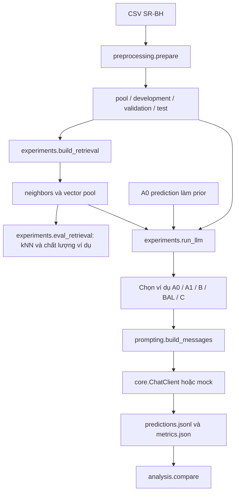

# Hướng dẫn đọc hiểu Label-Aware Web Attack Detection

Đối chiếu mã nguồn tại nhánh `main`, commit `15cf155`, ngày 22/10/2026. Tài liệu tập trung vào chức năng và cách lần theo code từ command đến từng module; bỏ qua nội dung viết báo cáo nghiên cứu. Các đường dẫn trong tài liệu là đường dẫn tương đối từ thư mục gốc repo.

## Mục lục

1. [Repo làm gì?](#1-repo-làm-gì)
2. [Bản đồ thư mục và thứ tự đọc](#2-bản-đồ-thư-mục-và-thứ-tự-đọc)
3. [Cách command đi vào Python](#3-cách-command-đi-vào-python)
4. [Chuẩn bị môi trường và chạy thử không cần dữ liệu thật](#4-chuẩn-bị-môi-trường-và-chạy-thử-không-cần-dữ-liệu-thật)
5. [Luồng chuẩn bị dữ liệu](#5-luồng-chuẩn-bị-dữ-liệu)
6. [Luồng xây retrieval](#6-luồng-xây-retrieval)
7. [Luồng đánh giá retrieval và kNN](#7-luồng-đánh-giá-retrieval-và-knn)
8. [Luồng chạy LLM: phần trung tâm](#8-luồng-chạy-llm-phần-trung-tâm)
9. [Đọc từng pipeline và cấu hình](#9-đọc-từng-pipeline-và-cấu-hình)
10. [Chạy cả bộ, model 120b và tập test](#10-chạy-cả-bộ-model-120b-và-tập-test)
11. [Resume, lỗi, ngân sách và khóa](#11-resume-lỗi-ngân-sách-và-khóa)
12. [Đọc kết quả và lần ngược một prediction](#12-đọc-kết-quả-và-lần-ngược-một-prediction)
13. [So sánh và kiểm định](#13-so-sánh-và-kiểm-định)
14. [Khảo sát SR-BH và CSIC](#14-khảo-sát-sr-bh-và-csic)
15. [Bản đồ kiểm thử](#15-bản-đồ-kiểm-thử)
16. [Tra cứu toàn bộ file code](#16-tra-cứu-toàn-bộ-file-code)
17. [Lộ trình đọc và tự kiểm tra](#17-lộ-trình-đọc-và-tự-kiểm-tra)

## 1. Repo làm gì?

Repo là bộ công cụ Python/CLI để nghiên cứu phân loại HTTP request bằng LLM và so sánh cách chọn ví dụ cho In-Context Learning. Không huấn luyện/fine-tune model. Chưa có web UI, server phục vụ dự đoán hay tích hợp chặn request trực tiếp.

Đầu vào là HTTP request gồm method, URI, protocol, headers, body. Đầu ra là một trong sáu nhãn:

| Nhãn | Ý nghĩa |
| --- | --- |
| `NORMAL` | Request bình thường |
| `SQL_INJECTION` | Chèn cú pháp SQL |
| `PATH_TRAVERSAL` | Truy cập đường dẫn/tệp ngoài phạm vi |
| `CODE_INJECTION` | Chèn mã của ngôn ngữ ứng dụng/server |
| `HTTP_RESPONSE_SPLITTING` | Chèn CR/LF hoặc header để tách response |
| `OS_COMMAND_INJECTION` | Chèn lệnh hệ điều hành |

Các chức năng đã triển khai:

- Chuẩn hóa, lọc nhãn, loại trùng, cách ly annotation mâu thuẫn và chia dataset theo nhóm.
- Kiểm chứng dữ liệu xuất ra và kiểm tra rò rỉ giữa các tập.
- Khảo sát SR-BH 2020 và parse dữ liệu CSIC 2010.
- Embed request, tìm hàng xóm tương tự và dự đoán bằng kNN.
- Chọn ví dụ theo A1, B, BAL, C; chạy A0 zero-shot và các pipeline có ví dụ.
- Gọi API tương thích OpenAI Chat Completions; có cấu hình Groq 20b/120b và backend giả lập.
- Lưu prediction bền vững, resume, xử lý rate limit, theo dõi ngân sách.
- Tính metrics, phân tích prior đúng/sai, bootstrap và McNemar.

Artifact hiện có: 7 pipeline 20b trên validation 200 mẫu và test 300 mẫu; 6 pipeline 120b trên test 300 mẫu. Đây là kết quả đã lưu, không phải kết quả chạy lại trong lúc viết tài liệu. Bảng tiến độ trong README còn thông tin cũ.



## 2. Bản đồ thư mục và thứ tự đọc

| Vị trí | Vai trò | Thứ tự đọc gợi ý |
| --- | --- | --- |
| [`src/configs/data.json`](src/configs/data.json) | Taxonomy, seed, schema, quy mô subset | 1 |
| [`src/experiments/data_io.py`](src/experiments/data_io.py) | Chọn file của từng split, đọc/ghi và hash | 2 |
| [`src/retrieval/views.py`](src/retrieval/views.py) | Cách request được trình bày cho embedding/prompt | 3 |
| [`src/retrieval/selectors.py`](src/retrieval/selectors.py) | Khác biệt giữa các phương pháp | 4 |
| [`src/experiments/prompting.py`](src/experiments/prompting.py) | Xây prompt, đọc nhãn, mock | 5 |
| [`src/experiments/run_llm.py`](src/experiments/run_llm.py) | Ghép toàn bộ luồng inference | 6 |
| [`src/pipeline_a0/core.py`](src/pipeline_a0/core.py) | API client, parser, smoke runner | 7 |
| `src/retrieval/embedding.py`, `index.py`, `knn.py` | Chi tiết truy hồi và prior kNN | 8 |
| `src/preprocessing/` | Dữ liệu đầu vào được tạo thế nào | 9 |
| `src/common/`, `src/analysis/`, `src/tests/` | Vận hành, đánh giá, kiểm chứng | 10 |

`src/data/` chứa dữ liệu raw/processed và không được track Git. `src/artifacts/` chứa dữ liệu dẫn xuất và kết quả; một phần artifact được track. `src/configs/` chứa tham số, không chứa API key. `.env` là file local; dùng `env.example` để biết tên biến.

## 3. Cách command đi vào Python

Chạy mọi command bên dưới từ thư mục gốc repo.

```bash
python -m src.experiments.run_llm --help
```

Python tìm module `src/experiments/run_llm.py`, thực hiện các import, rồi gặp:

```python
if __name__ == "__main__":
    main()
```

`main()` dùng `argparse` đọc các cờ CLI và gọi hàm nghiệp vụ. Với `python -m src.pipeline_a0`, target là một package, nên entry point là `src/pipeline_a0/__main__.py`.

| Command | Entry point | Hàm cần đọc tiếp |
| --- | --- | --- |
| `python -m src.preprocessing.prepare` | `preprocessing/prepare.py:main()` | `prepare()` |
| `python -m src.preprocessing.verify` | `preprocessing/verify.py:main()` | `verify()` |
| `python -m src.preprocessing.survey` | `preprocessing/survey.py:main()` | `survey()` |
| `python -m src.preprocessing.find_pair` | `preprocessing/find_pair.py:main()` | `search()` |
| `python -m src.preprocessing.csic_2010` | `preprocessing/csic_2010.py:main()` | `inspect()` |
| `python -m src.pipeline_a0` | `pipeline_a0/__main__.py:main()` | `core.load_config()` → `core.run()` |
| `python -m src.experiments.build_retrieval` | `experiments/build_retrieval.py:main()` | `build()` hoặc `add_split()` |
| `python -m src.experiments.eval_retrieval` | `experiments/eval_retrieval.py:main()` | `evaluate_retrieval()` |
| `python -m src.experiments.run_llm` | `experiments/run_llm.py:main()` | `run_experiment()` |
| `bash src/experiments/run_suite.sh validation` | `experiments/run_suite.sh` | Gọi `run_llm` nhiều lần |
| `python -m src.analysis.compare` | `analysis/compare.py:main()` | `compare()` |

Không chạy trực tiếp `python src/experiments/run_llm.py`: module có relative import; dùng `python -m ...` từ root để resolve import đúng.

## 4. Chuẩn bị môi trường và chạy thử không cần dữ liệu thật

Yêu cầu Python >= 3.10. Nếu đã có `.venv`, dùng lại môi trường đó.

```bash
python3 -m venv .venv
source .venv/bin/activate
python -m pip install -r src/requirements-experiments.txt
```

Trên Windows PowerShell, activate bằng `.venv\Scripts\Activate.ps1`. Các command Bash như `run_suite.sh` cần Bash/Git Bash.

Dependency:

| File | Dùng cho |
| --- | --- |
| `requirements-a0.txt` | A0 smoke chỉ dùng thư viện chuẩn |
| `requirements-data.txt` | Chuẩn bị dữ liệu chỉ dùng thư viện chuẩn |
| `requirements-experiments.txt` | `numpy`, `sentence-transformers`, `matplotlib` cho retrieval/thí nghiệm/phân tích |
| `requirements-survey.txt` | Matplotlib cho phần dựng hình khảo sát |

Smoke hoàn toàn độc lập với dataset thật và API key:

```bash
python -m src.pipeline_a0 \
  --config src/configs/pipeline_a0_mock.json \
  --input src/tests/fixtures/a0_requests.jsonl \
  --output src/artifacts/pipeline_a0/doc_mock \
  --limit 6
```

Đường đi:

```text
pipeline_a0/__main__.py:main()
  → core.load_config(config)
  → core.run(input, output, config, limit)
    → đọc JSONL, kiểm tra schema và request_id
    → đọc fixture a0_responses.json qua config
    → tạo manifest và cache key
    → common.locking.directory_lock(output)
    → core.recover_predictions() để đọc cache
    → core.messages(request_text)
    → core.MockClient.__call__() tra response theo request_text
    → core.parse_output() kiểm tra JSON và nhãn
    → append prediction, flush, fsync
    → core.evaluate()
    → metrics.json và last_invocation.json
```

Đọc `a0_requests.jsonl` cạnh `a0_responses.json` để thấy input tương ứng với output nào. Fixture cố ý có output sai/lỗi để kiểm tra nhánh xử lý, không phải tất cả prediction đều thành công.

```bash
python -m json.tool src/artifacts/pipeline_a0/doc_mock/last_invocation.json
python -m json.tool src/artifacts/pipeline_a0/doc_mock/metrics.json
```

Chạy lại đúng command sẽ resume. Smoke runner chỉ nhận `limit` từ 1 đến 10; khi dùng API thật, chỉ chấp nhận file `development.jsonl` đúng đường dẫn của repo.

## 5. Luồng chuẩn bị dữ liệu

### Command

Cần có CSV SR-BH thật tại `src/data/raw/data_capec_multilabel.csv`. Nếu đã có processed split phục vụ kết quả cũ, giữ nguyên split đó. Ví dụ dưới dùng output mới để không ghi đè bộ hiện có:

```bash
python -m src.preprocessing.prepare \
  --input src/data/raw/data_capec_multilabel.csv \
  --config src/configs/data.json \
  --output src/data/processed/sr_bh_doc_example \
  --artifacts src/artifacts/data/doc_example
```

`data_io.py` của thí nghiệm mặc định đọc `sr_bh_v1`, không tự chuyển sang output mới ở ví dụ này. CLI thí nghiệm hiện không có cờ `--data-dir`; nếu muốn chạy với bộ mới cần cấu hình đường dẫn trong code hoặc gọi hàm Python có tham số `data_dir`.

### Thứ tự hàm trong `prepare.py`

1. `main()` đọc đường dẫn và config rồi gọi `prepare()`.
2. `validate_config()` kiểm tra cấu hình; `file_hashes()` kiểm tra MD5 nguồn.
3. `scan_csv()` đọc từng dòng, nhận diện toàn bộ cột nhãn nguồn, kiểm tra schema và giá trị nhãn.
4. `build_request()` tạo chuỗi JSON canonical từ method/URI/protocol/headers/body. Payload giữ nguyên encoding.
5. Dùng SQLite tạm để gộp request trùng và phát hiện cùng nội dung nhưng khác tập nhãn. Phát hiện xung đột trước khi loại multi-label/out-of-scope.
6. `prepare()` cách ly xung đột, bỏ mẫu không hợp lệ/ngoài taxonomy/quá dài, tạo các trường hash và metadata.
7. `group_key()` tạo dấu nhóm bằng cách che biến thể số/hex trên nội dung dùng để gom nhóm. Việc này không thay đổi request đưa vào model.
8. `assign_groups()` chia nguyên nhóm vào pool/validation/test, rồi dành một số nhóm pool cho development.
9. `audit_splits()` kiểm tra giao nhau của ID, exact hash và group; đồng thời ghi nhận giao nhau endpoint.
10. `balanced_subset()` lấy subset luân phiên theo lớp với seed cố định.
11. Ghi JSONL, manifest, config snapshot, checksum và các mẫu cần review.

Group split giảm leakage theo quy tắc đã khai báo; không chứng minh đã loại được mọi request gần giống về ngữ nghĩa. Endpoint vẫn có thể xuất hiện ở nhiều tập.

### Schema một dòng JSONL

```json
{
  "request_id": "<hash>",
  "exact_hash": "<hash>",
  "group_id": "<template-group-hash>",
  "endpoint_hash": "<endpoint-hash>",
  "request_text": "{\"body\":\"\",\"headers\":{},\"method\":\"GET\",\"protocol\":\"HTTP/1.1\",\"uri\":\"/item?id=1\"}",
  "label": "NORMAL",
  "source_row": 2,
  "source_occurrences": 1
}
```

Đây là ví dụ cấu trúc, các hash là placeholder. `request_text` là **chuỗi chứa JSON**, còn `label` nằm ngoài chuỗi đó. Không truyền nguyên dataset row vào prompt.

### File nào được thí nghiệm đọc?

Trong [`data_io.py`](src/experiments/data_io.py), xem `SPLIT_FILES`, `split_path()`, `load_split()`:

| Split | File ở `src/data/processed/sr_bh_v1/` | Quy mô cấu hình |
| --- | --- | --- |
| pool | `pool_subset.jsonl` | 3.000 ví dụ |
| development | `development.jsonl` | Hiện có 30 mẫu |
| validation | `validation_subset.jsonl` | 200 mẫu |
| test | `test_subset.jsonl` | 600 mẫu trong subset; suite hiện chạy 300 mẫu đầu |

Các file `pool.jsonl`, `validation.jsonl`, `test.jsonl` là full split, khác subset dùng trong thí nghiệm.

### Kiểm chứng export

```bash
python -m src.preprocessing.verify \
  --output src/data/processed/sr_bh_doc_example \
  --input src/data/raw/data_capec_multilabel.csv \
  --report src/artifacts/data/doc_example/export_verification.json
```

`verify.py:main()` → `verify()` kiểm tra danh sách file/checksum, ID và nhóm, nhãn, manifest, subset membership và hash nguồn nếu truyền `--input`. Module này dùng lại các hàm canonical/hash/group từ `prepare.py`.

## 6. Luồng xây retrieval

### Command

Cần processed data mặc định và dependency thí nghiệm. Model embedding có thể cần tải trong lần đầu.

```bash
python -m src.experiments.build_retrieval \
  --output src/artifacts/retrieval/doc_minilm \
  --n-candidates 50
```

### Call flow qua từng file

```text
experiments/build_retrieval.py:main()
  → retrieval/embedding.py:SentenceTransformerEncoder(...)
  → build(encoder, output, [development, validation], 50)
    → experiments/data_io.py:load_split(pool)
    → retrieval/embedding.py:encode_requests(encoder, pool)
      → retrieval/views.py:embedding_view(request_text)
      → encoder.encode(texts)
    → retrieval/index.py:VectorIndex(ids, labels, vectors)
    → VectorIndex.save(output)
    → với từng split:
      → load_split(split)
      → encode_requests(queries)
      → VectorIndex.search(query_vectors, 50)
      → write_jsonl(neighbors_<split>.jsonl)
    → write_json(manifest.json)
```

- `views.py:parse_request()` parse JSON; nếu input là HTTP/text thô thì dùng fallback `raw`.
- `embedding_view()` đưa method/URI/protocol/body trước headers. Model mặc định chỉ đọc tối đa 256 token.
- `embedding.py` dùng `sentence-transformers/all-MiniLM-L6-v2`, encode batch và chuẩn hóa vector.
- `index.py:search()` nhân ma trận `normalize(query) @ pool_vectors.T`, lấy top-N rồi sắp xếp theo similarity; không dùng FAISS.
- Candidate có `request_id`, `label`, `similarity`, `rank`. Đây là **nhãn của ví dụ pool**, không phải nhãn của query.

Đầu ra gồm `pool_vectors.npy`, `pool_meta.jsonl`, `neighbors_development.jsonl`, `neighbors_validation.jsonl`, `manifest.json`. Vector là dữ liệu sinh ra; bản clone Git có thể không có dù metadata/neighbors đã có.

Phân biệt ba con số: build lưu **50** hàng xóm/query; config B/BAL/C xét tối đa **30** ứng viên; prompt lấy **4** ví dụ.

### Thêm test sau khi khóa cấu hình

```bash
python -m src.experiments.build_retrieval \
  --output src/artifacts/retrieval/doc_minilm \
  --add-split test
```

`main()` → `add_split()` kiểm tra encoder và hash pool, load index có sẵn, encode split mới, thêm neighbors và cập nhật manifest. Không mã hóa lại pool, không sửa neighbors validation; từ chối ghi đè neighbors của split đã tồn tại. Nhãn query không được dùng trong phép encode/search hoặc ghi vào neighbors.

Lưu ý: config thí nghiệm có sẵn trỏ tới `src/artifacts/retrieval/minilm`, không tự chuyển sang `doc_minilm`. Khi thử retrieval mới, tạo bản config mới có `retrieval_dir` tương ứng.

## 7. Luồng đánh giá retrieval và kNN

```bash
python -m src.experiments.eval_retrieval \
  --retrieval src/artifacts/retrieval/minilm \
  --split validation \
  --k 4 --n-candidates 30 --lam 0.1 \
  --output src/artifacts/retrieval/minilm/eval_doc_validation
```

`eval_retrieval.py:main()` đọc neighbors và dataset → `evaluate_retrieval()`:

1. `retrieval/knn.py:knn_vote()` thử số hàng xóm 1, 3, 5, 7, 10.
2. `analysis/metrics.py:classification_metrics()` chấm nhãn kNN.
3. Đo tỷ lệ ví dụ top-1 khác nhãn query.
4. Gọi selector B/BAL/C-knn/C-oracle và tính `label_consistency_rate()`.
5. Quét một số giá trị lambda để xem tác động đến nhãn ví dụ.

`knn_vote()` mặc định cộng phiếu theo `max(similarity, 0)`, không chỉ đếm số lượng. Hòa điểm thì ưu tiên nhãn có hàng xóm đứng trước.

LCR@k là tỷ lệ ví dụ đã chọn có nhãn trùng nhãn thật của query, dùng để chẩn đoán chất lượng lựa chọn. Nhãn thật chỉ tham gia đánh giá hoặc oracle. LCR tăng không đồng nghĩa F1 của LLM tăng.

Đầu ra chính là `retrieval_metrics.json`; CLI cũng tạo Markdown và hình minh họa. Bước này không gọi LLM. Nếu chấm cùng test run của suite, thêm `--split test --limit 300` để cùng tập query.

## 8. Luồng chạy LLM: phần trung tâm

### Chạy mock bằng runner thí nghiệm

```bash
python -m src.experiments.run_llm \
  --config src/configs/experiments/B_k4.json \
  --llm src/configs/llm/mock.json \
  --split development \
  --output src/artifacts/runs/development/B_doc_mock
```

Mock này không cần key, nhưng vẫn cần processed dataset và neighbors development vì đang thử pipeline B. Để thử hoàn toàn bằng fixture, dùng A0 smoke ở mục 4 hoặc bộ test ở mục 15.

### Chạy API thật cho một pipeline

Chuẩn bị `.env` local theo `env.example`, điền `A0_API_KEY`. Command có gọi API và tiêu thụ quota:

```bash
python -m src.experiments.run_llm \
  --config src/configs/experiments/B_k4.json \
  --llm src/configs/llm/groq.json \
  --env-file .env \
  --split validation \
  --output src/artifacts/runs/validation/B_doc_example \
  --budget src/configs/llm/budget.json
```

### 8.1. CLI và cấu hình

Trong `run_llm.py:main()`:

1. Parse `--config`, `--llm`, `--split`, `--output`, `--limit`, `--env-file`, `--budget` và các cờ vận hành.
2. `load_env_file()` nạp file env; giá trị không rỗng ghi đè biến môi trường hiện có.
3. `load_experiment()` kiểm tra pipeline/k/N/prior và bổ sung default.
4. `load_llm()` đọc backend, gọi `core.load_config()` nếu là API thật.
5. `SpendLedger.from_config()` tạo đối tượng ngân sách nếu truyền `--budget`.
6. Gọi `run_experiment()`.

Hai lớp config độc lập: `--config` quyết định **chọn ví dụ thế nào**, `--llm` quyết định **gọi model nào và tham số API**. Trong runner thí nghiệm, model/base URL ghi rõ trong file LLM thắng biến env, để cấu hình 120b không bị `.env` đổi về 20b.

### 8.2. Nạp dữ liệu và tách ground truth

Trong `run_experiment()`:

- Chặn split test nếu thiếu `allow_test`.
- `data_io.load_split(split)` đọc query; `limit` lấy N dòng đầu, không tự cân bằng lại.
- `truth` lưu `{request_id: label}` để chấm.
- `public` chỉ có `request_id`, `request_text` để chọn ví dụ và tạo prompt.
- Đọc `pool` thành dictionary để tra nội dung ví dụ từ ID.

Không có thao tác train ở đây. Pool là kho ví dụ có nhãn đưa vào prompt.

### 8.3. Nạp retrieval và prior

- B/BAL/C đọc manifest retrieval và `neighbors_<split>.jsonl`; kiểm tra query có neighbors.
- C-knn gọi `knn_vote()` trên ứng viên của query.
- C-llm gọi `load_llm_prior()` để đọc prediction của run A0 tương ứng; nếu thiếu query thì dừng. A0 trả lỗi thì prior là `None`.
- C-oracle lấy nhãn từ `truth` và đánh dấu `oracle_analysis`.
- A1 gọi `fixed_examples()` một lần để dùng chung bộ ví dụ cho mọi query.

### 8.4. Chọn ví dụ

Hàm lồng `select(query_id)` trong `run_experiment()` điều phối:

```text
A0  → []
A1  → fixed_examples đã tạo
B   → selectors.semantic_top_k(candidates, k)
BAL → selectors.class_balanced(candidates, k)
C   → selectors.label_aware_rerank(candidates, k, prior, lambda)
```

Selector chỉ trả metadata ví dụ. Runner dùng `pool[demo_id]` lấy `request_text` đầy đủ trước khi xây prompt.

### 8.5. Xây prompt

`experiments/prompting.py:build_messages()` → `retrieval/views.py:prompt_view()`:

- System prompt định nghĩa 6 nhãn, yêu cầu JSON `{"label": "..."}` và coi payload là dữ liệu không tin cậy.
- User message là JSON gồm `labeled_examples` nếu có, và `request_to_classify`.
- Ví dụ được đảo thứ tự: ví dụ có hạng cao nhất đặt cuối, gần query nhất.
- Ví dụ bị giới hạn theo `max_demo_chars` (cấu hình hiện tại 500 ký tự); query không bị cắt. Query quá dài được ghi `input_error` thay vì gửi API.

Ví dụ hình dạng user content, không phải prediction thật:

```json
{
  "labeled_examples": [
    {"request": "<chuỗi request của ví dụ>", "label": "SQL_INJECTION"}
  ],
  "request_to_classify": "<chuỗi request cần phân loại>"
}
```

### 8.6. Gọi backend và parse

```text
run_experiment()
  → budget.check() nếu có budget và dùng API thật
  → client(prompt)
    → core.ChatClient.__call__() khi gọi thật
       → POST <base_url>/chat/completions bằng urllib
       → đọc choices[0].message.content và usage
    → prompting.DemoMajorityMock.__call__() khi mock
  → budget.record() sau response thành công
  → prompting.parse_label(raw_output)
    → bỏ khối ```json ... ``` bao ngoài nếu có
    → core.parse_output()
       → JSON đúng một key label, không key lặp, nhãn thuộc taxonomy
```

`ChatClient` nằm trong module A0 nhưng được runner mọi pipeline tái sử dụng. Client chỉ nhận messages, không tự chọn ví dụ hoặc chấm điểm.

### 8.7. Ghi và tổng hợp

Sau mỗi query: append JSON vào `predictions.jsonl` → `flush()` → `os.fsync()` → cập nhật `done`. Cuối lượt chạy, `summarize()` gọi `classification_metrics()` và tính status/LCR/token/latency; ghi `metrics.json`, bao gồm `complete` và `n_selected`.

## 9. Đọc từng pipeline và cấu hình

Xem [`selectors.py`](src/retrieval/selectors.py) cạnh các JSON ở `src/configs/experiments/`:

| Config | Pipeline/hàm | Điểm cần hiểu |
| --- | --- | --- |
| `A0.json` | A0, không gọi selector | Không có demonstrations |
| `A1_k4.json` | `fixed_examples()` | Seed cố định, lấy luân phiên theo lớp; k=4 không thể bao phủ cả 6 lớp |
| `B_k4.json` | `semantic_top_k()` | Giữ top-4 theo similarity |
| `BAL_k4.json` | `class_balanced()` | Gom ứng viên theo nhãn, ưu tiên lớp có ứng viên tốt nhất đứng trước, lấy luân phiên |
| `C_knn_k4.json` | `label_aware_rerank()` | Prior từ kNN weighted, mặc định 5 hàng xóm |
| `C_llm_k4.json` | `label_aware_rerank()` | Prior từ file prediction A0 |
| `C_oracle_k4.json` | `label_aware_rerank()` | Prior là nhãn thật, chỉ để phân tích |

C dùng:

```text
score(candidate) = similarity(query, candidate)
                 + lambda * 1[candidate.label == prior(query)]
```

Ví dụ giả định prior là SQL Injection, lambda=0,1:

| Candidate | Nhãn | Similarity | Điểm C |
| --- | --- | ---: | ---: |
| d1 | NORMAL | 0,92 | 0,92 |
| d2 | SQL_INJECTION | 0,87 | 0,97 |

B xếp d1 trước, C xếp d2 trước. C cộng điểm trong top-N, không tìm lại toàn bộ pool. Nếu prior sai, việc cộng điểm có thể làm giảm chất lượng ví dụ. Nếu prior `None` hoặc lambda=0, C quay về thứ tự B. Hòa điểm sau rerank thì giữ thứ hạng ban đầu.

Các trường config:

| Trường | Ý nghĩa |
| --- | --- |
| `name` | Tên xuất hiện trong manifest và bảng so sánh |
| `pipeline` | A0/A1/B/BAL/C |
| `k` | Số ví dụ vào prompt; default của loader là 6, config chính đặt 4 |
| `n_candidates` | Số ứng viên dùng để chọn ví dụ; thường 30 |
| `max_demo_chars` | Giới hạn ký tự mỗi ví dụ; thường 500 |
| `retrieval_dir` | Vị trí neighbors/manifest |
| `lambda` | Mức cộng điểm cho ví dụ cùng prior |
| `prior_source` | `knn`, `llm`, `oracle` |
| `prior_run` | Run A0; `{split}` được thay bằng split đang chạy |
| `prior_knn_k` | Số hàng xóm để tạo prior kNN |
| `fixed_seed` | Seed chọn bộ ví dụ A1 |

## 10. Chạy cả bộ, model 120b và tập test

### Validation với 20b

```bash
bash src/experiments/run_suite.sh validation
```

Đọc [`run_suite.sh`](src/experiments/run_suite.sh) từ đầu xuống:

1. Lấy split từ đối số thứ nhất và `MODEL` từ môi trường, mặc định `20b`.
2. Chọn LLM config, thư mục experiment config, output root và budget.
3. Với test, yêu cầu đối số thứ hai là `--locked` rồi thêm `--allow-test --limit 300`.
4. Kiểm tra file env có key.
5. Lặp tên config; mỗi vòng gọi `python -m src.experiments.run_llm` với `--retry-errors --budget ...`.
6. Dừng bộ khi runner báo `budget_exhausted`/`quota_exhausted`; ghi nhận run bị chặn bởi lỗi khác.

| Model | Bộ mặc định theo thứ tự | Khi thêm `EXTRA=1` |
| --- | --- | --- |
| 20b | A0 → B → BAL → C-knn → C-llm | Thêm C-oracle, A1 |
| 120b | A0 → B → C-llm → C-oracle | Thêm C-knn, BAL |

A0 phải đứng trước C-llm vì C-llm đọc prediction A0. Bộ 120b hiện không có cấu hình A1.

```bash
EXTRA=1 bash src/experiments/run_suite.sh validation
```

### Test sau khi chốt cấu hình

```bash
EXTRA=1 bash src/experiments/run_suite.sh test --locked
MODEL=120b EXTRA=1 bash src/experiments/run_suite.sh test --locked
```

Đây là command tham khảo để hiểu/chạy lại thí nghiệm, có gọi API. Các run đã hoàn tất thường được resume/bỏ qua; không đổi cấu hình rồi ghi tiếp vào run cũ.

20b dùng `configs/experiments/`, `configs/llm/groq.json`, output `artifacts/runs/`. 120b dùng `configs/experiments_120b/`, `configs/llm/groq_120b.json`, output `artifacts/runs_120b/`. C-llm 120b đọc prior A0 của chính model 120b.

`--locked`/`--allow-test` là cờ xác nhận quy trình do người chạy cung cấp; code không tự chứng minh cấu hình đã được chốt. Không dùng test để sửa prompt hoặc chọn k/lambda.

### Phân biệt hai runner A0

| Đặc điểm | `python -m src.pipeline_a0` | `python -m src.experiments.run_llm --config .../A0.json` |
| --- | --- | --- |
| Mục đích | Smoke ban đầu | Benchmark chung với các pipeline khác |
| Điều phối | `core.run()` | `run_experiment()` |
| Prompt | `core.messages()`, khóa `request_text` | `prompting.build_messages()`, khóa `request_to_classify` |
| Backend giả | `core.MockClient`, tra fixture | `DemoMajorityMock`, vote nhãn ví dụ |
| Giới hạn | 1–10, API thật chỉ development | Có development/validation/test; test cần cờ |
| Env | CLI không tự đọc `.env` | Có `--env-file` |
| API client | `core.ChatClient` | Dùng lại `core.ChatClient` |

Không dùng artifact smoke để thay cho kết quả A0 benchmark vì hai runner có khung prompt và manifest khác nhau.

## 11. Resume, lỗi, ngân sách và khóa

### Resume trong runner thí nghiệm

Đọc khối `with directory_lock(output_dir)` trong `run_experiment()`:

1. Đối chiếu manifest: config/prompt/input/retrieval/prior thay đổi thì từ chối resume.
2. Nếu chỉ đổi hash code: run hoàn tất được bỏ qua; run dở có thể tiếp tục và ghi lịch sử hash code.
3. `core.recover_predictions()` đọc prediction; chỉ cắt phần đuôi chưa kết thúc bằng newline do gián đoạn, không âm thầm bỏ lỗi JSON ở giữa file.
4. Nếu có nhiều dòng cùng ID, dòng cuối là kết quả hiện hành.
5. `--retry-errors` bỏ `backend_error` khỏi tập đã xong để gọi lại; không tự retry `invalid_output`.
6. Mỗi query đã cache vẫn được kiểm tra `cache_key`, tính từ run key, ID và messages.

Smoke `core.run()` kiểm tra manifest nghiêm hơn: thay implementation hash cũng bị từ chối; không áp dụng ngoại lệ code hash như runner thí nghiệm.

### Trạng thái và xử lý API

| Trạng thái/kết quả dừng | Ý nghĩa | Đọc ở đâu |
| --- | --- | --- |
| `ok` | Parse được nhãn hợp lệ; chưa chắc dự đoán đúng | `parse_label()` và `truth` khi chấm |
| `invalid_output` | Output không đúng JSON/nhãn yêu cầu | `prompting.py`, `core.parse_output()` |
| `input_error` | Request vượt giới hạn; không gọi API | `run_experiment()` |
| `backend_error` | HTTP/transport/envelope API lỗi | `core.ChatClient` |
| `quota_exhausted` | Client diễn giải Retry-After dài là quota dài hạn; dừng không ghi prediction lỗi cho query đó | `core.QUOTA_EXHAUSTED`, runner |
| `budget_exhausted` | Ước tính request tiếp theo vượt budget; dừng trước API | `SpendLedger.check()` |

`ChatClient` retry HTTP 429, 5xx và lỗi transport theo cấu hình; HTTP không retry được sẽ thành `BackendError`. Với rate-limit waits được bật, 429 ngắn chờ theo Retry-After riêng với bộ đếm; Retry-After >120 giây được xử lý như quota dài hạn. Đây là quy tắc của client, không phải kiểm tra trực tiếp số dư tài khoản.

### Ngân sách và khóa

[`common/budget.py`](src/common/budget.py): `SpendLedger.from_config()` → `check()` trước API → `record()` sau response. Nếu có usage thì cộng token trả về; thiếu usage thì dùng ước tính. Giá/ngưỡng trong config là giá phục vụ ước tính của repo, không phải xác minh giá nhà cung cấp hiện tại. Lượt gọi lỗi có thể có token tính phí không được provider báo lại.

20b dùng ledger `api_spend_ledger.json`, 120b dùng `api_spend_ledger_120b.json`. Ngân sách chỉ áp dụng khi CLI nhận `--budget` hoặc chạy suite có truyền cờ này.

[`common/locking.py`](src/common/locking.py): `directory_lock()` khóa `.run.lock` bằng `fcntl` trên POSIX hoặc `msvcrt` trên Windows để tránh cùng ghi một run. Khóa này bảo vệ thư mục run, không phải khóa toàn cục cho mọi run dùng chung budget ledger; suite chạy tuần tự.

## 12. Đọc kết quả và lần ngược một prediction

### Các file cần mở

| File | Câu hỏi được trả lời |
| --- | --- |
| `manifest.json` | Model/config/prompt/split/limit/code/data/retrieval nào tạo run này? |
| `predictions.jsonl` | Query này chọn ví dụ gì, prior gì, model trả gì, mất bao lâu? |
| `metrics.json` | Run đã xong chưa, F1/accuracy/coverage ra sao, lỗi bao nhiêu? |
| `last_invocation.json` | Riêng smoke A0: lần gọi gần nhất xử lý mới/resume bao nhiêu? |

Không mặc định mọi run đều có `last_invocation.json`: runner thí nghiệm trả thống kê invocation ra stdout.

```bash
python -m json.tool src/artifacts/runs/test/B_k4/manifest.json
python -m json.tool src/artifacts/runs/test/B_k4/metrics.json
```

### Truy vết từng bước

1. Lấy `request_id` từ prediction cần xem. Nếu ID xuất hiện nhiều lần trong run thí nghiệm, dùng dòng cuối.
2. Tìm ID trong split mà manifest ghi. Với test suite, đối chiếu `limit=300` và `n_selected`.
3. Đọc `request_text` để biết request gốc, `label` để biết ground truth.
4. Đọc `demo_ids`, `demo_labels`, `demo_scores`, `prior` trong prediction.
5. Tra `demo_ids` trong `pool_subset.jsonl` để xem nội dung các ví dụ.
6. Tra query ID trong `neighbors_<split>.jsonl` để xem thứ hạng similarity trước selector.
7. Với C-llm, tra prediction A0 cùng ID ở `prior_run`; với C-knn, tính lại `knn_vote()` trên ứng viên.
8. Dùng `build_messages()` với đúng query, ví dụ và `max_demo_chars` để tái dựng prompt. Thứ tự prompt đảo so với thứ tự `demo_ids` tốt nhất trước.
9. Đọc `raw_output`, `predicted_label`, `status`, `error`, `usage`, `attempts`, `latency_seconds`.

Run không lưu nguyên mảng messages cho từng query. Tái dựng chính xác cần đúng dữ liệu, config, prompt và phiên bản code đã ghi trong manifest; khi dùng code khác phiên bản, kết quả tái dựng có thể khác.

### Cách đọc metrics đúng

- Macro-F1 là trung bình F1 của sáu lớp; xem thêm per-class để biết lớp nào yếu.
- Prediction lỗi được tính là sai, có cột `__INVALID_OR_ERROR__` trong confusion matrix.
- Coverage là tỷ lệ có nhãn hợp lệ, không phải accuracy.
- Run dở chỉ tổng hợp các query đã có kết quả; xem `complete`, `n`, `n_selected` trước khi so sánh.
- Token/latency là dữ liệu lần inference, không phải thời gian cache hit.
- `cost` trong metrics là thống kê lượt gọi/token/latency; ledger ngân sách mới chứa ước tính USD.
- Với C-llm, A0 prior được tính sẵn ở run khác. Trường lượt gọi/query là thống kê quy ước, không phải log chính xác mọi retry hay tổng hóa đơn API.

## 13. So sánh và kiểm định

```bash
python -m src.analysis.compare \
  --split test \
  --reference B_semantic_k4 \
  --runs 'src/artifacts/runs/test/*' \
  --output src/artifacts/reports/doc_test_comparison
```

Giữ wildcard trong dấu nháy để CLI tự mở rộng bằng `glob`. `--reference` nhận **experiment name trong manifest**, không phải tên thư mục `B_k4`.

Đường đi trong [`analysis/compare.py`](src/analysis/compare.py):

1. `main()` mở rộng run directories và gọi `compare()`.
2. `load_run()` đọc manifest/predictions/metrics, lấy dòng cuối theo ID.
3. `compare()` yêu cầu cùng split, cùng tập query và run hoàn tất.
4. Đọc truth từ dataset rồi gọi `classification_metrics()` tính lại metrics.
5. `metrics.paired_bootstrap()` ước lượng chênh lệch Macro-F1 và khoảng tin cậy.
6. `metrics.mcnemar()` so sánh số query chỉ một trong hai phương pháp đoán đúng.
7. `prior_breakdown()` phân nhóm prior đúng/sai/không có, đếm C sửa lỗi hay làm hỏng prediction so với B.
8. Xuất `comparison.json`; CLI còn dựng bảng Markdown và confusion matrix.

`paired_bootstrap()` có tham số nhóm, nhưng `compare()` hiện gọi mà không truyền `groups`, nên command này bootstrap theo query, không theo template group. C-oracle dùng nhãn thật nên không đánh giá như một phương pháp triển khai thực tế.

## 14. Khảo sát SR-BH và CSIC

### SR-BH

```bash
python -m src.preprocessing.survey \
  --input src/data/raw/data_capec_multilabel.csv \
  --processed src/data/processed/sr_bh_v1 \
  --output src/artifacts/data/doc_survey

python -m src.preprocessing.find_pair \
  --processed src/data/processed/sr_bh_v1 \
  --output src/artifacts/data/doc_survey/pair_search.json
```

- `survey.py:survey()` đọc raw và cấu hình ví dụ `sr_bh_survey_examples.json`, thống kê, kiểm tra provenance và tính hợp lệ của các ví dụ được chọn.
- `find_pair.py:search()` → `iter_requests()` → `context_key()`: tìm cặp request khác nhãn trong phạm vi development/pool theo các bộ lọc ngữ cảnh. Kết quả không phải tìm kiếm vét cạn toàn dataset; không đọc final test.

### CSIC 2010

```bash
python -m src.preprocessing.csic_2010 \
  --raw src/data/raw/csic_2010 \
  --output src/artifacts/data/doc_csic
```

Trong `csic_2010.py`: `main()` → `inspect()` → `parse_bytes()` đọc request từ byte, xử lý ranh giới/headers/body → `screen()` → `payload_parts()` → `find_pair()`. Có kiểm tra Content-Length và lưu provenance/hash. Dữ liệu nguồn nhãn Anomalous không được tự đổi thành SQL Injection.

`csic_2010_sources.json` mô tả nguồn; command inspect cần file raw đã có, không phải trình tải tự động. `survey_report.py` và `csic_report.py` chủ yếu dựng tài liệu/hình từ artifact; có thể bỏ qua để hiểu pipeline phân loại.

## 15. Bản đồ kiểm thử

```bash
python -m unittest discover -s src/tests -v
```

A0 và test preprocessing dùng thư viện chuẩn; bộ test toàn repo có phần dùng NumPy. Test end-to-end dùng encoder/client giả, không cần tải model embedding hay gọi API thật.

| File | Đọc để hiểu/kiểm tra |
| --- | --- |
| `test_data.py` | Giữ nguyên payload, lọc nhãn, conflict/dedup, group split, checksum, subset |
| `test_survey.py` | Đếm multi-label, provenance, từ chối relabel và ví dụ sai phạm vi |
| `test_csic_2010.py` | Ranh giới request/body, CRLF, header trùng, Content-Length, nhãn nguồn |
| `test_pipeline_a0.py` | Prompt/parser, API payload/retry/rate limit, smoke limit, cache và khôi phục sau gián đoạn |
| `test_retrieval.py` | View, index, weighted kNN, từng selector và lambda=0 |
| `test_experiments.py` | Build/add split, mọi pipeline, resume, test lock, budget, 120b, so sánh, không lộ truth vào prompt |
| `helpers.py` | Tạo dataset fixture và `HashingEncoder` để kiểm thử không cần model thật |

Để đọc một luồng cụ thể, mở `test_experiments.py:test_all_pipelines_run_resume_and_compare()` cạnh `run_experiment()`. Xem `test_query_labels_and_metadata_never_reach_the_prompt()` để hiểu ranh giới ground truth.

## 16. Tra cứu toàn bộ file code

### Preprocessing

| File | Hàm/vai trò chính |
| --- | --- |
| [`prepare.py`](src/preprocessing/prepare.py) | `build_request`, `scan_csv`, `assign_groups`, `balanced_subset`, `audit_splits`, `prepare` |
| [`verify.py`](src/preprocessing/verify.py) | Kiểm chứng export bằng `verify` |
| [`survey.py`](src/preprocessing/survey.py) | Khảo sát SR-BH và ví dụ bằng `survey` |
| [`find_pair.py`](src/preprocessing/find_pair.py) | `iter_requests`, `context_key`, `search` |
| [`csic_2010.py`](src/preprocessing/csic_2010.py) | `parse_bytes`, `screen`, `payload_parts`, `find_pair`, `inspect` |
| [`survey_report.py`](src/preprocessing/survey_report.py) | Render tài liệu/hình SR-BH; đọc sau nếu cần |
| [`csic_report.py`](src/preprocessing/csic_report.py) | Render tài liệu/hình CSIC; đọc sau nếu cần |

### Inference và retrieval

| File | Hàm/vai trò chính |
| --- | --- |
| [`pipeline_a0/__main__.py`](src/pipeline_a0/__main__.py) | CLI smoke A0 |
| [`pipeline_a0/core.py`](src/pipeline_a0/core.py) | `load_config`, `messages`, `parse_output`, `ChatClient`, `MockClient`, `recover_predictions`, `evaluate`, `run` |
| [`retrieval/views.py`](src/retrieval/views.py) | `parse_request`, `embedding_view`, `prompt_view`, `endpoint_of` |
| [`retrieval/embedding.py`](src/retrieval/embedding.py) | `SentenceTransformerEncoder`, `encode_requests`, `normalize` |
| [`retrieval/index.py`](src/retrieval/index.py) | `Candidate`, `VectorIndex.search/save/load` |
| [`retrieval/knn.py`](src/retrieval/knn.py) | `knn_vote` |
| [`retrieval/selectors.py`](src/retrieval/selectors.py) | `semantic_top_k`, `class_balanced`, `label_aware_rerank`, `fixed_examples` |

### Điều phối và đánh giá

| File | Hàm/vai trò chính |
| --- | --- |
| [`experiments/data_io.py`](src/experiments/data_io.py) | `ROOT`, `DATA_DIR`, `LABELS`, `SPLIT_FILES`, load/write/hash |
| [`experiments/build_retrieval.py`](src/experiments/build_retrieval.py) | CLI dựng index/neighbors, `build`, `add_split` |
| [`experiments/eval_retrieval.py`](src/experiments/eval_retrieval.py) | Chấm retrieval/kNN, `evaluate_retrieval` |
| [`experiments/prompting.py`](src/experiments/prompting.py) | Prompt chung, parser wrapper, `DemoMajorityMock` |
| [`experiments/run_llm.py`](src/experiments/run_llm.py) | Cấu hình, env, prior, `run_experiment`, `summarize`, CLI |
| [`experiments/run_suite.sh`](src/experiments/run_suite.sh) | Chọn model/config và chạy tuần tự nhiều pipeline |
| [`common/budget.py`](src/common/budget.py) | `SpendLedger` và `BudgetExceeded` |
| [`common/locking.py`](src/common/locking.py) | `directory_lock` xuyên nền tảng |
| [`analysis/metrics.py`](src/analysis/metrics.py) | Confusion/metrics, paired bootstrap, McNemar, LCR |
| [`analysis/compare.py`](src/analysis/compare.py) | `load_run`, `prior_breakdown`, `compare`, hình/bảng so sánh |

### Config, notebook và file phụ

| File/nhóm | Vai trò |
| --- | --- |
| `configs/data.json` | Nguồn SR-BH, nhãn, header mapping, seed, giới hạn request, split/subset |
| `configs/sr_bh_survey_examples.json` | Chọn ví dụ cho khảo sát SR-BH |
| `configs/csic_2010_sources.json` | Metadata nguồn CSIC |
| `configs/pipeline_a0_{mock,api,groq_smoke}.json` | Cấu hình runner smoke và fixture/API |
| `configs/llm/{mock,groq,groq_120b}.json` | Backend và tham số inference |
| `configs/llm/budget*.json` | Budget/giá ước tính/đường dẫn ledger |
| `configs/experiments/*.json` | Các pipeline 20b |
| `configs/experiments_120b/*.json` | Các pipeline 120b, tên run/prior path riêng |
| `notebooks/sr_bh_eda.ipynb`, `sr_bh_2020_khao_sat.ipynb` | Notebook khám phá/khảo sát; không là entry point benchmark |
| `notebooks/examples/eda_dataset.py` | Mẫu EDA dùng pandas với tên cột/`dataset.csv` minh họa; cần chỉnh cho dữ liệu thật |
| `tests/fixtures/a0_requests.jsonl`, `a0_responses.json` | Input/response giả của smoke A0 |
| Các `__init__.py` | Định nghĩa package; xem re-export nếu module import từ package |
| `requirements-*.txt`, `env.example`, `.gitignore` | Dependency, mẫu biến môi trường, quy tắc bỏ qua dữ liệu/key |

Artifact `layout_migration.json`, `layout_verification.json` và các file trong `_archive/` là thông tin lịch sử/kiểm chứng hoặc run cũ, không phải bước xử lý chính của command hiện tại. `docs/handoff/` và `setup_va_doc_lai.md` cung cấp ngữ cảnh; khi khác nhau, đối chiếu entry point, config và artifact của run cụ thể.

## 17. Lộ trình đọc và tự kiểm tra

### Lượt 1: hiểu đầu vào và thuật toán

Đọc `data.json` → `data_io.py` → `views.py` → `selectors.py` → `knn.py`. Tự giải thích được: query khác pool ra sao; similarity khác nhãn thế nào; B/BAL/C khác nhau ở bước nào.

### Lượt 2: theo một request đến output

Chạy mock smoke mục 4. Đọc `__main__.py` → `core.run()` → `messages()` → `MockClient` → `parse_output()` → `evaluate()`. Mở prediction và metrics để nối code với file thực tế.

### Lượt 3: hiểu runner benchmark

Đọc command B ở mục 8 và lần theo `main()` → `load_experiment/load_llm` → `run_experiment()` → `select()` → `build_messages()` → client → parse → ghi file → `summarize()`. Sau đó chuyển config sang C-knn và C-llm để xem phần prior bổ sung.

### Lượt 4: hiểu dataset, vận hành và đánh giá

Đọc `prepare()`/`verify()` → `build()`/`add_split()` → `SpendLedger`/`directory_lock()` → `compare()`/`metrics.py`. Đọc các test tương ứng để thấy cả nhánh bình thường và nhánh lỗi.

### Điểm đặt breakpoint gợi ý

| Breakpoint | Quan sát |
| --- | --- |
| Sau tạo `truth`, `public` trong `run_experiment` | Ground truth đã tách khỏi input model |
| Sau `demos = select(qid)` | ID/nhãn/điểm của ví dụ, prior và thứ hạng |
| Sau `prompt = build_messages(...)` | Nội dung thực tế gửi LLM, thứ tự ví dụ, chỗ cắt |
| Trước `client(prompt)` | Backend nào được dùng, budget còn cho phép không |
| Sau `parse_label()` | Raw output và nhãn parse được |
| Trước ghi `metrics.json` | Số query đã xong, lỗi và `complete` |

Có thể đặt breakpoint bằng editor hoặc bắt đầu với `python -m pdb -m src.experiments.run_llm ...`; dùng config mock để bước qua code mà không tiêu thụ API.

### Những câu nên tự trả lời sau khi đọc

1. Vì sao label của ví dụ có trong prompt, còn label của query không có?
2. Vì sao build lưu 50 hàng xóm nhưng prompt chỉ nhận 4 ví dụ?
3. Prior của C đến từ đâu, và khi prior sai thì điều gì có thể xảy ra?
4. Vì sao query không bị cắt còn demonstrations có giới hạn ký tự?
5. `ok` khác “đoán đúng” thế nào? Coverage khác accuracy thế nào?
6. Khi đổi prompt hoặc model, vì sao cần output directory mới?
7. Vì sao test subset có 600 mẫu nhưng kết quả suite hiện có 300?
8. Vì sao không dùng kết quả C-oracle như phương pháp triển khai?
9. Làm sao lần từ một prediction về query, ví dụ, neighbors và prompt?
10. Hai command chạy A0 khác nhau ở entry point và khung prompt nào?
