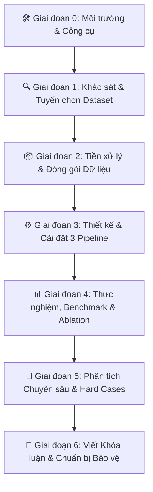

# 📋 CHECKLIST THỰC THI NGHIÊN CỨU TOÀN DIỆN (A – Z)

> **Đề tài:** Truy Hồi Nhận Biết Nhãn cho Phát Hiện Tấn Công Web Dựa Trên Mô Hình Ngôn Ngữ Lớn  
> *(Label-Aware Retrieval for LLM-Based Web Attack Detection)*  
> **Chuyên ngành:** Mạng máy tính / An toàn thông tin  
> **Trạng thái:** Kế hoạch thực thi chi tiết từ khởi tạo đến bảo vệ khóa luận / nộp bài báo  
> **Cập nhật:** 29/09/2026

---



---

## 🛠️ GIAI ĐOẠN 0: Chuẩn Bị Môi Trường & Công Cụ (Setup & Tooling)

- [ ] **0.1. Môi trường lập trình & Framework:**
  - [ ] Khởi tạo môi trường Python 3.10+ (Conda / venv).
  - [ ] Cài đặt các thư viện lõi:
    - *Deep Learning & LLM:* `torch`, `transformers`, `accelerate`, `vllm`, `ollama` (hoặc `litellm` nếu gọi API).
    - *Vector Search & Embeddings:* `faiss-cpu` / `faiss-gpu`, `sentence-transformers`, `chromadb`.
    - *Phân tích & Machine Learning:* `pandas`, `numpy`, `scikit-learn`, `lightgbm`, `seaborn`, `matplotlib`.
- [ ] **0.2. Lựa chọn mô hình & Tài nguyên tính toán:**
  - [ ] **LLM Backbone (Inference):**
    - [ ] Local Open-weights (Khuyến nghị: `Qwen/Qwen2.5-Coder-7B-Instruct` hoặc `meta-llama/Llama-3.1-8B-Instruct`).
    - [ ] Backup qua API (OpenAI / DeepSeek / Gemini) để kiểm tra chéo (sanity check).
  - [ ] **Embedding Model (Vector Database):**
    - [ ] Tải và kiểm tra các model biểu diễn text/code tốt: `BAAI/bge-base-en-v1.5`, `sentence-transformers/all-mpnet-base-v2` hoặc `jinaai/jina-embeddings-v2-base-code`.
- [ ] **0.3. Cấu trúc thư mục dự án chuẩn mực:**
  ```text
  src/
  ├── data/             # Raw data, preprocessing scripts, processed parquet/jsonl
  ├── retrieval/        # Vector index (FAISS), Prior Classifier, Label-aware logic
  ├── llm/              # Prompt templates, LLM wrappers, inference runner
  ├── eval/             # Metrics calculation (Accuracy, F1, LCR@k, latency)
  ├── experiments/      # Configuration yaml & experiment runner scripts
  ├── notebooks/        # EDA & visualization notebooks
  └── mini-reports/     # Báo cáo tiến độ và tài liệu học thuật
  ```

---

## 🔍 GIAI ĐOẠN 1: Khảo Sát, Đánh Giá & Tuyển Chọn Dataset (Dataset Survey & Selection)

> **Mục tiêu:** So sánh các ứng viên dataset tiềm năng theo các tiêu chí học thuật nghiêm ngặt trước khi chốt dataset chính thức cho đề tài.

- [ ] **1.1. Khảo sát & thu thập các ứng viên Dataset (Candidates):**
  - [ ] **Ứng viên 1 — `data_capec_multilabel.csv` (Hiện có):** 907k rows, log HTTP thực tế có nhãn CAPEC (SQLi, Path Traversal, Code Injection, Response Splitting, Normal...).
  - [ ] **Ứng viên 2 — CSIC 2010 HTTP Dataset:** Bộ benchmark kinh điển về Web Attack (có đầy đủ request, header, body cho SQLi, XSS, Buffer Overflow, Parameter Tampering).
  - [ ] **Ứng viên 3 — ECML/PKDD 2007 Web Attack Dataset:** Chứa các HTTP request tấn công và bình thường được gán nhãn chi tiết.
  - [ ] **Ứng viên 4 — CIC-IDS2017 / CSE-CIC-IDS2018 (Web Attack subset):** Trích xuất các luồng tấn công Web (SQLi, XSS, Brute Force) từ traffic capture.
  - [ ] **Ứng viên 5 — Tổng hợp từ PayloadsAllTheThings / SecLists:** Bộ payload tấn công chuẩn hóa kết hợp với benign HTTP traffic để tạo benchmark có kiểm soát.
- [ ] **1.2. Đánh giá ứng viên theo ma trận tiêu chí chọn lựa:**
  - [ ] *Độ rõ ràng và tin cậy của nhãn:* Nhãn có chuẩn hóa không (OWASP / CAPEC)? Tỷ lệ nhãn sai/nhiễu (annotation noise) là bao nhiêu?
  - [ ] *Tính đầy đủ của HTTP Request:* Có đủ Method, Path, Query parameters, Request Headers, Request Body không?
  - [ ] *Số lượng Attack Classes:* Tối thiểu $\ge 4 - 6$ lớp tấn công đại diện (Benign, SQLi, XSS, Path Traversal/LFI, Code/Command Injection...).
  - [ ] *Sự tồn tại của Hard Cases:* Có chứa các trường hợp ranh giới ngữ nghĩa gần nhau (ví dụ: query bình thường chứa từ khóa `SELECT`, `admin` nhưng là Benign) không?
  - [ ] *Tính khả thi chống Data Leakage:* Dễ dàng deduplicate và chia tập train/test độc lập.
- [ ] **1.3. Quyết định & Tài liệu hóa lựa chọn Dataset:**
  - [ ] Chốt phương án: Dùng 1 dataset chính thức (đã lọc sạch) HOẶC kết hợp (Primary benchmark + Out-of-distribution evaluation set).
  - [ ] Xuất tài liệu phân tích chi tiết chốt lý do chọn vào `mini-reports/p1_dataset_selection_report.md`.

---

## 📦 GIAI ĐOẠN 2: Tiền Xử Lý & Đóng Gói Dữ Liệu (Data Curation & Splitting)

> **Mục tiêu:** Biến dataset thô đã chọn thành các tập dữ liệu sạch, cân đối, chống rò rỉ dữ liệu (data leakage) tuyệt đối.

- [ ] **2.1. Chuẩn hóa Attack Taxonomy (Phân loại tấn công):**
  - [ ] Định nghĩa danh sách $5 - 6$ nhãn mục tiêu rõ ràng (VD: `Benign`, `SQL Injection`, `Cross-Site Scripting`, `Path Traversal`, `Code Injection`, `Command Injection`).
  - [ ] Loại bỏ các nhãn có quá ít mẫu, nhãn mơ hồ hoặc không thuộc phạm vi HTTP payload.
- [ ] **2.2. Quy trình Deduplication (Khử trùng lặp) đa tầng:**
  - [ ] *Tầng 1 (Exact row deduplication):* Loại bỏ các dòng hoàn toàn trùng nhau.
  - [ ] *Tầng 2 (Payload/URL-level deduplication):* Tránh việc 1 URL lặp lại hàng nghìn lần làm sai lệch phân phối Vector Database.
  - [ ] *Tầng 3 (Near-duplicate check via MinHash LSH / Edit Distance):* Đảm bảo không có các biến thể quá giống nhau giữa tập Retrieval và tập Test.
- [ ] **2.3. Khai thác và tách riêng tập Hard Cases:**
  - [ ] Lọc ra danh sách các mẫu có cùng URL path/cấu trúc tương tự nhau nhưng mang nhãn khác nhau (hoặc các payload obfuscated phức tạp) để làm tập đánh giá chuyên sâu.
- [ ] **2.4. Phân chia tập dữ liệu (Data Splitting):**
  - [ ] **Retrieval Database Pool (80%):** Ngân hàng chứa các ví dụ mẫu có gán nhãn để làm demonstration pool.
  - [ ] **Test Set (20% - Phân tầng theo class):** Dùng để đánh giá độc lập mô hình (không rò rỉ vào Retrieval DB).
  - [ ] Lưu trữ chuẩn hóa dưới định dạng `.parquet` / `.jsonl` tối ưu tốc độ đọc.

---

## ⚙️ GIAI ĐOẠN 3: Thiết Kế & Cài Đặt 3 Pipeline Thực Nghiệm (System Architecture)

> **Mục tiêu:** Xây dựng hệ thống hoàn chỉnh chứa 3 pipeline so sánh công bằng trên cùng một Test Set.

```text
[Test Query: HTTP Request]
    ├───> Pipeline A: Direct LLM Prompt (Zero-shot / Fixed Few-shot) ─────────> [Prediction A]
    ├───> Pipeline B: Vanilla Semantic Retrieval (Top-k Cosine) + LLM ────────> [Prediction B]
    └───> Pipeline C: Fast Classifier + Label-Aware Rerank (Top-k) + LLM ────> [Prediction C]
```

- [ ] **3.1. Pipeline A — LLM Baseline (No Retrieval):**
  - [ ] Thiết kế Prompt Template chuẩn: System role, định nghĩa các nhãn tấn công, quy tắc output JSON chặt chẽ.
  - [ ] Module thực thi Zero-shot và Fixed Few-shot cố định.
- [ ] **3.2. Pipeline B — Vanilla Semantic Retrieval + LLM (Standard RAG):**
  - [ ] Vectorize toàn bộ Retrieval Database Pool bằng Embedding Model và nạp vào FAISS index.
  - [ ] Cơ chế: Nhận Query $\to$ Tính Cosine Similarity $\to$ Lấy Top-$k$ mẫu tương đồng nhất $\to$ Ghép vào ICL prompt $\to$ LLM phán đoán.
- [ ] **3.3. Pipeline C — Label-Aware Retrieval + LLM (Proposed Method):**
  > **Ràng buộc thiết kế:** Không train bất kỳ model nào. Prior label lấy từ LLM zero-shot (inference only).
  - [ ] **Thành phần 1 — LLM Zero-shot Prior Module (không train):**
    - [ ] Gọi LLM (Ollama local hoặc free API) với prompt zero-shot ngắn để dự đoán nhãn sơ bộ $\hat{y}_{\text{prior}}$ cho query.
    - [ ] Prompt prior: `"Classify this HTTP request into one of: [label list]. Output only the label name."` + query.
    - [ ] Dùng cùng LLM với bước final (không cần model thứ 2); cache kết quả để tránh gọi lại.
    - [ ] Ablation bổ trợ: thử thêm rule-based prior (regex keyword matching) làm baseline so sánh.
  - [ ] **Thành phần 2 — Thuật toán Label-Aware Reranking:**
    - [ ] *Chiến lược 1 (Hard Filtering):* Chỉ chọn candidates từ Vector DB có $\text{Label}(d) = \hat{y}_{\text{prior}}$.
    - [ ] *Chiến lược 2 (Soft Scoring):*
      $$\text{FinalScore}(d, q) = \alpha \cdot \text{CosineSim}(\mathbf{e}_d, \mathbf{e}_q) + \beta \cdot \mathbb{I}[\text{Label}(d) = \hat{y}_{\text{prior}}] + \gamma \cdot \text{LabelDiversity}(S)$$
    - [ ] $\alpha, \beta, \gamma$ chỉnh trên **validation set** (grid/random search), không trên test set.
  - [ ] **Thành phần 3 — ICL Prompt Constructor:** Ghép top-k demonstrations (đúng nhãn + đa dạng) vào prompt few-shot gửi LLM dự đoán final.
- [ ] **3.4. Module Parser & Loggings:**
  - [ ] Parser tự động bóc tách nhãn từ output của LLM, xử lý retry/fallback nếu LLM output sai định dạng.
  - [ ] Lưu đầy đủ metadata cho từng lượt chạy: query, true_label, predicted_label, retrieved_demos (id, label, sim_score), latency, tokens.

---

## 📊 GIAI ĐOẠN 4: Thực Hiện Thực Nghiệm & Đo Lường (Benchmark & Ablations)

> **Mục tiêu:** Thu thập số liệu định lượng để trả lời đầy đủ các câu hỏi nghiên cứu (RQ1 – RQ4).

- [ ] **4.1. Hệ thống chỉ số đánh giá (Evaluation Metrics):**
  - [ ] **Chỉ số phân loại:** Accuracy, Macro-F1, Weighted-F1, Precision, Recall cho từng class.
  - [ ] **Chỉ số chất lượng Retrieval (Đóng góp mới):**
    - $\text{LCR@}k$ *(Label Consistency Rate @ $k$)*: Tỷ lệ demonstration trong Top-$k$ có nhãn trùng khớp với nhãn thực tế của query.
  - [ ] **Chỉ số vận hành hệ thống:** Thời gian xử lý trung bình mỗi request (Latency in ms), Token cost per query.
- [ ] **4.2. Bảng kết quả chính (Main Benchmark):**
  - [ ] Chạy và so sánh 4 cấu hình trên toàn bộ Test Set:
    - [ ] `1. Zero-shot LLM (Pipeline A)`
    - [ ] `2. Vanilla Semantic Retrieval + LLM (Pipeline B)`
    - [ ] `3. Label-Aware Hard Filtering + LLM (Pipeline C1)`
    - [ ] `4. Label-Aware Soft Scoring + LLM (Pipeline C2)`
- [ ] **4.3. Các thí nghiệm bóc tách (Ablation Studies):**
  - [ ] **Ablation 1 (Số lượng $k$):** Đánh giá khi $k \in \{1, 3, 5, 8, 10\}$.
  - [ ] **Ablation 2 (Trọng số kết hợp $\alpha, \beta$):** Quét lưới tìm vùng cân bằng tối ưu giữa semantic similarity và label consistency.
  - [ ] **Ablation 3 (Chất lượng Prior Label):** So sánh 3 cách lấy prior label:
    - LLM zero-shot (không có context)
    - LLM zero-shot + Chain-of-Thought (CoT)
    - Rule-based regex matching (baseline thô)
    → Đo tác động của chất lượng prior lên LCR@k và macro-F1 cuối.
  - [ ] **Ablation 4 (Khảo sát Embedding / LLM Backbone):** Đánh giá tính tổng quát trên $\ge 2$ LLMs (ví dụ `Qwen2.5-7B` vs `Llama-3.1-8B`) và $\ge 2$ Embedding models.

---

## 🔬 GIAI ĐOẠN 5: Phân Tích Chuyên Sâu, Hard Cases & Phân Tích Lỗi (Deep-Dive Analysis)

> **Mục tiêu:** Làm sáng tỏ cơ chế tại sao phương pháp hoạt động tốt và chỉ rõ giới hạn của giải pháp.

- [ ] **5.1. Đánh giá riêng biệt trên tập Hard Cases:**
  - [ ] So sánh độ chính xác của Vanilla RAG vs Label-Aware RAG trên tập các mẫu gây nhầm lẫn cao giữa Benign và Web Attacks.
- [ ] **5.2. Trực quan hóa ma trận nhầm lẫn (Confusion Matrix):**
  - [ ] Vẽ và đối chiếu Confusion Matrix của cả 3 pipeline để chứng minh Label-Aware giúp giảm thiểu false-positive / false-negative ở cặp nhãn nào.
- [ ] **5.3. Phân tích lỗi (Error Analysis & Failure Modes):**
  - [ ] Thống kê phân loại các ca mà Pipeline C vẫn dự đoán sai:
    - *Lỗi do Prior Classifier đoán sai hướng.*
    - *Lỗi do Payload quá tối nghĩa (obfuscated).*
    - *Lỗi do LLM reasoning hallucination.*
- [ ] **5.4. Nghiên cứu trường hợp định tính (Qualitative Case Studies):**
  - [ ] Chọn 2–3 ví dụ cụ thể minh họa trực quan: So sánh danh sách demonstrations mà Vanilla RAG kéo về (bị lẫn lộn nhãn) so với Label-Aware RAG kéo về (thuần nhất nhãn) để đưa vào báo cáo.

---

## 📝 GIAI ĐOẠN 6: Viết Khóa Luận, Bài Báo & Chuẩn Bị Bảo Vệ (Thesis & Publication)

> **Mục tiêu:** Chuyển hóa toàn bộ kết quả thành văn bản học thuật hoàn chỉnh và bài thuyết trình bảo vệ xuất sắc.

- [ ] **6.1. Cấu trúc nội dung quyển Khóa luận Tốt nghiệp / Paper:**
  - [ ] **Chương 1: Mở Đầu:** Đặt vấn đề, bối cảnh an ninh Web & WAF, lý do LLM cần ICL, câu hỏi nghiên cứu (RQ1–RQ4), đóng góp chính.
  - [ ] **Chương 2: Tổng Quan & Các Công Trình Liên Quan:** Phân tích 11 papers liên quan, bảng so sánh và phân tích Research Gap.
  - [ ] **Chương 3: Phương Pháp Đề Xuất:** Kiến trúc 3 pipeline, cơ chế Label-Aware Retrieval, công thức chấm điểm kết hợp, metric $\text{LCR@}k$.
  - [ ] **Chương 4: Dữ Liệu & Thiết Kế Thực Nghiệm:** Báo cáo khảo sát dataset, quy trình deduplication, thiết lập phần cứng/mô hình và kịch bản thực nghiệm.
  - [ ] **Chương 5: Kết Quả & Thảo Luận:** Bảng Main Benchmark, biểu đồ Ablation studies, phân tích Hard Cases, phân tích lỗi và hạn chế.
  - [ ] **Chương 6: Kết Luận & Hướng Phát Triển:** Tổng kết kết quả, đề xuất hướng nghiên cứu tiếp theo (streaming WAF, multi-modal payload).
- [ ] **6.2. Đóng gói mã nguồn & Khả năng tái lập (Reproducibility):**
  - [ ] Viết file `README.md` hướng dẫn chi tiết từng bước: Cài đặt $\to$ Download dataset $\to$ Preprocess $\to$ Run Pipeline $\to$ Generate Plots.
  - [ ] Xuất file `requirements.txt` / `environment.yml` cố định phiên bản thư viện.
- [ ] **6.3. Chuẩn bị Slide & Demo bảo vệ:**
  - [ ] Soạn Slide thuyết trình (15–20 slides súc tích: *Problem $\to$ Gap $\to$ Proposed Method $\to$ Experiments $\to$ Findings & Demo*).
  - [ ] Chuẩn bị kịch bản Demo trực tiếp (hoặc video demo ngắn) hiển thị rõ sự khác biệt của Top-$k$ demonstration và kết quả phân loại của LLM.

---

## 🎯 BẢNG THEO DÕI TIẾN ĐỘ THỰC HIỆN

| Giai đoạn | Nhiệm vụ trọng tâm | Sản phẩm đầu ra cụ thể (Artifacts) | Trạng thái |
| :---: | :--- | :--- | :---: |
| **0** | Môi trường & Công cụ | Repo code, environment, script load LLM/Embedding | ⏳ Đang làm |
| **1** | Khảo sát & Tuyển chọn Dataset | File so sánh candidates & Báo cáo chốt dataset | ⏳ Cần làm ngay |
| **2** | Tiền xử lý & Split dữ liệu | Dataset sạch, tập Retrieval DB, Test Set, Hard Cases | ⬜ Chưa |
| **3** | Cài đặt 3 Pipeline | Mã nguồn hoàn chỉnh cho Pipeline A, B, C | ⬜ Chưa |
| **4** | Benchmark & Ablation | Bảng số liệu Accuracy, F1, $\text{LCR@}k$, đồ thị ablation | ⬜ Chưa |
| **5** | Phân tích sâu & Hard Cases | Biểu đồ Confusion Matrix, bảng thống kê lỗi | ⬜ Chưa |
| **6** | Khóa luận & Slide bảo vệ | Quyển khóa luận hoàn chỉnh, Slide thuyết trình, Demo | ⬜ Chưa |
