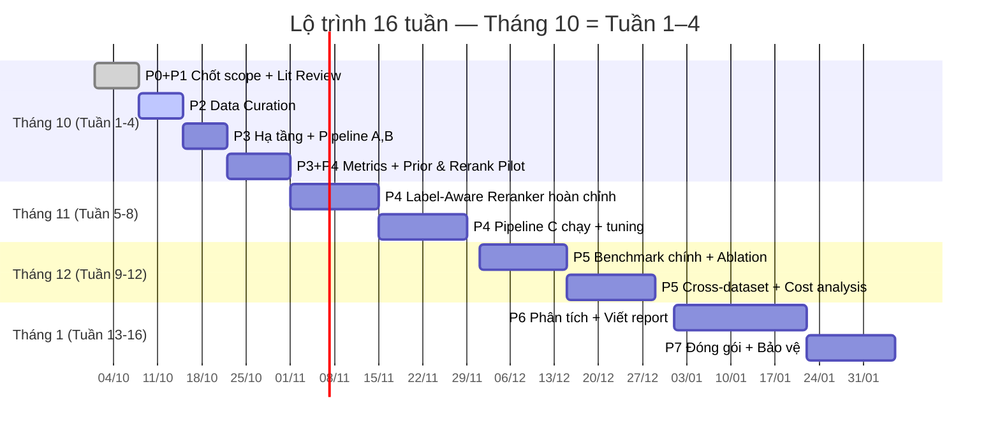

# 🎯 KẾ HOẠCH THÁNG 10/2026 — Label-Aware Retrieval for LLM-Based Web Attack Detection

> **Ngày lập:** 01/10/2026  
> **Tổng quan lộ trình gốc:** 16 tuần (Phase 0–7)  
> **Ràng buộc thiết kế:** Label-aware **rerank**, **hoàn toàn không train model**, LLM qua Ollama local / API miễn phí (Groq, Google AI Studio)  
> **Hiện trạng:** Đang ở **cuối Phase 0 / đầu Phase 1** — đã có literature review sơ bộ, EDA dataset, thiết kế pipeline, nhưng **chưa có code, chưa chốt dataset, chưa setup môi trường**

---

## 📊 1 THÁNG LÀM ĐƯỢC BAO NHIÊU % ?

### Đánh giá tiến độ hiện tại (tính đến 30/09/2026)

| Giai đoạn | Trạng thái | % hoàn thành |
|:---|:---:|:---:|
| **Phase 0** — Chốt phạm vi, RQ, thiết kế | ✅ Gần xong | **~80%** |
| **Phase 1** — Tổng quan tài liệu | ✅ Sơ bộ xong, chưa đọc kỹ | **~60%** |
| **Phase 2** — Dữ liệu (chọn, dedup, split) | ⏳ Đã EDA, chưa chốt/xử lý | **~20%** |
| **Phase 3** — Hạ tầng & baseline pipelines | ❌ Chưa bắt đầu | **0%** |
| **Phase 4** — Phương pháp đề xuất (Label-Aware) | ❌ Chưa bắt đầu | **0%** |
| **Phase 5** — Thực nghiệm chính & ablation | ❌ Chưa bắt đầu | **0%** |
| **Phase 6** — Phân tích & viết report | ❌ Chưa bắt đầu | **0%** |
| **Phase 7** — Đóng gói repo | ❌ Chưa bắt đầu | **0%** |

### Ước tính % hoàn thành sau tháng 10

> [!IMPORTANT]
> **Mục tiêu thực tế: hoàn thành ~35–40% toàn bộ project sau tháng 10.**  
> Cụ thể: **Phase 0–1 xong 100%, Phase 2 xong 100%, Phase 3 xong ~80–90%, Phase 4 bắt đầu pilot.**

| Giai đoạn | Mục tiêu cuối tháng 10 | % mục tiêu |
|:---|:---|:---:|
| **Phase 0** — Setup & Scope | ✅ 100% | 100% |
| **Phase 1** — Literature Review | ✅ 100% | 100% |
| **Phase 2** — Data Curation | ✅ 100% | 100% |
| **Phase 3** — Infrastructure & Baselines | Pipeline A + B chạy được, FAISS index, prompt template, parser | ~80% |
| **Phase 4** — Proposed Method | LLM Zero-shot Prior + Reranker module hoàn thành, chạy pilot Pipeline C | ~20% |
| **Phase 5–7** | Chưa | 0% |

### Trọng số các phase theo effort

```
Phase 0 (5%) ████░░░░░░░░░░░░░░░░  ~80% done
Phase 1 (10%) ██████░░░░░░░░░░░░░░  ~60% done  
Phase 2 (15%) ████░░░░░░░░░░░░░░░░  ~20% done
Phase 3 (20%) ░░░░░░░░░░░░░░░░░░░░  0% done    ← Focus tháng 10
Phase 4 (20%) ░░░░░░░░░░░░░░░░░░░░  0% done    ← Bắt đầu cuối tháng
Phase 5 (15%) ░░░░░░░░░░░░░░░░░░░░  0% done
Phase 6 (10%) ░░░░░░░░░░░░░░░░░░░░  0% done
Phase 7 (5%)  ░░░░░░░░░░░░░░░░░░░░  0% done

Hiện tại: ~13% tổng thể
Mục tiêu cuối tháng 10: ~38% tổng thể
→ Tháng 10 sẽ đẩy ~25% tiến độ
```

> [!NOTE]
> **Tại sao chỉ ~38%?** Vì Phase 0–2 tuy chiếm 30% effort nhưng phần lớn là nền tảng (đọc paper, EDA, dedup) — output ít code. Phase 3–4 mới là phần **nặng code** và cần thời gian debug. Nhưng **38% là solid** — bạn sẽ có dữ liệu sạch, 2 pipeline chạy được, và bắt đầu chạm vào core contribution.

---

## 📅 CHIA NHỎ THEO 4 TUẦN

---

### 🗓️ TUẦN 1 (01/10 – 07/10): CHỐT NỀN TẢNG

**Chủ đề:** *Đọc kỹ papers + Chốt dataset + Setup hoàn chỉnh*

| # | Task | Output cụ thể | Deadline |
|:---:|:---|:---|:---:|
| 1.1 | Đọc kỹ 8 bài báo quan trọng (đặc biệt CLL-RetICL, BFAD, DemoShapley) | File [`p1_literature_review_notes.md`](file:///d:/PERSONAL/Research/ITP/src/mini-reports/p1_literature_review_notes.md) — mỗi bài 4 dòng: Method, Dataset, Results, Difference | T3 (03/10) |
| 1.2 | Tải & khảo sát CSIC 2010 + Web App Payloads dataset | Bảng so sánh 3 datasets theo 5 tiêu chí | T4 (04/10) |
| 1.3 | **CHỐT dataset chính thức** — viết lý do rõ ràng | File `p1_dataset_selection_report.md` | T5 (05/10) |
| 1.4 | Setup Conda env (`itp`, Python 3.10), cài thư viện, tạo `requirements.txt` | `conda activate itp` chạy OK, import pandas/faiss/sentence_transformers OK | T6 (06/10) |
| 1.5 | Tạo cấu trúc thư mục chuẩn + init git repo | Repo structure theo [roadmap](file:///d:/PERSONAL/Research/ITP/src/label-aware-retrieval-roadmap.md) Section 8 | T7 (07/10) |

> [!TIP]
> **Checkpoint cuối tuần 1:** Bạn phải trả lời được: *"Tôi dùng dataset X, vì lý do Y, môi trường đã sẵn sàng"*. Nếu chưa chốt dataset → **mọi thứ bị block**.

**⏰ Ước tính thời gian:**
- Đọc papers: ~8–10h (mỗi bài ~1–1.5h đọc kỹ)
- Khảo sát datasets: ~3–4h
- Setup env + structure: ~2h
- **Tổng: ~14–16h**

---

### 🗓️ TUẦN 2 (08/10 – 14/10): DATA CURATION

**Chủ đề:** *Biến dataset thô thành dữ liệu sạch, sẵn sàng cho thực nghiệm*

| # | Task | Output cụ thể | Deadline |
|:---:|:---|:---|:---:|
| 2.1 | Viết script **exact dedup** (loại 2,746 rows trùng) | `src/data/dedup.py` — chạy ra số liệu trước/sau | T2 (09/10) |
| 2.2 | Viết script **path-level dedup per label** (giữ 1 đại diện per (path, label)) | Dataset giảm từ 907K → ~350K unique (path, label) pairs | T3 (10/10) |
| 2.3 | **Chuẩn hóa Attack Taxonomy** — lọc 5–6 class, loại class không phù hợp | Config file chốt labels: `[Normal, SQLi, Path Traversal, Code Injection, HTTP Response Splitting, OS CMDi]` | T4 (11/10) |
| 2.4 | Tách riêng **1,430 Hard Cases** (same path, different label) | File `data/hard_cases.jsonl` | T5 (12/10) |
| 2.5 | **Stratified split**: Retrieval DB Pool (80%) + Test Set (20%) | Files: `data/splits/retrieval_pool.parquet`, `data/splits/test_set.parquet` | T6 (13/10) |
| 2.6 | Thống kê mô tả sau dedup + split — viết mini-report | `mini-reports/p2_data_curation_report.md` — bảng phân phối class, size mỗi split | T7 (14/10) |

> [!WARNING]
> **Go/No-Go Gate (cuối tuần 2):** Chạy test chống data leakage — hash file split, kiểm tra giao tập rỗng giữa Pool và Test. **Nếu không pass → KHÔNG được đi tiếp.**

**⏰ Ước tính thời gian:**
- Viết scripts dedup: ~6–8h
- Taxonomy + hard cases: ~3–4h
- Split + statistics: ~3–4h
- **Tổng: ~14–16h**

---

### 🗓️ TUẦN 3 (15/10 – 21/10): XÂY HẠ TẦNG & PIPELINE A, B

**Chủ đề:** *Dựng cả hệ thống inference — từ embedding đến LLM output parser*

| # | Task | Output cụ thể | Deadline |
|:---:|:---|:---|:---:|
| 3.1 | **Embedding module**: vectorize Retrieval Pool bằng `bge-base-en-v1.5` hoặc `all-mpnet-base-v2` | `src/retrieval/embedder.py` + FAISS index file (`.faiss`) | T3 (17/10) |
| 3.2 | **Retriever module**: query → FAISS search → top-k candidates | `src/retrieval/retriever.py` — test: input 1 query, output k candidates với scores | T4 (18/10) |
| 3.3 | **Prompt Builder**: template System/User, format demonstrations, JSON output constraint | `src/llm/prompt_builder.py` + `src/llm/templates/` | T4 (18/10) |
| 3.4 | **LLM Client**: gọi Qwen2.5-Coder-7B local (Ollama/vLLM), retry logic, cache theo hash prompt | `src/llm/llm_client.py` — test: gọi 1 prompt, nhận JSON response | T5 (19/10) |
| 3.5 | **Output Parser**: bóc tách label từ LLM output, xử lý JSON hỏng, fallback | `src/llm/parser.py` — unit tests cho: valid JSON, JSON + garbage text, completely invalid | T6 (20/10) |
| 3.6 | **Pipeline A runner**: Zero-shot + Fixed Few-shot, chạy trên 50–100 mẫu test | `src/experiments/run_pipeline_a.py` — log kết quả + metrics sơ bộ | T7 (21/10) |
| 3.7 | **Pipeline B runner**: Vanilla Semantic Retrieval + LLM, chạy trên 50–100 mẫu test | `src/experiments/run_pipeline_b.py` — log kết quả + so sánh với Pipeline A | T7 (21/10) |

> [!IMPORTANT]
> **Go/No-Go Gate (cuối tuần 3):**
> - Pipeline A, B chạy được end-to-end trên 100 mẫu?
> - Kết quả tái lập giữa 2 lần chạy (deterministic)?
> - Invalid output rate < 5%?
> 
> **Nếu đạt → proceed. Nếu chưa → fix trước khi làm Pipeline C.**

**⏰ Ước tính thời gian:**
- Embedding + FAISS: ~5–6h
- Prompt + LLM client: ~6–8h (gồm setup Ollama/vLLM)
- Parser + unit tests: ~3–4h
- Pipeline runners: ~4–5h
- **Tổng: ~20–24h** ← Tuần nặng nhất

---

### 🗓️ TUẦN 4 (22/10 – 31/10): PIPELINE C (LABEL-AWARE RERANK) + PILOT + ĐO METRICS

**Chủ đề:** *Bắt đầu chạm vào core contribution — Label-Aware Rerank (Inference-only, không train)*

| # | Task | Output cụ thể | Deadline |
|:---:|:---|:---|:---:|
| 4.1 | **Eval module**: tính Accuracy, Macro-F1, Weighted-F1, Precision/Recall per class, LCR@k | `src/eval/metrics.py` — unit test so sánh với sklearn trên toy test case | T2 (23/10) |
| 4.2 | Chạy **benchmark sơ bộ** Pipeline A & B trên toàn bộ Test Set (hoặc subset 500–1000 mẫu) | Bảng kết quả đầu tiên: `results/pipeline_a_results.parquet`, `results/pipeline_b_results.parquet` | T4 (25/10) |
| 4.3 | **Pilot study**: đo label skew/ambiguity trong top-k của Pipeline B — tỷ lệ demonstration sai nhãn (LCR@k) | Mini-report: `mini-reports/p3_pilot_label_skew.md` — chứng minh định lượng label contamination xảy ra | T5 (26/10) |
| 4.4 | **Thiết kế LLM Zero-shot Prior Module** (Lấy prior $\hat{y}_{\text{prior}}$ từ chính LLM zero-shot, cache từ Pipeline A, 0% model training) | `src/retrieval/prior.py` — hàm `get_prior_label(request)` test cache hit 100% | T6 (27/10) |
| 4.5 | **Xây dựng Label-Aware Reranker Module** (Scoring $\alpha \cdot \text{Sim} + \beta \cdot \text{PriorMatch}$ + contrastive example) | `src/retrieval/rerank.py` — unit test: rerank candidates đảm bảo top-k cân bằng và sát prior | T7 (28/10) |
| 4.6 | **Pipeline C Runner & Benchmark pilot**: Chạy Pipeline C end-to-end, so sánh Macro-F1 & LCR@k với Pipeline B | `src/experiments/run_pipeline_c.py` + bảng so sánh A vs B vs C sơ bộ | CN (30/10) |
| 4.7 | Viết **báo cáo tiến độ tháng 10** — tổng hợp kết quả A/B/C, kế hoạch tháng 11 | `mini-reports/monthly_report_october.md` | T2 (31/10) |

> [!TIP]
> **Milestone quan trọng cuối tuần 4:**
> 1. Có **pilot data** chứng minh label contamination thực sự xảy ra trong Vanilla RAG (Pipeline B).
> 2. Pipeline C (Label-Aware Rerank) chạy thành công mà **không cần huấn luyện bất kỳ model nào**, bước đầu cho thấy cải thiện LCR@k và Macro-F1 so với Pipeline B.

**⏰ Ước tính thời gian:**
- Eval metrics: ~3–4h
- Benchmark run: ~4–6h (gồm thời gian inference LLM có cache)
- Pilot study: ~4–5h
- LLM Prior & Reranker module: ~5–6h
- Pipeline C runner + benchmark pilot: ~4–5h
- Monthly report: ~2h
- **Tổng: ~22–28h**

---

## 📈 TỔNG KẾT MỤC TIÊU THÁNG 10

### Deliverables bắt buộc (MUST-HAVE)

| # | Deliverable | Phase |
|:---:|:---|:---:|
| ✅ | Literature review notes đầy đủ 8 bài | P1 |
| ✅ | Dataset chính thức đã chọn + lý do | P1 |
| ✅ | Dataset sạch, dedup, 5–6 classes, split xong | P2 |
| ✅ | Repo code có structure chuẩn, environment chạy được | P0 |
| ✅ | Pipeline A (Zero-shot/Few-shot LLM) chạy end-to-end | P3 |
| ✅ | Pipeline B (Vanilla RAG) chạy end-to-end | P3 |
| ✅ | Bảng kết quả sơ bộ Pipeline A vs B | P5 |
| ✅ | Pilot: chứng minh label contamination trong top-k của Pipeline B | P4 |
| ✅ | LLM Zero-shot Prior Module + Label-Aware Reranker hoạt động (không train model) | P4 |
| ✅ | Pipeline C chạy được end-to-end trên test subset, có bảng so sánh A vs B vs C | P4 |

### Deliverables bonus (NICE-TO-HAVE)

| # | Deliverable | Phase |
|:---:|:---|:---:|
| 🎁 | Label-Aware Reranker v1 (Hard Filtering) chạy được | P4 |
| 🎁 | Pipeline C chạy thử trên 100 mẫu | P4 |
| 🎁 | So sánh sơ bộ 3 pipeline (A vs B vs C) | P5 |

---

## ⏱️ NGÂN SÁCH THỜI GIAN

| Tuần | Effort ước tính | Ghi chú |
|:---:|:---:|:---|
| Tuần 1 | ~14–16h | Nhẹ nhất — chủ yếu đọc + setup |
| Tuần 2 | ~14–16h | Data work — scripting Python |
| Tuần 3 | ~20–24h | **Nặng nhất** — dựng toàn bộ hạ tầng |
| Tuần 4 | ~22–28h | Benchmark + bắt đầu core method |
| **Tổng** | **~70–84h** | **~2.5–3h/ngày nếu làm mỗi ngày** |

> [!CAUTION]
> **Rủi ro và giải pháp LLM:**
> - **Ollama local (chính):** Cài `qwen2.5:7b-instruct` (hoặc `3b-instruct` nếu RAM thấp). Chạy hoàn toàn offline, 0 đồng.
> - **Groq API (backup siêu tốc):** Miễn phí hoàn toàn với model Llama 3.1 70B, tốc độ >200 tokens/s, thích hợp khi cần chạy nhanh hoặc máy không có GPU.
> - **Google AI Studio Gemini Flash (backup đa dạng):** Miễn phí (15 RPM, 1M TPM), dùng để cross-validate hoặc làm Ablation.
> - **Cache triệt để mọi query (`llm/cache.json`):** Tránh lặp lại request, giảm tối đa latency và số lần gọi inference.

---

## 🔄 TIMELINE TỔNG THỂ (VỊ TRÍ THÁNG 10 TRONG LỘ TRÌNH 16 TUẦN)



---

*Lần cập nhật tiếp theo: 07/10/2026 (cuối tuần 1)*
