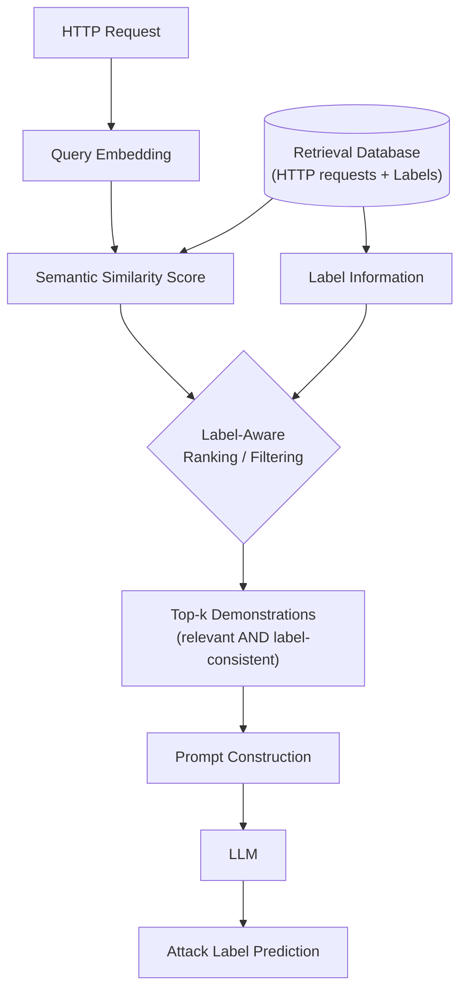

# ĐỀ CƯƠNG NGHIÊN CỨU KHOÁ LUẬN TỐT NGHIỆP

* **Tên đề tài (Tiếng Việt):** Truy Hồi Nhận Biết Nhãn cho Phát Hiện Tấn Công Web Dựa Trên Mô Hình Ngôn Ngữ Lớn
* **Tên đề tài (Tiếng Anh):** Label-Aware Retrieval for LLM-Based Web Attack Detection
* **Chuyên ngành:** Mạng máy tính (Định hướng An toàn thông tin)
* **Đối tượng thực hiện:** Sinh viên năm 4 Mạng máy tính, định hướng Web Security / LLM for Security

> **Quy ước đọc tài liệu:**
> - 🔵 **THỰC TẾ** — đã được xác nhận từ literature hoặc kiến thức kỹ thuật đã biết
> - 🟡 **GIẢ THUYẾT** — cần kiểm chứng bằng thực nghiệm
> - 🟢 **LỰA CHỌN THIẾT KẾ** — quyết định kỹ thuật sẽ xác định khi implement
> - ⬜ **[cần bổ sung thông tin...]** — phần chưa đủ thông tin để điền chính xác

---

## 1. Tóm Tắt Ý Tưởng Nghiên Cứu

**Câu hỏi cốt lõi — diễn đạt đơn giản nhất:**

> *"Nếu retriever biết nhãn (label) của các mẫu HTTP request trong kho dữ liệu, nó có chọn được demonstrations tốt hơn cho LLM phân loại Web Attack so với retrieval thông thường chỉ dựa trên semantic similarity hay không?"*

**Diễn đạt học thuật:**

> *This research investigates whether incorporating Web Attack labels into the retrieval of in-context demonstrations can improve LLM-based Web Attack classification compared with conventional semantic retrieval.*

Đây là **giả thuyết nghiên cứu 🟡**, chưa phải kết quả. Mục tiêu của đề tài là thiết kế thực nghiệm để kiểm chứng giả thuyết này một cách nghiêm túc.

---

## 2. Bối Cảnh & Vấn Đề Nghiên Cứu

### 2.1. Web Attack Detection — Tại sao quan trọng? 🔵

Các ứng dụng Web là mục tiêu hàng đầu của các cuộc tấn công mạng. Theo **OWASP Top 10**, những lớp tấn công phổ biến nhất gồm: SQL Injection (SQLi), Cross-Site Scripting (XSS), Path Traversal, Command Injection. Mỗi cuộc tấn công đều biểu hiện qua các **HTTP request bất thường** có cấu trúc cú pháp và payload đặc trưng.

Hai hướng phòng thủ truyền thống và điểm yếu của chúng:

| Phương pháp | Cơ chế | Điểm yếu |
|---|---|---|
| **Rule-based WAF** (ModSecurity, Snort) | So khớp với tập luật/chữ ký cố định | Dễ bypass bằng obfuscation, encoding đa lớp; không detect Zero-day |
| **ML/DL-based WAF** (SVM, CNN, BERT) | Học đặc trưng thống kê từ dữ liệu | Black-box, cần huấn luyện lại khi distribution thay đổi, FPR cao |

### 2.2. LLM cho Web Attack Detection — Cơ hội 🔵

Các LLM hiện đại (LLaMA, Mistral, Qwen, GPT-4) có năng lực hiểu cú pháp code, cấu trúc SQL, HTML và phân tích payload HTTP qua khả năng lý giải ngôn ngữ tự nhiên. Đây là nền tảng cho hướng ứng dụng **In-Context Learning (ICL)**:

```text
Target HTTP Request
        +
Labeled demonstrations (examples)
        ↓
       LLM
        ↓
Attack Classification (SQLi / XSS / Benign / ...)
```

🔵 **Đã được xác nhận từ literature:** Chất lượng ICL phụ thuộc mạnh vào việc **chọn demonstrations như thế nào** (Liu et al., 2022; Rubin et al., 2022). Kang et al. (2024) đã chứng minh định lượng rằng noisy labels trong demonstrations gây accuracy drop >30% (GPT-2-Neo: 78.4% → 47.8% khi noise 50%), cho thấy label quality của demonstrations là yếu tố quyết định.

### 2.3. Vấn đề cụ thể: Vanilla Retrieval "mù nhãn" 🔵

Standard semantic retrieval hoạt động thuần túy theo embedding distance:

```text
Query (HTTP Request)
  ↓ Embedding (Dense Vector)
  ↓ Similarity Search (Cosine / KNN)
  ↓ Top-k examples (chỉ dựa trên khoảng cách vector)
  ↓ LLM
```

**Vấn đề kỹ thuật cụ thể:** Các HTTP request từ các lớp tấn công khác nhau — thậm chí giữa tấn công và lưu lượng bình thường — có thể rất gần nhau trong không gian embedding vì chia sẻ cấu trúc cú pháp:

```text
Query:
  GET /search?q=select+from+users

Candidate A (embedding gần, semantic cao):
  SELECT username FROM users WHERE id=1
  Label: Benign   ← legitimate DB query

Candidate B (embedding xa hơn nhưng đúng label):
  ' UNION SELECT username,password FROM users--
  Label: SQL Injection
```

Nếu retriever chỉ dựa vào semantic similarity, Candidate A (Benign) có thể được chọn vào prompt, tạo ra **label contamination** — khiến LLM bị lẫn lộn ranh giới Benign/SQLi.

🟡 **Giả thuyết cần kiểm chứng:** Nếu retriever sử dụng thêm thông tin nhãn để lọc/rerank candidates, chất lượng ICL của LLM sẽ tốt hơn và ổn định hơn.

---

## 3. Câu Hỏi Nghiên Cứu

### Main Research Question

> **RQ: Does incorporating attack-label information into the retrieval process improve the effectiveness of LLM-based Web Attack Detection compared with conventional semantic retrieval?**

*Diễn giải:* Việc sử dụng thông tin nhãn tấn công trong quá trình retrieval có cải thiện hiệu quả phân loại Web Attack bằng LLM so với semantic retrieval thông thường hay không?

### Sub-questions

| ID | Câu hỏi | Bản chất |
|---|---|---|
| **RQ1** | Standard semantic retrieval hoạt động tốt như thế nào cho Web Attack Detection bằng LLM? | Baseline — đo đạc thực nghiệm |
| **RQ2** | Label-Aware Retrieval có cải thiện chất lượng demonstration pool (Label Consistency@k) so với Vanilla Retrieval? | Câu hỏi retrieval trực tiếp |
| **RQ3** | Label-Aware Retrieval ảnh hưởng thế nào đến classification accuracy, đặc biệt các lớp có semantic similarity cao với Benign? | Per-class và hard cases |
| **RQ4** | Phương pháp nhạy cảm với các tham số nào (k, cách tích hợp label, class distribution trong retrieval DB)? | Ablation study |

> **Lưu ý:** Câu hỏi nghiên cứu *không giả định trước kết quả*. Label-Aware Retrieval có thể tốt hơn, chỉ tốt với một số class, hoặc không tốt trong một số điều kiện — đây là điều cần khám phá.

---

## 4. Mục Tiêu Nghiên Cứu

1. **Xây dựng 3 pipeline thực nghiệm** để so sánh trực tiếp: LLM baseline (no retrieval), Standard Semantic Retrieval + LLM, Label-Aware Retrieval + LLM.
2. **Thiết kế và cài đặt module Label-Aware Retrieval** theo ít nhất một trong các chiến lược: label filtering, label-aware reranking, hoặc label-aware scoring.
3. **Đánh giá thực nghiệm** trên dataset Web Attack có nhãn, với thiết kế retrieval/test split tránh data leakage.
4. **Đo Label Consistency@k (LCR@k)** — metric chưa được đo trong bất kỳ related work nào — để chứng minh định lượng rằng Label-Aware Retrieval cải thiện chất lượng demonstration pool.
5. **Phân tích per-class và hard cases** — xác định khi nào Label-Aware Retrieval giúp ích và khi nào không.
6. **Thực hiện ablation study** về k và cách tích hợp label.

---

## 5. Related Work & Research Gap

### 5.1. Các Paper Đã Đọc và Xác Minh 🔵

#### [1] CyberRAG — Closest Work

> Blefari, F., Cosentino, C., Pironti, F. A., Furfaro, A., & Marozzo, F. (2025). *CyberRAG: An Agentic RAG cyber attack classification and reporting tool.* arXiv:2507.02424. *Future Generation Computer Systems.*

- **Đây là related work gần nhất:** cùng domain Web Attack (SQLi, XSS, SSTI) + RAG + LLM.
- Kiến trúc agentic: specialist BERT classifiers phân loại attack family trước → iterative retrieval-and-reason loop được condition theo label → LLM sinh báo cáo.
- Accuracy >94% per class, 94.92% overall; BERTScore 0.94; Expert (GPT-4) 4.9/5.
- **Gap so với đề tài:**
  - CyberRAG không dùng ICL-style demonstration selection — tập trung vào *report generation*, không phải *few-shot classification*;
  - Không có ablation so sánh label-aware vs vanilla retrieval.

#### [2] Detection-to-Response — Architecture Reference

> Islam, M. N. B., & Saha, S. (2026). *From Detection to Response: A Deep Learning and Retrieval-Augmented Generation Framework for Network Intrusion Mitigation.* arXiv:2605.17960.

- Framework 2 tầng: DNN Ensemble (Benign/DoS/DDoS, CICIDS2018/UNSW-NB15) + Hybrid RAG (BM25 + FAISS/`all-mpnet-base-v2` + Cross-Encoder reranker `ms-marco-MiniLM-L-6-v2`).
- Label được embed vào query string ("Attack class: DoS | Anomalous features: ...") → BM25 term matching tự nhiên ưu tiên chunks tagged DoS — label conditioning **implicit**, không phải hard filter.
- Kết quả Detection: 99.84% (CICIDS2018), 95.30% (UNSW-NB15); Retrieval P@5=0.91, Recall@5=0.84, MRR=0.87.
- **Gap so với đề tài:**
  - Domain Network Intrusion (packet flow features), không phải Web Attack (HTTP payload);
  - **Không có ablation "with vs without label in query"** — không đo được impact của label-awareness;
  - Không có metric Label Consistency Rate.

#### [3] ICL with Noisy Labels — Theoretical Foundation

> Kang, J., Son, D., Song, H., & Chang, B. (2024). *In-Context Learning with Noisy Labels.* arXiv:2411.19581.

- Chứng minh định lượng: noisy labels trong demonstrations gây accuracy drop >30%.
- Đề xuất Rectification (auxiliary GPT-2 + LoRA) correct labels *sau* retrieval, chỉ cần 10% clean data.
- **Áp dụng cho đề tài:** Vanilla Retrieval kéo về wrong-label demonstrations = label contamination → đây là motivation định lượng cho label-aware retrieval. Đề tài tiếp cận *prevention* (ngăn wrong-label ngay trong retrieval) thay vì *correction* (sửa sau khi retrieve).

#### [4] DemoShapley — Theoretical Lens

> Xie, S., Luo, M., Stern, C. D., Du, M., & Cheng, L. (2024). *DemoShapley: Valuation of Demonstrations for In-Context Learning.* arXiv:2410.07523.

- Shapley value đo marginal contribution của từng demonstration vào LLM performance; wrong-label demonstrations có Shapley value âm (harmful).
- **Áp dụng cho đề tài:** Cung cấp framework lý thuyết để hiểu tại sao label quality quan trọng. Có thể dùng offline để validate chất lượng demonstration pool (so sánh Shapley distribution của Vanilla vs Label-Aware).

### 5.2. Bảng So Sánh Related Work

| Tiêu chí | [1] CyberRAG | [2] Detection-to-Response | [3] ICL Noisy Labels | [4] DemoShapley | **Đề tài này** |
|---|---|---|---|---|---|
| **Domain** | Web Attack (SQLi/XSS/SSTI) | Network Intrusion (DoS/DDoS) | NLP chung | NLP chung | **Web Attack (HTTP)** |
| **LLM cho classification?** | ✓ | ✓ (report gen) | ✓ (ICL) | ✓ (ICL) | ✓ **ICL** |
| **Label trong Retrieval?** | ✓ Implicit | ✓ Soft (query embed) | ✗ | ✗ | ✓ **Explicit hard filter/reranking** |
| **Ablation Label-Aware vs Vanilla?** | ✗ | ✗ | N/A | N/A | ✓ **Có — contribution chính** |
| **Đo Label Consistency@k?** | ✗ | ✗ | ✗ | ✗ | ✓ **Có** |

### 5.3. Research Gap Statement 🟡

> *Existing work has demonstrated the value of RAG in cybersecurity contexts ([1], [2]) and has explored ICL robustness under noisy labels ([3], [4]). However, based on available literature, the impact of explicitly incorporating attack-label information into the retrieval/selection of in-context demonstrations — specifically for LLM-based classification of Web Application Attack types from HTTP requests — has not been quantitatively evaluated through a controlled ablation study comparing Label-Aware vs. Vanilla Retrieval, nor has Label Consistency@k been used as a retrieval quality metric in this context.*

> ⬜ **[cần bổ sung thông tin...]** Cần thực hiện systematic literature search rộng hơn (Google Scholar, ACL Anthology, IEEE Xplore, arXiv cs.CR/cs.CL) để xác nhận/bác bỏ gap. Các query cần search:
> - `"label-aware retrieval" "in-context learning"`
> - `"LLM web attack detection HTTP payload"`
> - `"demonstration selection cybersecurity classification"`

---

## 6. Kiến Trúc 3 Pipeline Thực Nghiệm

Ba pipeline chạy trên **cùng một dataset, cùng một test set** — đảm bảo so sánh công bằng.

### 6.1. Pipeline A — LLM Baseline (No Retrieval)

Mục đích: đo năng lực của LLM khi không có bất kỳ retrieval nào.

```text
HTTP Request
     ↓
Prompt (zero-shot hoặc fixed few-shot, không dùng retrieval)
     ↓
    LLM
     ↓
Attack Label Prediction
```

### 6.2. Pipeline B — Standard Semantic Retrieval + LLM (Vanilla RAG Baseline)

Mục đích: baseline retrieval thông thường, không dùng label.

```text
HTTP Request → Query Embedding → Vector DB → Top-k (cosine only) → Prompt → LLM → Prediction
```

### 6.3. Pipeline C — Label-Aware Retrieval + LLM (Proposed Method)

Mục đích: phương pháp đề xuất — đưa thông tin nhãn vào quá trình chọn demonstrations.



🟢 **Các chiến lược tích hợp label (lựa chọn thiết kế):**

| Chiến lược | Cơ chế | Nguồn prior label | Phù hợp scope? |
|---|---|---|---|
| **LLM-as-Prior + Hard Filtering** | Gọi LLM zero-shot → lấy ŷ_prior → chỉ lấy candidates có Label(d) = ŷ_prior | LLM zero-shot (cùng model, prompt ngắn) | ✓ **Khuyến nghị** — không train gì |
| **LLM-as-Prior + Soft Scoring** | `FinalScore = α × Semantic + β × I[Label(d) = ŷ_prior]` — có thể ablate α, β | LLM zero-shot | ✓ Cân bằng semantic + label |
| **Label Diversity (MMR-style)** | Phạt khi tập đã chọn toàn cùng nhãn; đảm bảo ≥1 demo nhãn đối chiếu | Không cần prior — heuristic | ✓ Bổ trợ, dễ kết hợp |
| **Rule-based Prior** | Regex/keyword: `UNION SELECT` → SQLi, `<script>` → XSS, `../../` → Path Traversal | Regex (không cần model) | 🟡 Coverage thấp, dùng bổ trợ |
| **Label-Aware Embedding** | Train/finetune encoder theo label | Cần train — ngoài scope | ✗ **Ngoài phạm vi** |

**Khuyến nghị:** Triển khai **LLM-as-Prior + Label-Aware Scoring + Label Diversity**. Không train bất kỳ model nào — prior label lấy từ LLM zero-shot inference.

🟡 **Công thức scoring tham khảo:**

$$\text{FinalScore}(d, q) = \alpha \cdot \text{CosineSim}(\mathbf{e}_d, \mathbf{e}_q) + \beta \cdot \mathbb{I}[\text{Label}(d) = \hat{y}_{\text{prior}}] + \gamma \cdot \text{LabelDiversity}(S)$$

Trong đó:
- $\hat{y}_{\text{prior}}$ = kết quả LLM zero-shot trên query (không train — inference only)
- $\text{LabelDiversity}(S)$ = phần thưởng khi tập S đã chọn có nhiều nhãn khác nhau (MMR-style)
- $\alpha, \beta, \gamma$ = siêu tham số chỉnh trên validation set

---

## 7. Dataset

### 7.1. Yêu cầu tối thiểu

Mỗi record bắt buộc phải có: `HTTP Request / URL / Payload` + `Attack Label`.

Ví dụ cấu trúc lý tưởng:

| Request | Label |
|---|---|
| `GET /index?id=1` | Benign |
| `GET /index?id=1' OR 1=1--` | SQLi |
| `GET /search?q=<script>alert(1)</script>` | XSS |
| `GET /file?name=../../etc/passwd` | Path Traversal |

### 7.2. Attack taxonomy — Scope ban đầu 🟢

```
Benign
SQL Injection (SQLi)
Cross-Site Scripting (XSS)
Path Traversal / Local File Inclusion (LFI)
Command Injection (CMDi)   ← tuỳ theo dataset chọn được
```

### 7.3. Dataset candidates

> ⬜ **[cần bổ sung thông tin...]** Cần thực hiện dataset survey trước khi quyết định. Các tiêu chí đánh giá:

| Tiêu chí | Lý do |
|---|---|
| Có label rõ ràng cho từng request | Cốt lõi của đề tài |
| HTTP request đủ thông tin (path, query, body) | LLM cần context đủ để phán đoán |
| Có ≥ 3–4 attack classes | So sánh per-class |
| Đủ mẫu mỗi class (≥ vài trăm) | Tránh class imbalance cực đoan |
| Có hard cases (semantic gần nhưng label khác) | Chứng minh giá trị label-aware |
| Có thể split retrieval/test tránh data leakage | Tính công bằng của evaluation |

Candidates cần xem xét:
- **CSIC 2010 HTTP Dataset** — được dùng nhiều trong nghiên cứu Web Attack, có full HTTP request
- **OWASP-related labeled datasets** — ⬜ cần tìm
- **Kaggle/GitHub Web Attack datasets** — ⬜ cần survey cụ thể
- **Dataset tổng hợp từ PayloadsAllTheThings** — có thể dùng để bổ sung synthetic hard cases

### 7.4. Dataset split 🟢

```text
Toàn bộ Dataset
     |
     ├── ~80% → Retrieval Database (demonstration pool)
     │           (embedding → index vào Vector DB)
     │
     └── ~20% → Test Set (KHÔNG được lọc về Retrieval DB)
```

**Tránh data leakage:** Cần deduplication (MinHash LSH hoặc exact match) trước khi split.

---

## 8. Thiết Kế Thực Nghiệm & Đánh Giá

### 8.1. LLM được sử dụng 🟢

> **Ràng buộc thiết kế:** Không train/fine-tune LLM. Chỉ dùng inference (zero-shot prior + few-shot ICL). Ưu tiên miễn phí/local.

**Tier 1 — Ollama Local (Primary — Miễn phí, reproducible):**

| Model | VRAM | Ghi chú |
|---|---|---|
| `qwen2.5:7b-instruct` | ~5 GB | **Khuyến nghị #1** — hiểu SQL/code payloads tốt |
| `llama3.1:8b-instruct` | ~5 GB | Khuyến nghị #2 — strong general baseline |
| `qwen2.5-coder:7b-instruct` | ~5 GB | Nếu cần hiểu code payload sâu hơn |

**Tier 2 — Free API (Cross-validation):**

| Provider | Model | Free Quota | Ghi chú |
|---|---|---|---|
| Google AI Studio | Gemini 1.5 Flash | 15 RPM, ~1M tokens/day | **Khuyến nghị** — quota lớn |
| Groq | Llama 3.1 8B/70B | 30 RPM, 14.4K req/day | Inference cực nhanh |

**Chiến lược:** Ollama (Qwen2.5-7B) làm primary cho mọi thí nghiệm chính. Gemini Flash làm secondary để kiểm tra chéo (Ablation D). **Không dùng API trả phí** trừ khi được cấp budget.

### 8.2. Embedding model 🟢

> ⬜ **[cần bổ sung thông tin...]** Chưa quyết định. Các lựa chọn:
- `all-MiniLM-L6-v2` — nhẹ, nhanh, phù hợp prototype
- `BAAI/bge-small-en-v1.5` — cân bằng performance/tốc độ
- `all-mpnet-base-v2` — dùng trong [2], để so sánh

### 8.3. Evaluation metrics

**Primary metrics (bắt buộc):**
- **Macro-F1** ← metric chính (dataset thường bị class imbalance)
- **Per-class Precision, Recall, F1**
- **Confusion Matrix**
- **Accuracy** (tham khảo)

**Retrieval-specific metrics (đặc thù đề tài):**

- **Label Consistency@k (LCR@k)** — metric chưa có trong related work:

$$\text{LCR@k}(q) = \frac{|\{d \in \text{Top-k}(q) : \text{Label}(d) = \text{Label}(q)\}|}{k}$$

- **Precision@k, Recall@k**: Chất lượng Top-k candidates

### 8.4. Ablation studies

| Ablation | Biến số | Mục đích |
|---|---|---|
| **A** | k = 1, 3, 5, 10 | LCR@k và Macro-F1 thay đổi theo k? |
| **B** | α/β = (1.0/0.0), (0.8/0.2), (0.5/0.5), (0.0/1.0) | Mức độ tích hợp label ảnh hưởng thế nào? |
| **C** | Natural vs Balanced distribution trong Retrieval DB | Class imbalance ảnh hưởng thế nào? |
| **D** *(tuỳ chọn)* | LLM A vs LLM B | Phương pháp phụ thuộc LLM không? |

### 8.5. Phân tích Hard Cases

> Tìm test samples mà semantic similarity với top candidates rất cao nhưng labels khác nhau.

```text
Query: GET /search?q=select+from+users   (GT: SQLi)

Pipeline B Top-1 (Vanilla):
  URL: GET /products?category=select
  Label: Benign  ← Vanilla retrieval chọn nhầm!

Pipeline C Top-1 (Label-Aware):
  URL: ' UNION SELECT 1,username FROM users--
  Label: SQLi    ← Label-Aware chọn đúng
```

Phân tích: Tỷ lệ hard cases nào Pipeline C cải thiện được so với Pipeline B?

---

## 9. Phạm Vi Thực Hiện

### 9.1. Trong phạm vi

- Python, HTTP/Web basics, Web Security basics
- Dataset preprocessing & EDA (label distribution, duplicate detection, hard case analysis)
- Text embedding bằng pre-trained model (sentence-transformers, BGE) — **không fine-tune encoder**
- Vector database (FAISS hoặc ChromaDB)
- Semantic retrieval & label-aware reranking/filtering — **inference-only, không train reranker**
- LLM zero-shot làm prior label predictor (Ollama local hoặc free API) — **không fine-tune LLM**
- Prompt engineering cho Web Attack classification
- LLM local (Ollama 7–8B) hoặc free API (Gemini Flash, Groq)
- Classification evaluation (macro-F1, per-class, confusion matrix)
- Retrieval evaluation (LCR@k, Precision@k, Recall@k)

### 9.2. Ngoài phạm vi

- Train hoặc fine-tune bất kỳ model nào (LLM, embedding encoder, classifier)
- Train fast prior classifier riêng (TF-IDF + LR, LightGBM, DistilBERT, v.v.)
- Fine-tune embedding model theo domain
- Xây dựng production-grade WAF hoặc SIEM
- Bao phủ toàn bộ OWASP Top 10
- Phân tích lưu lượng mạng thời gian thực (packet/flow)
- Tự xây vector database từ đầu
- Dùng API LLM trả phí (OpenAI, Anthropic) làm primary

---

## 10. Đóng Góp Khoa Học Dự Kiến

> *Contribution phù hợp với sinh viên năm 4 — khiêm tốn, có thực nghiệm rõ ràng:*

1. **Pipeline so sánh đầy đủ:** Xây dựng và đánh giá 3 pipeline (LLM-only, Semantic RAG, Label-Aware RAG) trên Web Attack Detection từ HTTP request.

2. **Label-Aware Retrieval module:** Đề xuất và cài đặt cơ chế đưa attack-label information vào retrieval/reranking cho ICL phân loại Web Attack.

3. **Định lượng LCR@k:** Đề xuất và đo metric Label Consistency@k — chưa được đo trong các related work — để đánh giá trực tiếp chất lượng demonstration pool.

4. **Phân tích empirical:** Bằng chứng thực nghiệm về *khi nào* và *với lớp attack nào* Label-Aware Retrieval có lợi thế.

5. **Phân tích hard cases:** Xác định và phân tích các trường hợp semantic similarity cao nhưng label khác nhau trong Web Attack context.

**Không claim:** "Phương pháp SOTA mới" / "Luôn tốt hơn" / Kết quả thực nghiệm trước khi chạy.

---

## 11. Kế Hoạch Thực Hiện (14–16 Tuần)

| Giai đoạn | Thời gian | Nội dung | Sản phẩm |
|---|---|---|---|
| **P1: Literature & Dataset Survey** | Tuần 1–3 | Systematic search; Khảo sát & chọn dataset; EDA | Bảng related work; Dataset analysis report; Xác nhận gap |
| **P2: Pipeline A & B (Baselines)** | Tuần 4–6 | Preprocessing; Embedding; Vector DB; Vanilla RAG | Codebase baseline; Số liệu A & B |
| **P3: Pipeline C (Label-Aware)** | Tuần 7–9 | Label-aware reranking/filtering; LCR@k metric; Sanity check | Module `label_aware.py`; Kết quả C sơ bộ |
| **P4: Thực nghiệm & Phân tích** | Tuần 10–12 | Chạy 3 pipeline; Ablation; Per-class; Hard cases | Log kết quả đầy đủ; Biểu đồ so sánh |
| **P5: Viết báo cáo & Bảo vệ** | Tuần 13–16 | Khóa luận; Slide; Demo; Nộp | Bản thảo khóa luận; Slide bảo vệ |

---

## 12. MVP (Minimal Viable Pipeline)

```text
1 dataset (đã phân tích kỹ)
    ↓ Preprocessing (HTTP request → string chuẩn hoá)
    ↓ Retrieval/Test split (tránh data leakage)
    ↓ Embedding (1 model, ví dụ: all-MiniLM-L6-v2)
    ↓ Vector DB (FAISS)
    ↓ [Pipeline A] Zero-shot LLM
    ↓ [Pipeline B] Top-k Semantic + LLM
    ↓ [Pipeline C] Top-k Label-Aware + LLM
    ↓ Evaluation (Macro-F1, LCR@k, per-class, confusion matrix)
    ↓ Phân tích & Ablation
```

**Chỉ mở rộng sau khi MVP hoạt động ổn định.**

---

## 13. Phân Tích Rủi Ro & Phương Án Dự Phòng

| Rủi ro | Khả năng | Giải pháp |
|---|---|---|
| Không tìm được dataset phù hợp | Trung bình | Kết hợp nhiều dataset; synthetic hard cases từ PayloadsAllTheThings |
| Thiếu GPU để chạy LLM cục bộ | Trung bình | OpenAI API hoặc Google Colab + Ollama; model 7B quantized 4-bit |
| Label-Aware Retrieval không cải thiện đáng kể | Cao | Kết quả hợp lệ — phân tích điều kiện không giúp, vẫn có đóng góp khoa học |
| Data leakage nghiêm trọng (duplicate) | Trung bình | Deduplication pipeline (MinHash LSH) trước khi split |
| LLM output không đúng format | Thấp | Structured output / output parsing / regex fallback |
| Research gap bị bác bỏ sau systematic search | Thấp–Trung bình | Điều chỉnh contribution: focus vào Web Attack context / ablation aspect |

---

## 14. Tài Liệu Tham Khảo

### Đã đọc và xác minh:

1. Blefari, F., Cosentino, C., Pironti, F. A., Furfaro, A., & Marozzo, F. (2025). *CyberRAG: An Agentic RAG cyber attack classification and reporting tool.* arXiv:2507.02424. *Future Generation Computer Systems.*

2. Islam, M. N. B., & Saha, S. (2026). *From Detection to Response: A Deep Learning and Retrieval-Augmented Generation Framework for Network Intrusion Mitigation.* arXiv:2605.17960.

3. Kang, J., Son, D., Song, H., & Chang, B. (2024). *In-Context Learning with Noisy Labels.* arXiv:2411.19581.

4. Xie, S., Luo, M., Stern, C. D., Du, M., & Cheng, L. (2024). *DemoShapley: Valuation of Demonstrations for In-Context Learning.* arXiv:2410.07523.

### Cần đọc và xác minh:

5. Liu, J., et al. (2022). *What Makes Good In-Context Examples for GPT-3?* ACL Findings 2022.

6. Rubin, O., et al. (2022). *Learning To Retrieve Prompts for In-Context Learning.* NAACL 2022.

7. Lewis, P., et al. (2020). *Retrieval-Augmented Generation for Knowledge-Intensive NLP Tasks.* NeurIPS 2020.

8. ⬜ **[cần bổ sung thông tin...]** Các paper về ML/DL for Web Attack Detection (BERT, CNN, transformer-based HTTP classification).

9. ⬜ **[cần bổ sung thông tin...]** Các paper về Label-Aware / Class-Aware Retrieval trong NLP.

10. ⬜ **[cần bổ sung thông tin...]** Dataset paper — sau khi chọn dataset cụ thể.
