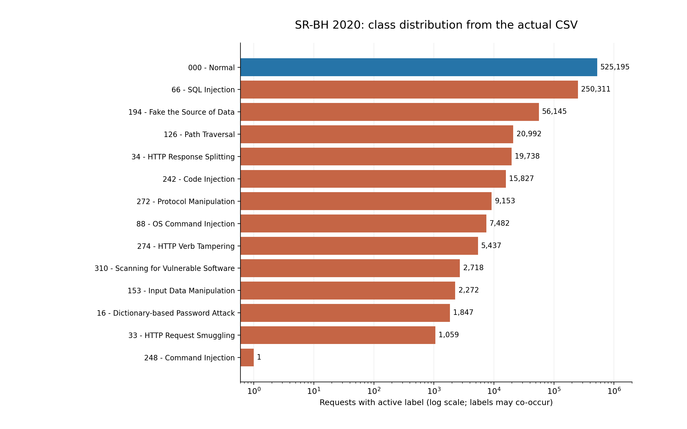
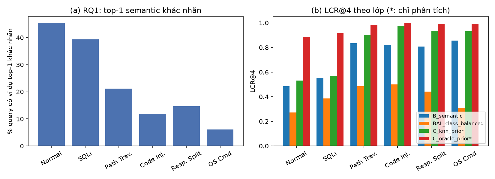
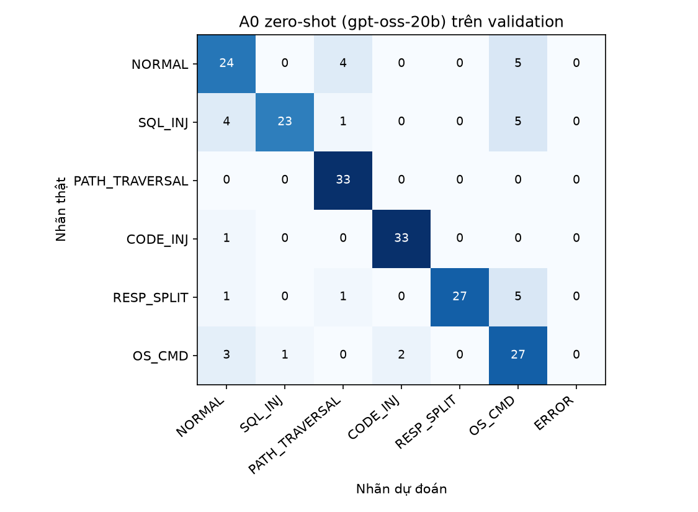

# Giải thích Chương 4 (Thực nghiệm) của báo cáo giữa kỳ

Tài liệu đọc kèm báo cáo giữa kỳ (bản `52300264_52300266_da_sua.docx`). Đi lần lượt 4.1 → 4.2 → 4.3, giải thích từng bảng, từng hình bằng lời đơn giản, rồi tóm lại **đóng góp** của báo cáo. Số trong tài liệu này đã được đối chiếu với kết quả trong repo.

---

## 0. Đọc nhanh trong 1 phút

- **Bài toán:** đưa cho LLM một HTTP request, hỏi nó thuộc lớp nào trong 6 lớp (Normal hoặc 5 loại tấn công).
- **Cách làm:** trước khi hỏi, cho LLM xem **4 ví dụ mẫu có đáp án** (gọi là *demonstrations*). Câu hỏi của đề tài: **chọn 4 ví dụ đó thế nào thì tốt nhất?**
- **Ý tưởng đề xuất (C):** đoán sơ bộ nhãn của request trước (*prior*), rồi ưu tiên ví dụ có nhãn trùng với dự đoán đó.
- **Kết quả giữa kỳ (200 request validation):**
  - Cho LLM xem 4 ví dụ **giống nhất** (B) tốt hơn hẳn không cho ví dụ nào (A0): Macro-F1 **0,893** so với **0,835**.
  - Phương pháp đề xuất C (0,882 và 0,874) **chưa vượt** B.
  - Lý do: khi đoán sơ bộ sai, C chọn nhầm ví dụ và làm LLM sai theo.
- **Đóng góp:** không phải "phương pháp mới thắng", mà là **một thí nghiệm công bằng, tái lập được**. Thí nghiệm chỉ ra *khi nào* thông tin nhãn giúp, *khi nào* hại, và nút thắt nằm ở **chất lượng của dự đoán sơ bộ**. Chi tiết ở mục 4.

---

## 1. Chương 4 trả lời câu hỏi gì?

Báo cáo đặt 3 câu hỏi nghiên cứu (RQ). Nói đơn giản:

| RQ | Câu hỏi đơn giản | Được trả lời ở đâu trong Chương 4 |
| --- | --- | --- |
| RQ1 | Ví dụ "giống nhất" có hay bị **khác nhãn** không? | Hình 4.2(a) |
| RQ2 | Ưu tiên ví dụ theo nhãn dự đoán (C) có giúp LLM phân loại đúng hơn, báo nhầm ít hơn, và tốn thêm bao nhiêu? | Bảng 4.3, phần chi phí |
| RQ3 | Khi dự đoán sơ bộ **đúng** thì sao, **sai** thì sao? | Bảng 4.4 |

---

## 2. Mục 4.1 — Dữ liệu thực nghiệm

### 2.1. Bộ dữ liệu SR-BH 2020

- Một website WordPress được đưa lên Internet **12 ngày (tháng 7/2020)**. Mọi request gửi tới đều được ghi lại bằng ModSecurity (một loại tường lửa web), rồi được gán nhãn thủ công hoặc bán tự động.
- File CSV gốc có **907.815 dòng, 38 cột, 14 cột nhãn**.
- **Đa nhãn:** một request có thể mang nhiều nhãn cùng lúc.

### 2.2. Hình 4.1 — Phân bố 14 nhãn

**Đọc hình thế nào:**

- Mỗi thanh là một nhãn; con số cuối thanh là **số request mang nhãn đó**. Ví dụ Normal có 525.195, SQL Injection có 250.311.
- **Trục ngang là thang logarit:** mỗi vạch chia lớn gấp **10 lần** vạch trước (1 → 10 → 100 → 1.000…). Vì vậy:
  - thanh dài gấp đôi **không** có nghĩa là số lượng gấp đôi;
  - Normal (525 nghìn) và HTTP Request Smuggling (1 nghìn) chênh nhau **500 lần**, nhưng nhìn hình chỉ thấy dài gấp khoảng 2 lần.
- Dùng log vì số lượng chênh quá lớn: vẽ thang thường thì các nhãn nhỏ gần như không thấy.
- **Không cộng các thanh lại** để ra tổng số request, vì một request có thể nằm ở nhiều thanh (đa nhãn).
- Có hai nhãn tên gần giống nhau: "248 – Command Injection" (chỉ 1 request) và "88 – OS Command Injection" (7.482). Đề tài dùng nhãn **88**.

**Hình này nói lên điều gì:** dữ liệu **mất cân bằng nặng**. Nếu lấy mẫu ngẫu nhiên, gần như toàn là Normal và SQLi, còn các lớp nhỏ gần như không xuất hiện. Đây là lý do nhóm phải lấy các tập con **cân bằng** (mục 2.4).

### 2.3. Lọc và chia dữ liệu

1. **Chỉ giữ request có đúng 1 nhãn** và nhãn đó thuộc 6 lớp: Normal, SQL Injection, Path Traversal, Code Injection, HTTP Response Splitting, OS Command Injection.
2. **Bỏ request trùng**, và cách ly các request giống hệt nhau nhưng bị gán nhãn khác nhau (mâu thuẫn).
3. Còn lại **466.267 request không trùng**.
4. **Chia theo nhóm (seed 42):** những request "gần như giống hệt" được gom chung một nhóm, và cả nhóm phải nằm trọn trong một tập.
   - Ví dụ: hai request chỉ khác nhau một số ID trong URL được coi là cùng nhóm.
   - Nếu một request nằm trong kho ví dụ còn "anh em sinh đôi" của nó nằm trong tập kiểm tra, LLM chỉ việc chép đáp án và điểm sẽ bị **thổi phồng**. Chia theo nhóm để tránh việc này (gọi là tránh **rò rỉ dữ liệu**).

### 2.4. Bảng 4.1 — Các tập con

| Tập | Số request | Dùng để |
| --- | --- | --- |
| Pool | 3.000 (500/lớp) | "Thư viện" ví dụ có đáp án để chọn ra 4 ví dụ cho LLM. **Không** dùng để huấn luyện. |
| Development | 30 (5/lớp) | Chạy thử xem code có chạy không. |
| Validation | 200 (33–34/lớp) | So sánh các phương án ở giữa kỳ. **Toàn bộ kết quả Chương 4 tính trên tập này.** |
| Test | 300 (50/lớp) | Kiểm tra cuối kỳ, **chỉ chạy sau khi khóa cấu hình**. |

**Vài điểm cần hiểu:**

- **Vì sao lấy cân bằng (mỗi lớp gần bằng nhau)?** Để lớp nhỏ cũng có đủ mẫu mà đánh giá. Đổi lại, tỷ lệ này **không giống lưu lượng thật**, vì ngoài đời hầu hết request là Normal. Báo cáo đã ghi rõ giới hạn này.
- **Vì sao test chỉ chạy sau khi khóa cấu hình?** Giống đề thi: không được xem đề rồi mới sửa cách làm bài. Nếu nhìn kết quả test rồi chỉnh prompt hay tham số, điểm test sẽ "đẹp giả".
- **Cảnh báo về nhãn:**
  - Kiểm tra tự động cho thấy các tập không trùng nhau về ID, nội dung hay nhóm. Tuy vậy, cùng một endpoint vẫn có thể xuất hiện ở nhiều tập.
  - Quan trọng hơn: **nhãn của dataset chưa chắc đúng 100%**. Nhóm thấy một số request mang nhãn Normal nhưng chứa payload tấn công.
  - Vì vậy "điểm cao" nghĩa là **khớp với nhãn của dataset**, không phải "phát hiện đúng tấn công thật".

---

## 3. Mục 4.2 — Cài đặt thực nghiệm

### 3.1. Bảng 4.2 — Cấu hình chính, giải thích từng dòng

| Thành phần | Ý nghĩa đơn giản |
| --- | --- |
| **LLM:** `openai/gpt-oss-20b` qua Groq, temperature = 0, reasoning_effort = low, max_tokens = 1.024 | Model ngôn ngữ được gọi qua mạng. **temperature = 0** để hỏi lại cùng câu thì trả lời gần như giống nhau (ít ngẫu nhiên). **reasoning_effort = low** để model suy nghĩ ngắn, đỡ tốn tiền. |
| **Embedding:** all-MiniLM-L6-v2, vector 384 chiều, tối đa 256 token | Một model nhỏ chạy trên máy, biến mỗi request thành **một dãy 384 con số**. Hai request giống nhau thì hai dãy số "gần nhau". Model chỉ đọc khoảng 256 token đầu, nên nhóm đặt method/URI/body lên trước header để payload không bị cắt mất. |
| **Truy xuất:** pool 3.000, lấy 30 ứng viên gần nhất, chọn 4 | Với mỗi request cần phân loại: tìm 30 request giống nhất trong pool, rồi chọn ra 4 cái đưa vào prompt. |
| **Pipeline C:** λ = 0,1; prior từ kNN (5 láng giềng) hoặc từ A0 | Công thức `điểm = độ giống + 0,1 × (1 nếu nhãn ví dụ trùng prior, 0 nếu không)`. Xem ví dụ ở mục 3.2. |
| **Prompt:** cùng định nghĩa 6 lớp; mỗi ví dụ tối đa 500 ký tự | Mọi phương án dùng chung hướng dẫn, chỉ khác 4 ví dụ. Ví dụ dài quá thì cắt bớt cho rẻ; request cần phân loại thì giữ nguyên. |
| **Mốc kết quả:** validation tại commit 7123082; cấu hình khóa ngày 20/10/2026 | Ghi lại đúng phiên bản code đã chạy, để ai cũng chạy lại ra đúng số này. |

### 3.2. Các phương án được so sánh (hiểu bằng ví dụ đời thường)

Hình dung LLM là **một học sinh làm bài phân loại**, và trước mỗi câu được xem 4 "bài mẫu có lời giải":

| Phương án | Cách chọn 4 bài mẫu | Ví von |
| --- | --- | --- |
| **kNN** | Không hỏi LLM. Lấy 5 request giống nhất trong pool, bỏ phiếu nhãn (cái giống hơn được nhiều phiếu hơn). | Không làm bài, chỉ chép đáp án của 5 bài giống nhất. |
| **A0** | Không có bài mẫu nào (zero-shot). | Làm bài bằng kiến thức có sẵn. |
| **A1** | 4 bài mẫu **cố định**, câu nào cũng như nhau. | Lúc nào cũng xem đúng 4 bài mẫu đó, dù chẳng liên quan. |
| **B** | 4 bài **giống câu đang làm nhất**. | Xem 4 bài mẫu giống đề nhất. |
| **BAL** | Từ 30 bài giống nhất, lấy **luân phiên mỗi lớp một bài**. | Xem bài mẫu đủ loại, cho khỏi thiên về một loại. |
| **C-kNN** | Như B, nhưng **cộng điểm** cho bài mẫu có nhãn trùng dự đoán sơ bộ của kNN. | Đoán trước "chắc là SQLi", rồi ưu tiên xem bài mẫu SQLi. |
| **C-LLM** | Như C-kNN, nhưng dự đoán sơ bộ lấy từ A0. | Như trên, nhưng tự đoán trước bằng cách làm thử một lần không xem bài mẫu. |
| **C-oracle** | Như C, nhưng "dự đoán sơ bộ" chính là **đáp án thật**. | Phép thử "nếu đoán trước luôn đúng thì sao". **Chỉ để phân tích**, ngoài đời không làm được vì không biết đáp án. |

**Ví dụ tính điểm của C** (λ = 0,1, giả sử prior = SQLi):

- Ứng viên X: độ giống 0,94, nhãn Normal (khác prior), nên điểm = 0,94.
- Ứng viên Y: độ giống 0,90, nhãn SQLi (trùng prior), nên điểm = 0,90 + 0,1 = **1,00**.

Y được xếp trên X dù kém giống hơn. Nếu prior đúng, đó là điều tốt. Nếu prior **sai**, C sẽ kéo ví dụ sai lớp lên đầu.

Đây là **cộng điểm mềm**: ứng viên khác nhãn vẫn có thể thắng nếu giống hơn hẳn (chênh hơn 0,1). Khi λ = 0, C giống hệt B.

### 3.3. Các chỉ số đo, giải thích đơn giản

**Macro-F1 (chỉ số chính, càng cao càng tốt, tối đa 1).**

- Với mỗi lớp, tính F1, là trung bình hài hòa của hai câu hỏi:
  - *Precision:* trong những lần model nói "là lớp X", bao nhiêu lần đúng?
  - *Recall:* trong những request thật sự là X, model bắt được bao nhiêu?
- Rồi lấy **trung bình cộng 6 lớp, mỗi lớp nặng như nhau**. Nhờ vậy lớp nào bị bỏ bê cũng kéo điểm xuống.
- Ví dụ lớp Normal của A0 (lấy từ Hình 4.3):
  - model nói "Normal" 33 lần, đúng 24 lần, nên precision = 24/33 ≈ 0,73;
  - có 33 request Normal thật, bắt được 24, nên recall = 24/33 ≈ 0,73;
  - F1 của Normal ≈ **0,73**.

**FPR Normal (tỷ lệ báo động nhầm, càng thấp càng tốt).** Trong các request bình thường, bao nhiêu phần trăm bị báo là tấn công. Ví dụ: 10/33 bị báo nhầm thì FPR = 30,3%. Chỉ số này quan trọng vì báo nhầm nhiều thì người vận hành sẽ mệt và bỏ qua cảnh báo.

**LCR@4 (tỷ lệ ví dụ cùng nhãn).**

- Trong 4 ví dụ được chọn, bao nhiêu cái **cùng nhãn thật** với request? Ví dụ 3/4 thì LCR@4 = 0,75.
- Đây chỉ là **chỉ số chẩn đoán**, đo "ví dụ được chọn trông có hợp lý không". Nó không đo LLM trả lời đúng hay sai.
- LCR chỉ tính được khi đã biết đáp án, nên chỉ dùng lúc đánh giá.

**Kiểm tra độ chắc chắn: bootstrap và McNemar.**

- Với 200 câu, chênh nhau 0,01 điểm có thể chỉ là **may rủi**. Hai phép kiểm tra giúp phân biệt "khác thật" với "khác do may rủi".
- **Bootstrap (2.000 lần):**
  - bốc ngẫu nhiên lại 200 câu từ chính 200 câu đó (có lặp), tính lại chênh lệch, làm 2.000 lần;
  - lấy khoảng chứa 95% kết quả, gọi là **khoảng tin cậy 95% (CI)**;
  - **CI chứa số 0** thì chưa đủ bằng chứng để nói hai phương án khác nhau; **CI không chứa 0** thì khác nhau thật.
- **McNemar:** chỉ nhìn những câu mà hai phương án **cho kết quả khác nhau**. Ví dụ B đúng còn A0 sai ở 15 câu, ngược lại chỉ 3 câu. Lệch như vậy khó là do may rủi (p = 0,008).

**Chi phí:** số lượt gọi LLM và số token mỗi request. Token là đơn vị tính tiền của API, khoảng 3–4 ký tự tiếng Anh một token. C-LLM phải tính cả lượt chạy A0 để lấy prior, dù trong thí nghiệm nhóm dùng lại kết quả A0 đã lưu.

---

## 4. Mục 4.3 — Kết quả và thảo luận

Tất cả trên **cùng 200 request validation**. Bảy run LLM đều trả lời hợp lệ đủ 200/200 câu: không có câu nào sai định dạng hay lỗi API.

### 4.1. RQ1 — Ví dụ giống nhất có cùng nhãn không? (Hình 4.2)

**Kết quả tổng:** **23,0%** request có ví dụ giống nhất (top-1) **khác nhãn**, dù độ giống trung bình của top-1 rất cao (0,956 trên thang tối đa 1). Nói cách khác, khoảng 1/4 trường hợp "trông rất giống" nhưng thuộc lớp khác.

**Hình 4.2(a), cột bên trái, theo từng lớp:** cột càng cao thì lớp đó càng hay bị "ví dụ giống nhất mà khác nhãn".

| Lớp | Top-1 khác nhãn |
| --- | ---: |
| Normal | **45,5%** |
| SQL Injection | **39,4%** |
| Path Traversal | 21,2% |
| HTTP Response Splitting | 14,7% |
| Code Injection | 11,8% |
| OS Command Injection | 6,1% |

**Ý nghĩa:**

- Normal và SQLi là hai lớp dễ "đội lốt" nhau nhất. Một request SQLi thường chỉ là request bình thường thêm vài ký tự như `+AND+1%3D1`. Đây chính là cặp minh họa ở Hình 1.1.
- Hình này mới cho thấy **có hiện tượng**. Nó **chưa** chứng minh ví dụ khác nhãn làm LLM sai: đôi khi xem một ví dụ khác nhãn lại giúp LLM phân biệt rõ hơn.

**Hình 4.2(b), cột bên phải: LCR@4 theo lớp.** Mỗi nhóm 4 cột màu là một lớp:

- **Xanh dương (B):** khoảng 0,8 ở các lớp tấn công "dễ", nhưng chỉ khoảng **0,48 ở Normal** và **0,55 ở SQLi**. Khớp với phần (a): hai lớp này hay bị lẫn.
- **Cam (BAL):** thấp ở mọi lớp (0,27–0,50). Điều này **đúng như thiết kế**: lấy luân phiên nhiều lớp thì đương nhiên ít ví dụ cùng nhãn hơn.
- **Xanh lá (C-kNN):** cao hơn B ở hầu hết các lớp, nhưng ở Normal và SQLi chỉ nhích nhẹ (0,53 và 0,57), vì kNN hay đoán sai đúng ở hai lớp này.
- **Đỏ (C-oracle\*):** gần 1 ở mọi lớp vì dùng đáp án thật; dấu \* nghĩa là chỉ để phân tích.
  - Ở Normal và SQLi vẫn chỉ khoảng 0,89 và 0,92, do cơ chế cộng điểm mềm: ứng viên khác nhãn nhưng giống hơn hẳn vẫn có thể lọt vào top-4.

**Trung bình cả 6 lớp:**

| Phương án | LCR@4 |
| --- | ---: |
| BAL | 0,400 |
| B | 0,726 |
| C-kNN | 0,809 |
| C-LLM | 0,860 |
| C-oracle | 0,963 |

> **Hiểu sâu hơn (không có trong báo cáo, nhưng nên biết khi bị hỏi):**
>
> - Với B, chỉ 7% request **không có ví dụ cùng nhãn nào** trong 4 ví dụ. Với C-kNN, con số này tăng lên **16,5%**.
> - Lý do: khi kNN đoán sai, C kéo cả 4 ví dụ về lớp sai.
> - Vì vậy LCR **trung bình** tăng, nhưng có thêm nhiều request bị "dắt sai hoàn toàn". Đây là manh mối giải thích kết quả ở mục 4.2 bên dưới.

### 4.2. RQ2 — Kết quả phân loại cuối cùng (Bảng 4.3)

| Phương án | Macro-F1 ↑ | FPR Normal ↓ |
| --- | ---: | ---: |
| kNN (không LLM) | 0,800 | 45,5% |
| A0 (không ví dụ) | 0,835 | 27,3% |
| A1 (ví dụ cố định) | 0,814 | 27,3% |
| **B (giống nhất)** | **0,893** | 30,3% |
| BAL (luân phiên lớp) | 0,869 | 33,3% |
| C-kNN | 0,882 | 27,3% |
| C-LLM | 0,874 | 27,3% |
| C-oracle (phân tích) | 0,888 | 30,3% |

**Đọc bảng theo từng ý:**

1. **Có LLM tốt hơn không LLM:** kNN chỉ đạt 0,800 và báo nhầm tới 45,5% request Normal. LLM, kể cả khi không có ví dụ (A0), đã tốt hơn.
2. **Ví dụ phải liên quan mới có ích:**
   - B (0,893) hơn A0 (0,835) rõ ràng: CI của chênh lệch là [−0,098; −0,018], **không chứa 0**.
   - A1 dùng 4 ví dụ cố định còn **kém hơn cả A0** (0,814). Ví dụ không liên quan có thể làm LLM phân tâm.
   - Lưu ý: A1 chỉ là **một** bộ ví dụ cố định cụ thể, không đại diện cho mọi bộ cố định.
3. **Ép đủ loại lớp (BAL) không giúp:** BAL = 0,869, thấp hơn B. Trên validation, CI [−0,048; −0,004] không chứa 0, tức BAL **kém hơn B thật**.
4. **Phương pháp đề xuất C chưa vượt B:**
   - C-kNN = 0,882 (chênh −0,010, CI [−0,034; +0,009]);
   - C-LLM = 0,874 (chênh −0,019, CI [−0,047; +0,008]);
   - cả hai CI đều chứa 0, nên kết luận đúng là **"chưa có bằng chứng C tốt hơn B"**. Không được nói "C kém hơn B" hay "C bằng B".
5. **Ngay cả C-oracle (biết đáp án) cũng chưa vượt B** (0,888 so với 0,893). Đây là phát hiện quan trọng:
   - ví dụ cùng nhãn nhiều hơn (LCR 0,963 so với 0,726) **không đồng nghĩa** LLM đoán đúng hơn;
   - có thể ví dụ khác nhãn nhưng rất giống lại giúp LLM thấy rõ ranh giới giữa hai lớp.
6. **Báo nhầm:** B báo nhầm 10/33 request Normal; A0 và hai bản C báo nhầm 9/33. Chênh nhau **đúng 1 request**, quá nhỏ để kết luận.

### 4.3. Hình 4.3 — Ma trận nhầm lẫn của A0

**Cách đọc:**

- **Hàng** là nhãn thật, **cột** là nhãn model đoán.
- **Đường chéo** (từ trên trái xuống dưới phải) là các câu **đoán đúng**; màu càng đậm thì số càng lớn.
- Ô **ngoài đường chéo** là đoán nhầm. Ví dụ ô (hàng NORMAL, cột OS_CMD) = 5, nghĩa là 5 request bình thường bị đoán là OS Command Injection.
- Cột ERROR dành cho câu trả lời lỗi hoặc sai định dạng. Ở đây toàn bằng 0, tức model luôn trả lời hợp lệ.

**Hình này nói gì:**

- **Path Traversal (33/33) và Code Injection (33/34)** gần như không sai: dấu hiệu tấn công rõ, như `../../` hay `<?php`.
- **Normal chỉ đúng 24/33:** bị đoán thành Path Traversal 4 lần và OS_CMD 5 lần. Đây là 9 lần **báo động nhầm**, nên FPR = 9/33 = 27,3%.
- **SQLi chỉ đúng 23/33:** 4 lần bị cho là Normal (**bỏ sót tấn công**, loại lỗi nguy hiểm hơn), 5 lần nhầm sang OS_CMD.
- **OS_CMD là "thùng rác":** nhiều lớp khác bị đổ về OS_CMD (5 từ Normal, 5 từ SQLi, 5 từ Resp. Split). Model zero-shot hơi "nhạy" với lớp này.

Đây là kết quả của A0, **trước khi có ví dụ**. Nó cho thấy chỗ cần cải thiện, và B đã sửa được nhiều chỗ: F1 của SQLi tăng từ 0,81 lên 0,87, của OS_CMD từ 0,72 lên 0,83.

### 4.4. RQ3 — Prior đúng hay sai thì sao? (Bảng 4.4)

Nhóm so **từng request** giữa C và B, rồi chia thành hai nhóm: prior đoán đúng và prior đoán sai.

| Phương án | Prior | Số request | C sửa được lỗi của B | C làm hỏng câu B đúng |
| --- | --- | ---: | ---: | ---: |
| C-kNN | Đúng | 162 | 1 | 0 |
| C-kNN | **Sai** | 38 | **0** | **3** |
| C-LLM | Đúng | 167 | 0 | 2 |
| C-LLM | **Sai** | 33 | 2 | **4** |

**Đọc bảng:**

- Phần lớn request thì C và B cho **cùng** kết quả, nên hai cột cuối toàn số nhỏ. Bảng chỉ đếm những câu hai bên **khác nhau**.
- **Khi prior sai:**
  - C-kNN không sửa được câu nào mà làm hỏng 3 câu;
  - C-LLM sửa 2 nhưng hỏng 4;
  - vậy **prior sai thì C có hại**.
- **Khi prior đúng:** C-kNN chỉ sửa được đúng 1 câu; C-LLM còn làm hỏng 2 câu dù prior đúng.
- **Kết luận:**
  - chất lượng prior quan trọng: sai là hại;
  - nhưng prior đúng **cũng chưa chắc giúp**, vì đổi bộ ví dụ (dù đúng lớp hơn) không bảo đảm tốt hơn bộ ví dụ "giống nhất" của B.

### 4.5. Chi phí

| Phương án | Token trung bình/request | Lượt gọi LLM |
| --- | ---: | ---: |
| A0 | ≈ 637 | 1 |
| B, BAL, C-kNN | ≈ 1.500 | 1 |
| C-LLM | ≈ 2.137 (1.500 + 637 để lấy prior) | 2 |

- Thêm 4 ví dụ làm prompt dài gấp khoảng 2,3 lần, đổi lại Macro-F1 tăng từ 0,835 lên 0,893.
- C-LLM đắt nhất (gọi LLM 2 lần) mà **không tốt hơn** B.
- Độ trễ (thời gian chờ) có ghi lại nhưng **không dùng để so sánh**, vì các run chạy vào những thời điểm khác nhau; tốc độ mạng và máy chủ lúc đó khác nhau nên so không công bằng.

### 4.6. Ba điều rút ra ở giữa kỳ

1. Hiện tượng "**giống nhau nhưng khác nhãn**" có thật và tập trung ở Normal và SQLi.
2. Chọn ví dụ theo **độ giống (B)** đang tốt nhất; ví dụ cố định (A1) và ép đủ lớp (BAL) đều kém hơn.
3. Cộng điểm theo prior (C) **chưa mang lại lợi ích rõ ràng**; prior sai thì gây hại.

Báo cáo tự nêu giới hạn: chỉ **một dataset, một LLM, 200 câu validation**. Vì vậy phải chờ tập test để kết luận chắc hơn.

---

## 5. Đóng góp của báo cáo — nói sao cho đúng

### 5.1. Những gì **là** đóng góp

1. **Đo được một hiện tượng cụ thể bằng số liệu.**
   - Trên SR-BH 2020, **23%** request có "hàng xóm gần nhất" khác nhãn; ở Normal là **45,5%**, ở SQLi là **39,4%**.
   - Đây là bằng chứng định lượng cho vấn đề mà đề tài đặt ra, thay vì chỉ nói chung chung "request giống nhau có thể khác nhãn".
2. **Một thí nghiệm có đối chứng công bằng.**
   - Mọi phương án dùng chung model, prompt, số ví dụ k = 4 và cùng 30 ứng viên; chỉ khác **cách chọn ví dụ**. Nhờ vậy chênh lệch kết quả là do cách chọn ví dụ, không phải do yếu tố khác.
   - Bộ đối chứng tách riêng từng tác động: có ví dụ hay không (A0), ví dụ cố định hay theo câu hỏi (A1 với B), cân bằng lớp (BAL), dùng nhãn dự đoán (C), và mức trần khi nhãn dự đoán luôn đúng (C-oracle).
3. **Kết quả rõ ràng, có kiểm định thống kê.** Truy xuất ví dụ giống nhất (B) cải thiện rõ so với zero-shot trong miền HTTP, với CI không chứa 0. Bài KATE (Liu và cộng sự, 2022) làm trên văn bản thông thường; báo cáo **kiểm chứng lại trong miền tấn công web**.
4. **Một kết quả "âm tính" có giá trị: thêm thông tin nhãn không tự động giúp.**
   - Báo cáo chỉ ra **vì sao**: prior sai thì làm hỏng (Bảng 4.4), và LCR cao hơn không có nghĩa là đúng hơn (C-oracle không vượt B).
   - Từ đó xác định **nút thắt là chất lượng prior**, không phải công thức rerank.
   - Kết quả này giúp người khác khỏi đi vào ngõ cụt, và chỉ hướng cải tiến (prior tốt hơn, hoặc chỉ dùng prior khi đủ tự tin).
5. **Quy trình tái lập và trung thực.**
   - Code, cấu hình, kết quả từng câu đều lưu trong repo.
   - Cấu hình được **khóa trước khi chạy test**, tránh "chỉnh cho đẹp số".
   - Không bỏ câu lỗi ra khỏi phép tính.
   - Chi phí có kiểm soát (dưới 5 USD).

### 5.2. Những gì **không phải** đóng góp (đừng nói quá)

- **Không** đề xuất model mới, **không** huấn luyện model nào.
- **Không** chứng minh C tốt hơn B; số liệu hiện tại **không** ủng hộ điều đó.
- **Không** khẳng định phát hiện được "tấn công thật". Điểm số chỉ đo mức khớp với nhãn của dataset, mà nhãn này có chỗ chưa chính xác.
- Ý tưởng dùng nhãn khi chọn ví dụ **không** phải do nhóm nghĩ ra đầu tiên: CLL-RetICL (Lin và cộng sự, 2025) đã có hướng này. Đóng góp của nhóm là **kiểm chứng nó trong bài toán HTTP**, với một thiết kế đơn giản dùng prior.

### 5.3. Một câu để nói với giảng viên

> "Nhóm chưa làm cho phương pháp đề xuất thắng baseline, nhưng đã đo được hiện tượng gây khó, dựng được thí nghiệm công bằng, tái lập được, và chỉ ra bằng số liệu rằng nút thắt nằm ở chất lượng nhãn dự đoán ban đầu."

---

## 6. Sau giữa kỳ: kết quả test đã xác nhận kết luận

Chương 4 trong báo cáo chỉ có validation. Sau khi khóa cấu hình (20/10/2026), nhóm đã chạy **300 request test** (50/lớp). Kết quả **giữ nguyên các kết luận** trên. Phần này dành cho báo cáo cuối kỳ.

| Phương án | Macro-F1 validation (200) | Macro-F1 test (300) |
| --- | ---: | ---: |
| kNN | 0,800 | 0,742 |
| A0 | 0,835 | 0,834 |
| A1 | 0,814 | 0,797 |
| **B** | **0,893** | **0,881** |
| BAL | 0,869 | 0,865 |
| C-kNN | 0,882 | 0,862 |
| C-LLM | 0,874 | 0,861 |
| C-oracle | 0,888 | 0,900 |

- B vẫn tốt nhất trong các phương án dùng được ngoài thực tế. B hơn A0 có ý nghĩa thống kê.
- Trên test, khi prior **sai**, C-kNN làm hỏng **11** câu và chỉ sửa **2**; C-LLM làm hỏng 7, sửa 1. Bằng chứng "prior sai thì hại" rõ hơn hẳn validation.
- Trên test, C-oracle nhỉnh hơn B (+0,019) nhưng CI [−0,003; +0,043] vẫn chứa 0. Nếu prior tốt hơn thì **có thể** có lợi, nhưng chưa chắc chắn.
- Chạy lại với model lớn hơn (gpt-oss-120b) thì thứ tự và kết luận vẫn như cũ.

Chi tiết: [`src/artifacts/reports/test/comparison.md`](../../src/artifacts/reports/test/comparison.md), [`reports/experiments/thi_nghiem_bo_sung_120b.md`](../experiments/thi_nghiem_bo_sung_120b.md).

---

## 7. Câu hỏi giảng viên có thể hỏi, và gợi ý trả lời

| Câu hỏi | Gợi ý trả lời |
| --- | --- |
| Phương pháp đề xuất không thắng thì đề tài có ý nghĩa gì? | Xem mục 5.1: đo được hiện tượng, có thí nghiệm công bằng, và chỉ ra nút thắt là chất lượng prior. Kết quả âm tính được kiểm định thống kê vẫn là kết quả khoa học. |
| Sao không chỉnh λ cho C thắng? | λ = 0,1 được chọn **trước** khi chạy LLM. Chỉnh theo kết quả là "chỉnh cho đẹp số". Bảng quét λ cho thấy tăng λ chỉ làm LCR tăng nhẹ, và tỷ lệ request không có ví dụ đúng lớp tăng theo (16,5% → 17,5%). |
| 200 câu có ít quá không? | Đúng, nên nhóm dùng bootstrap và McNemar và không kết luận khi CI chứa 0. Tập test 300 câu cho kết luận giống validation. |
| Sao C-oracle (biết đáp án) mà không thắng B? | Ví dụ cùng nhãn chưa chắc hữu ích hơn ví dụ giống nhất. Ví dụ khác nhãn nhưng rất giống có thể giúp LLM thấy ranh giới giữa hai lớp. |
| Điểm cao có nghĩa là phát hiện tấn công thật không? | Không. Điểm đo mức khớp với nhãn dataset; một số request nhãn Normal lại chứa payload tấn công, nên nhãn có nhiễu. |
| Sao không fine-tune model? | Phạm vi đề tài là inference-only: chỉ thay đổi ví dụ trong prompt để đo riêng tác động của cách chọn ví dụ. |
