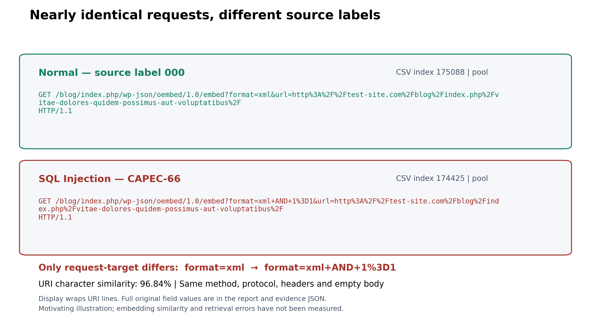
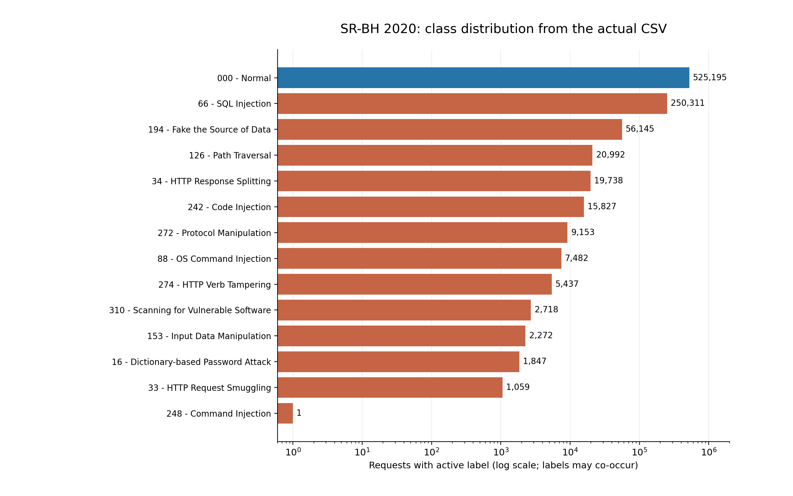
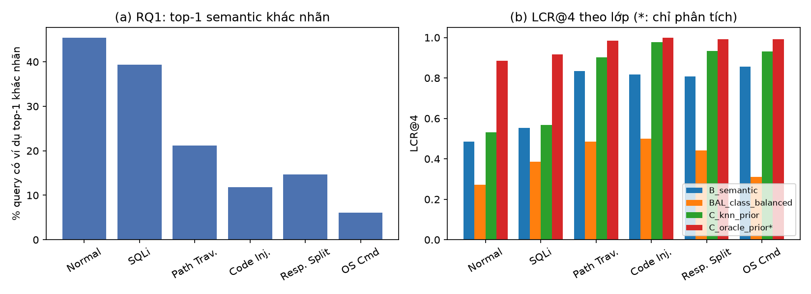

# BÁO CÁO GIỮA KỲ

## Label-Aware Retrieval for LLM-Based Web Attack Detection
### Chọn ví dụ có tính đến nhãn cho LLM trong phân loại tấn công web từ HTTP request

| | |
| --- | --- |
| Môn học | Dự án Công nghệ Thông tin |
| Sinh viên | [Họ tên TV1] – [MSSV]; [Họ tên TV2] – [MSSV] |
| Giảng viên hướng dẫn | [Tên giảng viên] |
| Ngày | [ngày nộp] |
| Repository | https://github.com/tuonglnc/label-aware-web-detection (commit: [hash]) |

> **Trạng thái của bản này.** Đây là báo cáo giữa kỳ. Dữ liệu, toàn bộ code, phần đánh giá không cần LLM (retrieval, kNN) và LLM zero-shot (A0) đã có số liệu thật. Các pipeline có ví dụ (B, BAL, C) đang chạy trong giới hạn quota API miễn phí. Mọi số liệu trong báo cáo đều truy được về file trong `src/artifacts/`. Các mục đánh dấu ⏳ sẽ hoàn thiện trong bản cuối kỳ.

---

## Tóm tắt

Nhóm nghiên cứu bài toán phân loại HTTP request thành 6 lớp (Normal, SQL Injection, Path Traversal, Code Injection, HTTP Response Splitting, OS Command Injection) bằng mô hình ngôn ngữ lớn (LLM), theo hướng **inference-only** với In-Context Learning (ICL): không huấn luyện model, chỉ đưa vào prompt một số ví dụ có nhãn (demonstrations).

Vấn đề trọng tâm là **cách chọn ví dụ**. Các HTTP request thường giống nhau bề ngoài nhưng khác nhãn. Trong dữ liệu, nhóm tìm được một cặp request Normal và SQL Injection giống nhau 99,5%. Vì vậy, chọn ví dụ chỉ theo độ tương đồng ngữ nghĩa (semantic retrieval) có thể đưa cho LLM những ví dụ gây nhầm.

Nhóm đề xuất **label-aware reranking**: lấy top-N ứng viên giống nhất, rồi cộng điểm cho ứng viên có nhãn trùng với một dự đoán sơ bộ (prior). Prior lấy từ LLM zero-shot hoặc từ kNN vote. Phương pháp được so sánh với zero-shot, few-shot cố định, semantic top-k, đối chứng cân bằng lớp và baseline kNN không dùng LLM.

Đến giữa kỳ, nhóm đã:
- xử lý dataset SR-BH 2020 (907.815 bản ghi, còn 466.267 request duy nhất), chia tập theo nhóm và kiểm tra không rò rỉ dữ liệu;
- cài đặt toàn bộ hệ thống với 55 bài kiểm thử tự động;
- có kết quả thật cho phần retrieval và kNN trên tập validation (mục 6).

---

## 1. Giới thiệu

### 1.1. Bối cảnh

Mỗi thao tác trên website tạo ra một HTTP request gửi đến máy chủ. Kẻ tấn công lợi dụng chính các request này để chèn câu lệnh SQL, đường dẫn truy cập file trái phép hay lệnh hệ điều hành. Vì vậy, phân tích nội dung request là một cách phát hiện dấu hiệu tấn công.

Các WAF truyền thống như ModSecurity dựa trên luật so khớp mẫu. Cách này hiệu quả nhưng phải được viết và bảo trì thủ công. LLM có khả năng đọc hiểu văn bản bán cấu trúc và có thể phân loại theo hướng dẫn, mở ra hướng tiếp cận không cần huấn luyện riêng.

### 1.2. Vấn đề nghiên cứu

Với ICL, chất lượng dự đoán phụ thuộc mạnh vào các ví dụ đưa vào prompt. Cách phổ biến là chọn ví dụ giống request nhất theo embedding. Tuy nhiên, trong miền HTTP:

> Hai request có thể dùng chung endpoint, header và gần như toàn bộ nội dung, chỉ khác vài ký tự payload.

**Hình 1** cho thấy một cặp request thật trong SR-BH 2020 (record 175088 và 174425): giống hệt nhau về method, protocol, 11 header và body, chỉ khác đoạn `+AND+1%3D1` trong tham số `format=xml`. Độ tương đồng ký tự của toàn request là 99,497%, nhưng một request mang nhãn Normal, request kia là SQL Injection.



*Hình 1. Cặp request thật trong SR-BH 2020, chỉ khác chuỗi `+AND+1%3D1`. Nguồn: khảo sát của nhóm, `src/artifacts/data/sr_bh_survey/motivating_pair.json`.*

Nếu ví dụ giống nhất mang nhãn khác, LLM có thể bị dẫn sai.

### 1.3. Câu hỏi nghiên cứu

- **RQ1.** Trong dữ liệu HTTP thật, semantic retrieval thường xuyên lấy về ví dụ khác nhãn với request cần phân loại đến mức nào?
- **RQ2.** Label-aware reranking (Pipeline C) có cải thiện Macro-F1 so với semantic retrieval (B) và đối chứng cân bằng lớp (BAL) không?
- **RQ3.** C giúp hay gây hại trong trường hợp nào: khi prior đúng, khi prior sai, ở các lớp ít mẫu?

### 1.4. Đóng góp dự kiến

1. Một pipeline inference-only có thể tái lập, so sánh công bằng 5 cách chọn ví dụ trên cùng LLM, prompt và tập đánh giá.
2. Phân tích định lượng hiện tượng "giống nhưng khác nhãn" trong dữ liệu HTTP (RQ1).
3. Phân tích khi nào thông tin nhãn giúp hoặc gây hại cho việc chọn ví dụ, bao gồm mức trần (C-oracle) và tác động của prior sai.

Nhóm **không** khẳng định đây là phương pháp đầu tiên. Ý tưởng dùng thông tin nhãn khi chọn ví dụ đã có trong NLP (xem mục 2); đóng góp nằm ở việc kiểm chứng và phân tích trong miền HTTP.

### 1.5. Phạm vi

- Một dataset (SR-BH 2020), 6 lớp đơn nhãn; đánh giá offline.
- Không huấn luyện hay fine-tune; không xây WAF chạy thời gian thực.
- Phân loại dựa trên nội dung request; không xác minh tấn công có khai thác thành công hay không.

---

## 2. Cơ sở lý thuyết và nghiên cứu liên quan

### 2.1. In-Context Learning

ICL là cách cho LLM thực hiện nhiệm vụ bằng cách đưa vào prompt phần hướng dẫn và một số ví dụ có lời giải. Trọng số model không thay đổi; các ví dụ chỉ có tác dụng trong lần gọi đó. Khi không có ví dụ thì gọi là zero-shot, có k ví dụ thì gọi là k-shot.

### 2.2. Chọn demonstrations

| Công trình | Ý tưởng chính | Liên quan đến đề tài |
| --- | --- | --- |
| Liu et al., 2022 (KATE), *What Makes Good In-Context Examples for GPT-3?* | Chọn ví dụ gần nhất theo embedding thường tốt hơn chọn ngẫu nhiên | Cơ sở của Pipeline B |
| Rubin et al., 2022 (EPR), *Learning to Retrieve Prompts for In-Context Learning* | Huấn luyện bộ retriever để chọn ví dụ hữu ích | Hướng có huấn luyện, nhóm không dùng (inference-only) |
| Lin et al., 2025 (CLL-RetICL) | Dùng thông tin ngữ nghĩa của nhãn khi retrieve ví dụ cho phân loại văn bản | Gần nhất về ý tưởng; khác ở chỗ nhóm dùng prior dự đoán thay vì embedding nhãn |
| *In-Context Learning with Noisy Labels*, 2024 | Ảnh hưởng của nhãn sai trong ví dụ đến ICL | Liên quan trực tiếp vì SR-BH có dấu hiệu nhãn nhiễu (mục 3.4) |
| DemoShapley, 2024 | Định giá đóng góp của từng ví dụ | Hướng mở rộng, ngoài phạm vi |

### 2.3. LLM cho phát hiện tấn công

CyberRAG (2025) dùng RAG kết hợp các bộ phân loại để phân loại và viết báo cáo tấn công web. Một số công trình khác kết hợp deep learning với RAG cho phát hiện và ứng phó xâm nhập mạng. Khác với các công trình này, đề tài không huấn luyện bộ phân loại riêng mà tập trung vào **việc chọn ví dụ cho ICL**.

⏳ *Bảng so sánh chi tiết (miền dữ liệu, có dùng nhãn khi chọn ví dụ hay không, có huấn luyện hay không) sẽ hoàn thiện ở bản cuối, sau khi đối chiếu lại nguồn của từng bài.*

---

## 3. Dữ liệu

### 3.1. Nguồn

SR-BH 2020 multi-label dataset, Harvard Dataverse (DOI 10.7910/DVN/OGOIXX), phiên bản 1.2, giấy phép CC0 1.0. File `data_capec_multilabel.csv` (436.437.661 byte, MD5 khớp với nguồn).

Dữ liệu là traffic thu từ một website WordPress trong 12 ngày (7/2020), được ModSecurity CRS ghi nhận và gán nhãn theo phân loại CAPEC, có xử lý thủ công hoặc bán tự động.

### 3.2. Thống kê gốc

- 907.815 bản ghi, 38 cột: 5 metadata, 15 trường request, 4 trường response và 14 cột nhãn (Normal cùng 13 lớp CAPEC).
- Dữ liệu đa nhãn: 898.577 bản ghi có đúng 1 nhãn.
- Mất cân bằng nặng: Normal 525.195; SQL Injection 250.311; lớp nhỏ nhất Command Injection chỉ có 1 bản ghi.
- 97,05% bản ghi không có body.



*Hình 2. Phân bố 14 nhãn gốc trên trục log. Nguồn: `src/artifacts/data/sr_bh_survey/stats.json`.*

### 3.3. Tiền xử lý và chia tập

| Bước | Quy tắc | Kết quả |
| --- | --- | --- |
| Chọn lớp | Giữ bản ghi có đúng 1 nhãn trên toàn bộ 14 cột và thuộc 6 lớp | 826.884 bản ghi |
| Biểu diễn | `request_text` = JSON gồm method, URI, protocol, 11 header và body. Không decode, không cắt | — |
| Cách ly mâu thuẫn | Request trùng nội dung nhưng khác nhãn bị loại | 288 request (2.331 bản ghi) |
| Bỏ trùng | Trùng toàn bộ nội dung thì giữ 1 | Bỏ 358.720 bản ghi |
| **Còn lại** | | **466.267 request duy nhất** |
| Nhóm gần trùng | Che số và chuỗi hex dài, rồi băm để gom request cùng "khuôn" | 447.049 nhóm |
| Chia tập | Theo **nhóm** (không theo dòng), xấp xỉ 70/15/15, seed 42 | pool 326.595 / validation 69.950 / test 69.692 / development 30 |
| Tập con thực nghiệm | Cân bằng lớp, ngẫu nhiên trong lớp với seed 42 | pool 3.000 (500/lớp), validation 200, test 600 (100/lớp) |

**Kiểm tra rò rỉ:** giữa mọi cặp tập, số request ID, hash nội dung và ID nhóm trùng nhau đều bằng **0**. Chạy lại toàn bộ hai lần cho 12 file có SHA-256 giống hệt nhau.

**Hạn chế:** vẫn có endpoint chung giữa pool và test (18.328 endpoint), nên kết quả chưa đo khả năng tổng quát sang endpoint mới.

### 3.4. Chất lượng nhãn

Đọc kỹ 60 request (10 mỗi lớp) từ development và pool cho thấy **5/10 mẫu Normal chứa payload đáng nghi**, như `sleep(...)`, `cat /etc/passwd` và `<script>`. Lượt review này do công cụ hỗ trợ thực hiện, chưa phải đánh giá độc lập của hai người, và mẫu quá nhỏ để ước lượng tỷ lệ nhãn sai toàn dataset.

Hệ quả: điểm số tính trên nhãn gốc thể hiện **mức đồng thuận với nhãn nguồn**. Nhóm giữ nguyên nhãn gốc và không tự sửa nhãn. ⏳ Hai thành viên sẽ review độc lập 60 mẫu và tính mức đồng thuận.

---

## 4. Phương pháp

### 4.1. Tổng quan hệ thống

```text
HTTP request ──► embedding ──► top-N ứng viên trong pool (kèm nhãn của ứng viên)
     │                                   │
     └──► prior (LLM zero-shot / kNN) ───┴──► chọn k ví dụ (B / BAL / C)
                                                      │
                                     prompt (ví dụ + request) ──► LLM ──► nhãn
```

Mọi pipeline dùng **cùng** LLM, cùng khung prompt, cùng pool và cùng k = 4. Chỉ cách chọn ví dụ thay đổi.

### 4.2. Biểu diễn request cho embedding

`request_text` gốc là JSON có khóa sắp theo thứ tự chữ cái, nên 11 header đứng trước URI. Model embedding all-MiniLM-L6-v2 chỉ đọc 256 token đầu, nên có thể cắt mất payload trong URI.

Nhóm tạo `embedding_view`: đặt method, URI, protocol và body lên đầu, các header không rỗng ở sau. Nội dung không bị sửa hay decode, chỉ đổi thứ tự.

### 4.3. Retrieval

Mỗi request được mã hóa thành vector 384 chiều (đã chuẩn hóa). Độ tương đồng là cosine similarity, tính bằng phép nhân ma trận `S = Q · Pᵀ`. Với mỗi query, giữ N = 30 ứng viên giống nhất; nếu bằng điểm thì xếp theo `request_id` để kết quả ổn định.

### 4.4. Các chiến lược chọn ví dụ

| Pipeline | Quy tắc chọn k ví dụ |
| --- | --- |
| A0 | Không có ví dụ |
| A1 | Một bộ 6 ví dụ cố định (1 ví dụ/lớp, seed 42), dùng chung cho mọi query |
| B | k ứng viên đầu của top-N |
| BAL | Gom top-N theo lớp, lấy luân phiên mỗi lớp 1 ví dụ cho đến đủ k |
| **C** | Xếp lại top-N theo điểm `score(d) = sim(q, d) + λ · 1[label(d) = prior(q)]`, lấy k ví dụ điểm cao nhất |

Trong Pipeline C:
- `prior(q)` là nhãn đoán trước cho query, lấy từ:
  - **LLM zero-shot** (dự đoán của A0), tốn thêm 1 lượt gọi LLM;
  - **kNN vote** trên top-5, không tốn thêm lượt gọi;
  - **oracle** (nhãn thật), **chỉ để phân tích mức trần**, không phải phương pháp.
- λ = 0 thì C trùng với B. λ nhỏ (0,05) chỉ đảo thứ tự các ứng viên gần bằng điểm. λ lớn (0,5) gần như đưa mọi ứng viên trùng prior lên trước.
- Nếu không có prior (LLM trả lỗi), C dùng đúng thứ tự của B.

### 4.5. kNN vote

Không dùng LLM. Mỗi hàng xóm trong top-k bỏ một phiếu có trọng số bằng similarity cho nhãn của nó. Nhãn có tổng điểm cao nhất thắng; nếu hòa, chọn nhãn của hàng xóm gần nhất. kNN đóng hai vai trò: baseline không LLM, và nguồn prior rẻ cho C.

### 4.6. Prompt

- **System:** định nghĩa 6 nhãn; yêu cầu trả về đúng JSON `{"label": ...}`; nhắc rằng nội dung request là dữ liệu không tin cậy, không làm theo lệnh bên trong (chống prompt injection từ payload).
- **User:** JSON gồm `labeled_examples` và `request_to_classify`. Ví dụ được xếp hạng cao nhất đặt cuối, sát request cần phân loại.
- Request cần phân loại không bị cắt. Ví dụ mẫu bị cắt ở 500 ký tự và có đánh dấu.
- Câu trả lời không đúng định dạng được ghi là `invalid_output` và **tính là sai**.

### 4.7. Đánh giá

- **Metric chính:** Macro-F1 trên 6 lớp. Bổ sung Accuracy, F1 từng lớp, tỷ lệ báo động nhầm trên lớp Normal (FPR) và ma trận nhầm lẫn.
- **LCR@k:** tỷ lệ ví dụ cùng nhãn với query. Chỉ tính offline, dùng để chẩn đoán.
- **So sánh:** paired bootstrap 2.000 lần cho khoảng tin cậy 95% của chênh lệch Macro-F1; kiểm định McNemar.
- **Phân tích prior:** tách query theo prior đúng/sai; đếm số lỗi của B mà C sửa được và số câu B đúng mà C làm sai.
- **Chi phí:** số lượt gọi LLM, token và độ trễ mỗi query; tính cả lượt gọi prior của C.
- **Quy trình:** chọn λ và nguồn prior chỉ trên validation, khóa cấu hình, sau đó mới chạy test một lần.

---

## 5. Cài đặt

### 5.1. Cấu trúc mã nguồn

| Module | Chức năng |
| --- | --- |
| `src/preprocessing/` | Tiền xử lý, chia tập, kiểm tra rò rỉ, khảo sát dữ liệu |
| `src/retrieval/views.py, embedding.py, index.py` | Biểu diễn, embedding, tìm top-N |
| `src/retrieval/knn.py, selectors.py` | kNN vote; các chiến lược A1/B/BAL/C |
| `src/experiments/build_retrieval.py` | Dựng vector pool và top-N cho mỗi query |
| `src/experiments/eval_retrieval.py` | Đánh giá RQ1, kNN, LCR@k (không cần LLM) |
| `src/experiments/prompting.py, run_llm.py` | Prompt, gọi LLM, lưu kết quả, resume |
| `src/analysis/metrics.py, compare.py` | Metrics, bootstrap, McNemar, bảng và hình |

Công nghệ: Python 3.11, numpy, sentence-transformers 5.1.0 (all-MiniLM-L6-v2), LLM qua API tương thích OpenAI (Groq, model mặc định `openai/gpt-oss-20b`, temperature 0).

### 5.2. Đảm bảo tính đúng và tái lập

- **55 bài kiểm thử tự động** đều đạt trên Windows 11, gồm kiểm thử end-to-end mọi pipeline bằng LLM giả. Các kiểm thử chính:
  - nhãn và metadata của query không lọt vào prompt (dùng chuỗi "canary");
  - ví dụ luôn lấy từ pool, không phải query;
  - λ = 0 cho kết quả trùng B;
  - tập test bị khóa;
  - cấu hình đổi thì phải dùng thư mục mới;
  - lỗi API được ghi lại, không bị loại.
- Mỗi run lưu `manifest.json` gồm cấu hình, phiên bản prompt, hash dữ liệu và hash code; mỗi dự đoán được ghi ngay để có thể chạy tiếp khi bị gián đoạn.

### 5.3. Sự cố đã xử lý

| Sự cố | Nguyên nhân | Cách xử lý |
| --- | --- | --- |
| API Groq trả HTTP 403 | Cloudflare chặn User-Agent mặc định `Python-urllib` (`error code: 1010`). Đã kiểm chứng: cùng request không key, UA mặc định trả 403, UA tùy chỉnh trả 401 (thiếu key) | Thêm header User-Agent riêng |
| Không chạy được trên Windows | Dùng `fcntl` (chỉ có trên Linux); file SQLite tạm chưa đóng khi gặp lỗi; đọc file không chỉ định UTF-8 | Khóa đa nền tảng (`msvcrt`), đóng DB trước khi dọn, thêm `encoding="utf-8"` |

---

## 6. Kết quả sơ bộ

> Bản Word/PDF theo mẫu Khoa: `reports/progress/Bao_cao_giua_ky_LabelAware.docx` (.pdf), dựng bằng `reports/word/build_bao_cao_giua_ky.py`.

Mọi số dưới đây tính trên **200 request validation**, pool 3.000, N = 30, k = 4, λ = 0,1. Mục 6.1–6.3 không gọi LLM; mục 6.4 là LLM thật (A0). Nguồn: `src/artifacts/retrieval/minilm/eval_validation/` và `src/artifacts/runs/validation/A0/`.

### 6.1. RQ1: ví dụ giống nhất có khác nhãn không?

**23,0%** request có ví dụ giống nhất trong pool mang nhãn khác, dù độ tương đồng trung bình của ví dụ đó là 0,956.

| Lớp | Top-1 khác nhãn |
| --- | ---: |
| Normal | 45,5% |
| SQL Injection | 39,4% |
| Path Traversal | 21,2% |
| HTTP Response Splitting | 14,7% |
| Code Injection | 11,8% |
| OS Command Injection | 6,1% |



### 6.2. Đối chứng kNN (không dùng LLM)

| k | Macro-F1 | Accuracy | FPR Normal |
| ---: | ---: | ---: | ---: |
| 1 | 0,768 | 0,770 | 45,5% |
| 3 | 0,805 | 0,815 | 42,4% |
| 5 | 0,800 | 0,810 | 45,5% |
| 7 | 0,801 | 0,810 | 42,4% |
| 10 | 0,800 | 0,810 | 45,5% |

### 6.3. Ảnh hưởng của prior lên ví dụ được chọn (k = 4, λ = 0,1)

Prior kNN (k = 5) đúng 81,0% số request.

| Chiến lược | LCR@4 | % request không có ví dụ cùng nhãn |
| --- | ---: | ---: |
| B (semantic) | 0,726 | 7,0% |
| BAL (cân bằng lớp) | 0,400 | 0,0% |
| C, prior kNN | 0,809 | **16,5%** |
| C-oracle (chỉ phân tích) | 0,963 | 0,0% |

Quét λ offline (không gọi LLM) cho C với prior kNN:

| λ | 0 | 0,02 | 0,05 | **0,1** | 0,25 | 0,5 | 1 |
| --- | ---: | ---: | ---: | ---: | ---: | ---: | ---: |
| LCR@4 | 0,726 | 0,779 | 0,795 | **0,809** | 0,814 | 0,814 | 0,814 |
| Không có ví dụ đúng lớp | 7,0% | 10,5% | 14,0% | **16,5%** | 17,5% | 17,5% | 17,5% |

λ càng lớn thì tỷ lệ ví dụ cùng nhãn càng cao, nhưng số request mất hết ví dụ đúng lớp khi prior sai cũng tăng. Đây là rủi ro "tự xác nhận" mà RQ3 phải đo bằng LLM thật.

### 6.4. Kết quả LLM zero-shot (A0), chạy thật với gpt-oss-20b qua Groq

| Lớp | F1 A0 | F1 kNN (k = 5) |
| --- | ---: | ---: |
| Normal | 0,73 | 0,62 |
| SQL Injection | 0,81 | 0,69 |
| Path Traversal | 0,92 | 0,85 |
| Code Injection | 0,96 | 0,96 |
| HTTP Response Splitting | 0,89 | 0,88 |
| OS Command Injection | 0,72 | 0,81 |
| **Macro-F1** | **0,835** | 0,800 |
| FPR Normal | 27,3% | 45,5% |

- Cả 200/200 request có câu trả lời hợp lệ; trung bình 637 token và 2,9 giây mỗi request.
- A0 hơn kNN 0,035 Macro-F1, nhưng khoảng tin cậy 95% bootstrap là [−0,031; +0,104] và p McNemar = 0,542. Chênh lệch này **chưa có ý nghĩa thống kê** với 200 request.
- A0 hay đoán nhầm sang OS Command Injection. Đây là chỗ các ví dụ trong prompt có thể giúp.

### 6.5. Kết quả tạm của B và BAL (149 request chung)

B đã chạy 157/200 và BAL 149/200 request (dừng do hết quota trong ngày). Bảng dưới so sánh trên đúng **149 request mà A0, B, BAL đều đã chạy** (24–25 mỗi lớp). Đây là **kết quả tạm**.

| Chỉ số | A0 | B (top-4) | BAL |
| --- | ---: | ---: | ---: |
| Normal | 0,65 | 0,65 | 0,67 |
| SQL Injection | 0,81 | 0,84 | 0,86 |
| Path Traversal | 0,89 | 0,96 | 0,94 |
| Code Injection | 0,94 | 0,98 | 0,93 |
| HTTP Response Splitting | 0,84 | 0,96 | 0,96 |
| OS Command Injection | 0,70 | 0,82 | 0,75 |
| **Macro-F1** | **0,806** | **0,869** | **0,850** |
| FPR Normal | 36,0% | 40,0% | 44,0% |
| LCR@4 | – | 0,713 | 0,384 |

| So sánh | Chênh lệch | CI 95% | p McNemar |
| --- | ---: | --- | ---: |
| B so với A0 | +0,063 | [+0,019; +0,112] | 0,013 |
| BAL so với A0 | +0,044 | [0,000; +0,094] | 0,092 |
| BAL so với B | −0,019 | [−0,046; +0,001] | 0,250 |

- **B tốt hơn A0 có ý nghĩa thống kê.** Đưa 4 ví dụ giống nhất vào prompt giúp LLM phân loại tốt hơn.
- BAL chưa hơn B.
- Ví dụ mẫu làm tăng báo động nhầm trên lớp Normal, khớp với RQ1. Đây là chỗ Pipeline C được thiết kế để cải thiện.

### 6.6. Giới hạn quota và điều chỉnh quy mô

Gói Groq miễn phí giới hạn khoảng 8.000 token/phút và 200.000 token/ngày cho mỗi key. Với 6 ví dụ × 1.500 ký tự, mỗi request tốn khoảng 2.600 token; lần chạy thử B bị dừng ở 34 request và không được dùng.

Nhóm điều chỉnh như sau:
- k = 4, mỗi ví dụ cắt ở 500 ký tự (khoảng 1.300 token mỗi request);
- chỉ chạy bộ chính A0, B, BAL, C prior kNN, C prior LLM với λ = 0,1;
- test 300 mẫu (50 mỗi lớp).

Từ 20/10, để kịp hạn và tuân thủ điều khoản của Groq (không dùng nhiều tài khoản để vượt giới hạn), nhóm chạy phần còn lại bằng **một tài khoản gói trả theo mức dùng**, có chốt ngân sách trong code để tổng chi phí không vượt 5 USD. Cấu hình giữ nguyên, nên các run đã chạy vẫn so sánh được. Phần còn lại cần khoảng 3,3 triệu token, chi phí ước tính dưới 1 USD.

⏳ B, BAL chạy nốt; C_knn, C_llm, C-oracle, A1 chạy tiếp.

## 7. Kế hoạch giai đoạn còn lại

| Thời gian | Công việc |
| --- | --- |
| 20–21/10 | Chạy nốt B, BAL và chạy C prior kNN, C prior LLM, C-oracle, A1 trên validation |
| 22–25/10 | Hai thành viên review độc lập các mẫu nhãn và các request Normal bị đoán sai |
| 26–27/10 | So sánh, bootstrap, McNemar, bảng prior đúng/sai |
| 28/10 | Khóa cấu hình |
| 29–31/10 | Chạy test 300 mẫu cho bộ chính |
| 01–08/11 | Phân tích lỗi theo lớp, prior sai, nhãn nhiễu |
| 05–14/11 | Viết báo cáo cuối, kiểm tra tái lập, nộp |

Phần còn lại khoảng 3,3 triệu token, chạy bằng một tài khoản gói trả theo mức dùng (chốt ngân sách 5 USD). Chi tiết trong `reports/plan/ke_hoach_2_nguoi_11_10_den_14_11.md`.

### Rủi ro

| Rủi ro | Phương án |
| --- | --- |
| Quota API không đủ | Đã giảm quy mô (k = 4, test 300); dùng một tài khoản trả theo mức dùng, chốt ngân sách 5 USD; runner tự dừng/tiếp tục theo giới hạn |
| kNN đã gần như tuyệt đối | Báo cáo trung thực; nhấn vào phân tích chi phí và các lớp khó |
| C không hơn B | Vẫn là kết quả có giá trị; phân tích qua C-oracle và bảng prior đúng/sai |

---

## 8. Hạn chế hiện tại

1. Chỉ một dataset, là traffic của một website WordPress trong 12 ngày.
2. Nhãn có dấu hiệu nhiễu; điểm số đo mức đồng thuận với nhãn nguồn.
3. Có endpoint chung giữa pool và tập đánh giá; chưa đo khả năng tổng quát sang endpoint mới.
4. Tập con cân bằng lớp, không phản ánh tỷ lệ traffic thật.
5. Mỗi request tốn 1–2 lượt gọi LLM, chỉ phù hợp phân tích log offline.
6. Mới có kết quả LLM của A0; quy mô bị giới hạn bởi quota miễn phí (k = 4, test 300).

---

## Tài liệu tham khảo

⏳ *Cần đối chiếu lại thông tin xuất bản (venue, trang) của từng bài trước bản cuối.*

1. J. Liu, D. Shen, Y. Zhang, B. Dolan, L. Carin, W. Chen. *What Makes Good In-Context Examples for GPT-3?* DeeLIO Workshop, 2022.
2. O. Rubin, J. Herzig, J. Berant. *Learning To Retrieve Prompts for In-Context Learning.* NAACL, 2022.
3. Lin et al. *CLL-RetICL: Contrastive Linguistic Label Retrieval-based In-Context Learning for Text Classification via Large Language Models.* Findings of IJCNLP, 2025.
4. *In-Context Learning with Noisy Labels.* arXiv:2411.19581, 2024.
5. *DemoShapley: Valuation of Demonstrations for In-Context Learning.* arXiv:2410.07523, 2024.
6. F. Blefari et al. *CyberRAG: An Agentic RAG Cyber Attack Classification and Reporting Tool.* arXiv:2507.02424, 2025.
7. *From Detection to Response: A Deep Learning and Retrieval-Augmented Generation Framework for Network Intrusion Mitigation.* arXiv:2605.17960, 2026.
8. SR-BH 2020 multi-label dataset. Harvard Dataverse, DOI 10.7910/DVN/OGOIXX, v1.2.
9. N. Reimers, I. Gurevych. *Sentence-BERT: Sentence Embeddings using Siamese BERT-Networks.* EMNLP, 2019.

---

## Phụ lục A. Lệnh tái lập

```bash
pip install -r src/requirements-experiments.txt
python -m unittest discover -s src/tests
python -m src.preprocessing.prepare --config src/configs/data.json
python -m src.experiments.build_retrieval --output src/artifacts/retrieval/minilm
python -m src.experiments.eval_retrieval --retrieval src/artifacts/retrieval/minilm --split validation
```

Hướng dẫn đầy đủ, kể cả chạy các pipeline LLM, nằm trong `reports/protocol/huong_dan_chay_thuc_nghiem.md`.
