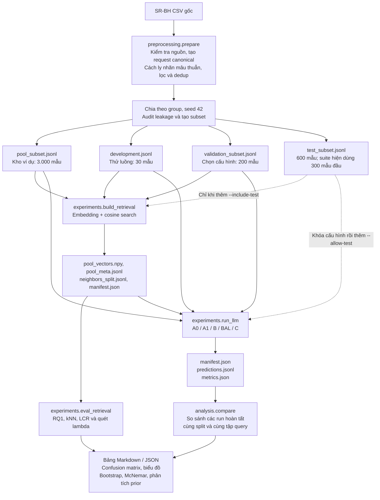
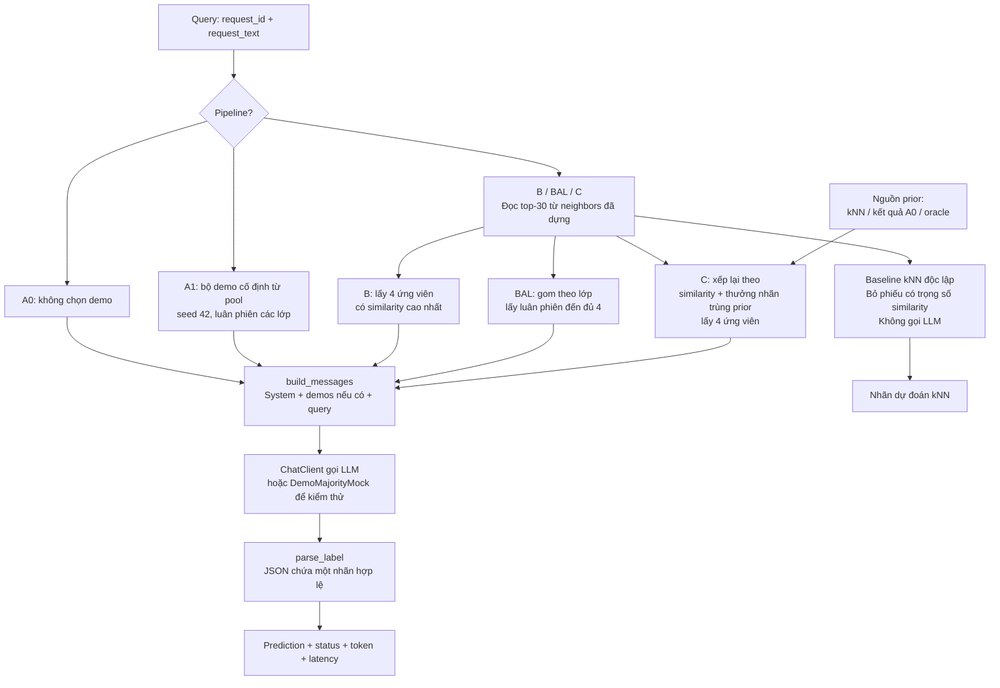
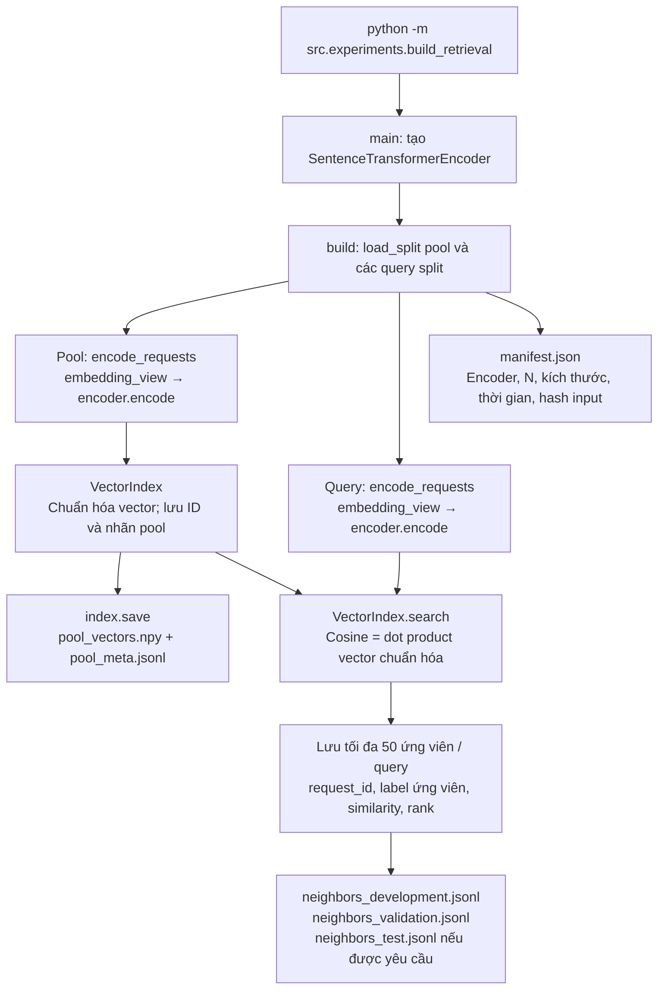
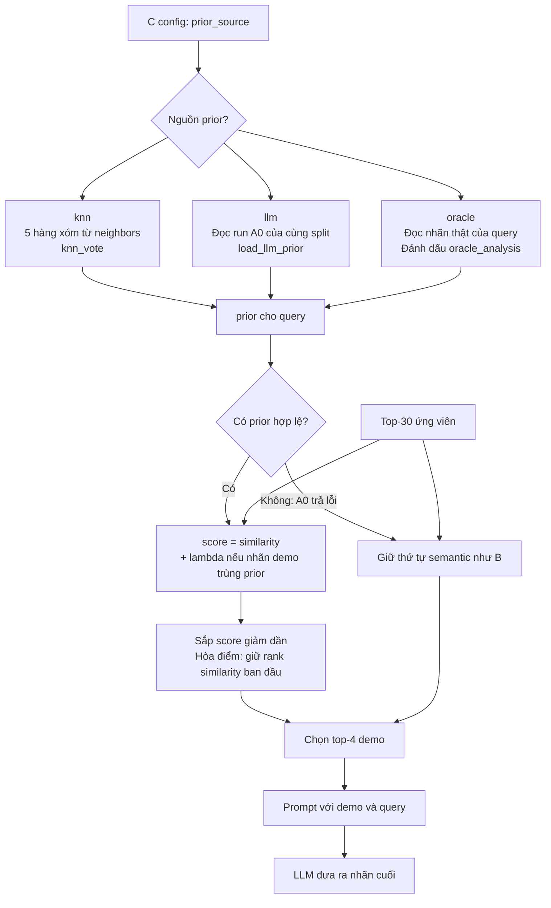
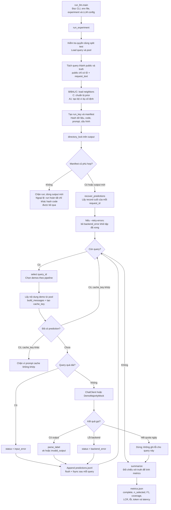
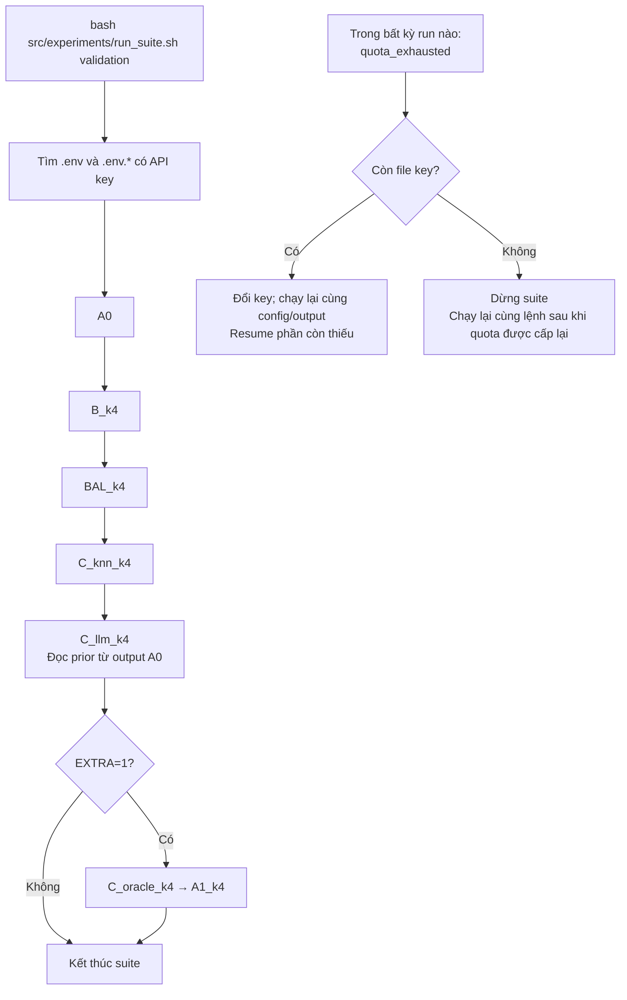
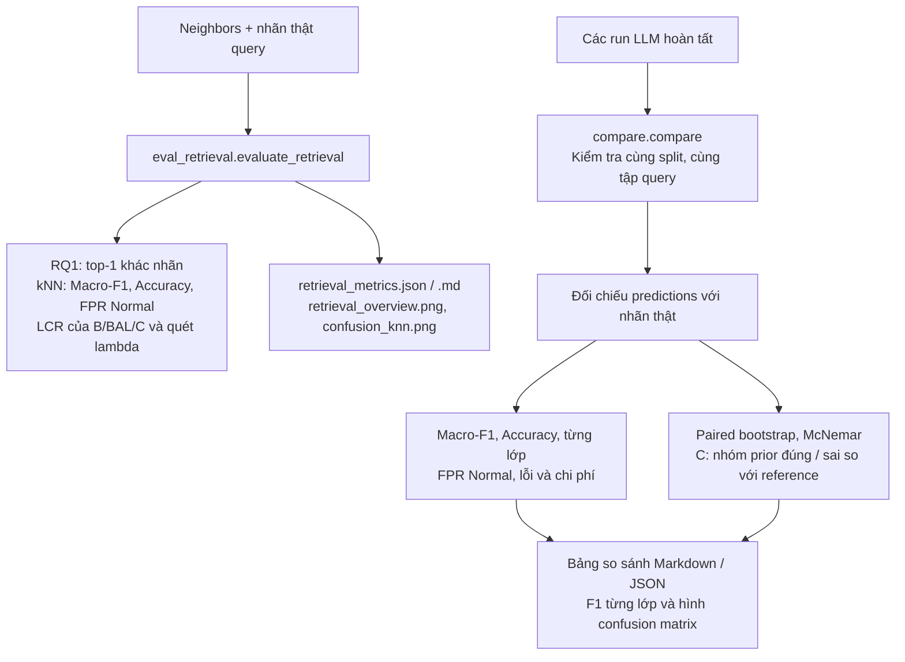

# Sơ đồ workflow, pipelines và code flow

Đối chiếu mã nguồn tại commit `cee6ed1`, ngày 20/10/2026. Đây là mô tả cách hệ thống được triển khai; sơ đồ không có nghĩa mọi thí nghiệm đã chạy xong.

Các sơ đồ dùng Mermaid, xem trực tiếp trên GitHub hoặc trong trình xem Markdown có hỗ trợ Mermaid. Trong VS Code, mở file rồi chọn **Open Preview** (`Ctrl+Shift+V`); nếu sơ đồ hiện dạng code, cần bật/cài hỗ trợ Mermaid cho Markdown Preview.

## 1. Workflow tổng thể

Mục tiêu: phân loại HTTP request thành một trong sáu nhãn. Hệ thống dùng model có sẵn để inference, không huấn luyện hoặc fine-tune. `pool` là kho ví dụ có nhãn dùng cho retrieval và in-context learning.



Đường `neighbors → run_llm` chỉ cần cho B/BAL/C. A0/A1 không cần retrieval; runner hiện vẫn đọc pool ở bước khởi tạo cho tất cả pipeline. CSIC có luồng khảo sát riêng trong `preprocessing/csic_2010.py`, chưa phải nguồn của các run SR-BH trong sơ đồ này.

| Tập | File được `experiments.data_io.load_split()` đọc | Vai trò |
| --- | --- | --- |
| pool | `src/data/processed/sr_bh_v1/pool_subset.jsonl` | Ví dụ có nhãn để chọn demonstrations |
| development | `src/data/processed/sr_bh_v1/development.jsonl` | Thử nhanh, sửa lỗi |
| validation | `src/data/processed/sr_bh_v1/validation_subset.jsonl` | Chọn prompt/cấu hình trước benchmark |
| test | `src/data/processed/sr_bh_v1/test_subset.jsonl` | Đánh giá sau khi khóa cấu hình |

## 2. Các pipeline khác nhau ở đâu?

`Query` là request cần phân loại; `demo` là ví dụ có nhãn đưa vào prompt; `prior` là nhãn dự đoán trước để định hướng chọn demo. Các pipeline LLM dùng chung khung prompt, backend và parser. A0 không có demo; các cấu hình few-shot hiện dùng `k = 4`.



| Pipeline | Hàm/chỗ triển khai | Cách chọn demo / prior | Lượt LLM cho một query mới, chưa tính retry |
| --- | --- | --- | --- |
| A0 | `run_llm.py: select()` | Danh sách demo rỗng | 1 |
| A1 | `selectors.fixed_examples()` | Một bộ cố định, ngẫu nhiên trong lớp với seed cố định | 1 |
| B | `selectors.semantic_top_k()` | Top-k theo similarity | 1 |
| BAL | `selectors.class_balanced()` | Luân phiên các lớp xuất hiện trong top-N | 1 |
| C_knn | `knn_vote()` → `label_aware_rerank()` | Prior từ 5 hàng xóm; rerank top-30 | 1 |
| C_llm | `load_llm_prior()` → `label_aware_rerank()` | Prior đọc từ predictions của A0 đã chạy | 1 lượt C; tổng A0 + C là 2 |
| C_oracle | `truth` → `label_aware_rerank()` | Prior là nhãn thật, chỉ dùng phân tích mức trần | 1 |
| kNN | `knn.knn_vote()` qua `eval_retrieval.py` | Bỏ phiếu nhãn, không dựng prompt | 0 |

Với sáu lớp và `k = 4`, A1/BAL không thể chứa đủ sáu lớp trong một prompt. BAL chỉ cân bằng trong các lớp có mặt ở top-N. kNN mặc định cộng `max(similarity, 0)` theo nhãn; hòa điểm thì ưu tiên nhãn có hàng xóm đứng trước.

## 3. Luồng retrieval: chạy trước LLM



- Encoder mặc định: `sentence-transformers/all-MiniLM-L6-v2`, tối đa 256 token.
- `embedding_view()` đưa method, URI, protocol và body lên trước headers để phần chứa payload xuất hiện sớm; không decode payload.
- Build mặc định lưu **50** hàng xóm. Các config B/BAL/C hiện chỉ dùng **30** ứng viên đầu, rồi chọn **4** demo.
- Embedding chỉ đọc `request_text`. File neighbors ghi nhãn **ứng viên trong pool**, không ghi nhãn thật của query.
- `run_llm.py` đọc file neighbors; không gọi embedding/search lại cho từng request.

## 4. Pipeline C: prior và label-aware reranking



Công thức đang dùng:

```text
score(query, demo) = cosine_similarity(query, demo)
                  + lambda * 1[demo.label == prior(query)]

lambda = 0.1; N = 30; k = 4; prior_knn_k = 5
```

Prior chỉ ảnh hưởng việc chọn demo, không được chèn thành trường prior riêng trong prompt. LLM vẫn phân loại từ nội dung query và demo. `lambda = 0` hoặc `prior = None` đưa selector C về cách chọn của B. Nếu run A0 thiếu hẳn một query, runner chặn C_llm; nếu A0 có record lỗi cho query đó, prior là `None` và dùng fallback.

## 5. Code flow của runner LLM



`complete = true` nghĩa mọi query được chọn đã có record, không đảm bảo mọi record đều `ok`. Metrics coi prediction lỗi là sai. Khi quota dừng giữa chừng, metrics chỉ tính trên các query đã có record và `complete = false`.

Prompt dùng `prompt_view()`: demo cắt sau 500 ký tự rồi thêm dấu đánh dấu truncation; query không bị cắt. Demo có rank tốt nhất được đặt cuối danh sách, gần query nhất. Query dài hơn giới hạn LLM config (hiện 32.768 ký tự) được ghi `input_error` thay vì gửi API.

## 6. Theo dấu một query B/C qua các module

```mermaid
sequenceDiagram
    participant U as CLI
    participant R as run_llm.py
    participant D as data_io.py
    participant S as selectors.py
    participant P as prompting.py
    participant C as core.ChatClient
    participant F as Artifact files
    U->>R: main → run_experiment
    R->>D: load_split + load_jsonl neighbors
    D-->>R: queries, pool, candidates
    Note over R: Tách truth; chuẩn bị prior cho C
    R->>F: Kiểm tra manifest, recover predictions
    loop Mỗi query chưa có kết quả
        R->>S: semantic_top_k / class_balanced / label_aware_rerank
        S-->>R: Demo IDs, labels, scores
        R->>P: build_messages(query, demo_rows, max_demo_chars)
        P-->>R: System + user messages
        R->>C: client(messages)
        C-->>R: raw_output, usage, attempts hoặc BackendError
        R->>P: parse_label(raw_output)
        P-->>R: Nhãn hoặc ValueError
        R->>F: Append record; flush; fsync
    end
    R->>R: summarize(records, truths, prior_usage)
    R->>F: Ghi metrics.json
    R-->>U: selected, resumed, processed_now, status_counts
```

Sơ đồ sequence mô tả đường chạy thông thường. Các nhánh lỗi, quota và cache được chi tiết ở sơ đồ runner phía trên.

## 7. Suite: thứ tự chạy và tiếp tục khi hết quota



Suite không tự preprocessing hoặc build retrieval; cần chuẩn bị trước. Các run dùng `--sleep 1 --retry-errors`. Nhánh quota áp dụng cho từng run; lỗi runner khác được script ghi nhận rồi chuyển sang run tiếp theo. Với test, script yêu cầu `test --locked` và truyền `--allow-test --limit 300` cho runner.

## 8. Luồng đánh giá và phân tích



LCR@k là tỷ lệ demo có nhãn trùng nhãn thật query, dùng để phân tích sau khi chọn demo. LCR tăng chưa đủ chứng minh chất lượng phân loại tăng. Nhãn thật query phục vụ đánh giá; chỉ C_oracle được dùng nó để chọn demo và run đó được đánh dấu riêng.

## 9. Bản đồ file để đọc code

Các đường dẫn dưới đây tính từ gốc repo; liên kết mở trực tiếp mã nguồn.

| Bước | File | Hàm/điểm cần đọc |
| --- | --- | --- |
| Chuẩn bị dữ liệu | [prepare.py](../../src/preprocessing/prepare.py) | `prepare`, `scan_csv`, `assign_groups`, `balanced_subset`, `audit_splits` |
| Kiểm chứng export | [verify.py](../../src/preprocessing/verify.py) | `verify` |
| Quy ước split | [data_io.py](../../src/experiments/data_io.py) | `SPLIT_FILES`, `load_split` |
| Hai cách trình bày request | [views.py](../../src/retrieval/views.py) | `embedding_view`, `prompt_view` |
| Embedding | [embedding.py](../../src/retrieval/embedding.py) | `encode_requests`, `SentenceTransformerEncoder` |
| Cosine search | [index.py](../../src/retrieval/index.py) | `VectorIndex.search`, `save` |
| Dựng retrieval | [build_retrieval.py](../../src/experiments/build_retrieval.py) | `main`, `build` |
| Chọn demonstrations | [selectors.py](../../src/retrieval/selectors.py) | B, BAL, C, A1 |
| kNN baseline / prior | [knn.py](../../src/retrieval/knn.py) | `knn_vote` |
| Chạy pipeline | [run_llm.py](../../src/experiments/run_llm.py) | `main`, `run_experiment`, `select`, `load_llm_prior`, `summarize` |
| Prompt / parser / mock | [prompting.py](../../src/experiments/prompting.py) | `build_messages`, `parse_label`, `DemoMajorityMock` |
| API client dùng lại từ A0 | [core.py](../../src/pipeline_a0/core.py) | `ChatClient`, `BackendError`, `recover_predictions`, `parse_output` |
| Khóa run | [locking.py](../../src/common/locking.py) | `directory_lock` |
| Chạy nhiều cấu hình | [run_suite.sh](../../src/experiments/run_suite.sh) | Thứ tự config, đổi key, resume |
| Đánh giá retrieval | [eval_retrieval.py](../../src/experiments/eval_retrieval.py) | `evaluate_retrieval` |
| Metrics và kiểm định | [metrics.py](../../src/analysis/metrics.py) | Các hàm metrics, bootstrap, McNemar |
| So sánh run | [compare.py](../../src/analysis/compare.py) | `compare`, `prior_breakdown` |

Lệnh `python -m src.pipeline_a0` là runner zero-shot/smoke có từ giai đoạn đầu. Bộ thí nghiệm A0/A1/B/BAL/C hiện đi qua `python -m src.experiments.run_llm`; nó dùng lại client và tiện ích của `pipeline_a0.core`, nhưng dùng prompt ICL chung trong `experiments.prompting`.

## 10. Đường chạy thực tế để đối chiếu sơ đồ

Chạy từ gốc repo sau khi đã cài dependency và có các split dữ liệu. Lần đầu encoder có thể cần tải model. Các lệnh dưới đây là hướng dẫn, không phải những lệnh đã được chạy để tạo tài liệu này.

```bash
# 1. Dựng neighbors cho development + validation
python -m src.experiments.build_retrieval --output src/artifacts/retrieval/minilm

# 2. Đánh giá retrieval / kNN; không gọi LLM
python -m src.experiments.eval_retrieval --retrieval src/artifacts/retrieval/minilm --split validation

# 3. Thử luồng B với mock; vẫn cần pool, development và neighbors
python -m src.experiments.run_llm --config src/configs/experiments/B_k4.json --llm src/configs/llm/mock.json --split development --output src/artifacts/runs/development/B_mock_diagram

# 4. Chạy bộ LLM thật; cần cấu hình key trong .env
bash src/experiments/run_suite.sh validation

# 5. Chỉ chạy sau khi các run chính hoàn tất trên cùng tập query
python -m src.analysis.compare --split validation --reference B_k4 --runs src/artifacts/runs/validation/A0 src/artifacts/runs/validation/B_k4 src/artifacts/runs/validation/BAL_k4 src/artifacts/runs/validation/C_knn_k4 src/artifacts/runs/validation/C_llm_k4 --output src/artifacts/reports/validation
```

`--reference` dùng tên thư mục run (`B_k4` trong suite), không phải trường `name` trong experiment config. Run dở có manifest/code không còn khớp cần output mới theo thông báo runner; không sửa manifest để ép resume.

Đọc thêm: [hướng dẫn chạy thực nghiệm](huong_dan_chay_thuc_nghiem.md), [hướng dẫn đọc và chạy code](huong_dan_doc_va_chay_code.md), [chuẩn bị dữ liệu](README.md).
