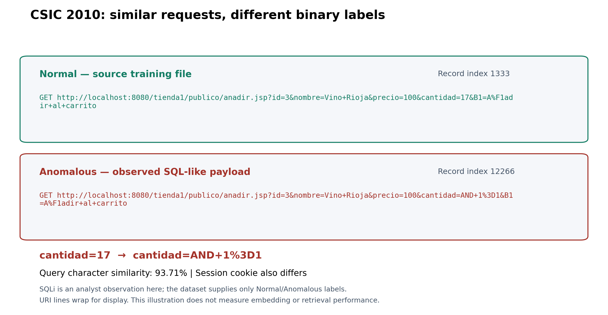

# Khảo sát HTTP Dataset CSIC 2010 trên dữ liệu thật

Ngày khảo sát: 19/10/2026. Tên chuẩn là **CSIC 2010**. Đã tải và đọc hết ba file HTTP dạng text, không dùng số liệu trên website thay cho việc đếm file.

## Nguồn, phạm vi và provenance

Trang gốc `http://www.isi.csic.es/dataset/` không truy cập được trong phiên. Dữ liệu được tải từ [mirror raw HTTP ở commit cố định](https://github.com/msudol/Web-Application-Attack-Datasets/tree/424c6e1c1951570473d9d6c0227eaaac6fdd6d02/OriginalDataSets/csic_2010), commit `424c6e1c1951570473d9d6c0227eaaac6fdd6d02`. Đây là bản mirror; chưa đối chiếu byte với một archive tải trực tiếp từ tác giả. Hash bên dưới là hash tự tính để tái lập.

[Catalog IMPACT](https://www.impactcybertrust.org/dataset_view?idDataset=940) mô tả traffic được sinh cho ứng dụng eCommerce, nhãn Normal/Anomalous, cùng train normal và hai file test. Catalog là nguồn mô tả, không phải nơi đã tải file trong phiên. Điều kiện sử dụng/giấy phép gốc chưa được xác minh đầy đủ; không suy ra license dataset từ một repository mirror.

File local ở `src/data/raw/csic_2010/`, được gitignore. [Summary](../../src/artifacts/data/csic_2010/summary.json), [ví dụ nguyên văn](../../src/artifacts/data/csic_2010/examples.json), [motivating pair](../../src/artifacts/data/csic_2010/motivating_pair.json).

| File | Byte | SHA-256 |
| --- | ---: | --- |
| `anomalousTrafficTest.txt` | 15.734.523 | `12fa4f0d496ceb859bb2652abf7f0f0ed8c59e1d9ce501b8a9a0ef38a625c046` |
| `normalTrafficTest.txt` | 20.151.204 | `f05dfc312d5d14fd1ed8371de27a9e4deab3dc09265f5d7f9df2643df8385089` |
| `normalTrafficTraining.txt` | 20.148.988 | `d51de812d9201ef2b173b6ae3e3e740c309047ac85545c06c51d6fb1ddbc1e63` |

## 1. Tổng số request

**97.065 request** khi tính cả ba file. Không có header CSV vì dữ liệu là các HTTP request nối tiếp nhau.

| File | Split nguồn | Nhãn kế thừa từ file | Request đếm thực tế |
| --- | --- | --- | ---: |
| `anomalousTrafficTest.txt` | source_test_anomalous | ANOMALOUS | 25.065 |
| `normalTrafficTest.txt` | source_test_normal | NORMAL | 36.000 |
| `normalTrafficTraining.txt` | source_train | NORMAL | 36.000 |

Riêng hai file **test** có **61.065 request**. Vì vậy số 61.065 và 97.065 có thể chỉ hai phạm vi đếm khác nhau: test-only và cả training+test. Báo cáo luôn ghi rõ phạm vi thay vì gọi cả hai là tổng dataset.

Parser tìm request line ở đầu dòng, đọc header/body boundary và kiểm Content-Length khi có. Ba file dùng UTF-8 hợp lệ và newline LF trong bản mirror này. Không có record thiếu header/body separator, không có header line không parse được và không có Content-Length mismatch theo parser đã kiểm thử. Raw bytes và offsets được giữ để kiểm chứng; đây là dump HTTP text, không phải PCAP.

## 2. Có bao nhiêu nhãn và bảng phân bố lớp?

**Hai nhãn nguồn: Normal và Anomalous. Không có attack subtype labels cho từng request trong ba file này.** Nhãn được gắn từ tên file, không phải một trường nằm trong HTTP request.

| Nhãn | Cả ba file | Chỉ source test |
| --- | ---: | ---: |
| Normal | 72.000 | 36.000 |
| Anomalous | 25.065 | 25.065 |
| **Tổng** | **97.065** | **61.065** |

Tài liệu mô tả có SQLi, XSS, CRLF, buffer overflow, information gathering, files disclosure, server-side include, parameter tampering… Nhưng không thể biến danh sách đó thành bảng support multiclass nếu không có annotation riêng. Chưa xác định được số mẫu chính xác của từng loại attack theo ground truth nguồn.

Script tìm dấu hiệu SQL/XSS để chọn ví dụ. Với bộ regex hiện tại, anomalous file có **628 record khớp SQL pattern** và **736 record khớp XSS pattern**. Đây là screening phụ thuộc pattern, có thể bỏ sót/trùng lặp; **không phải 628 SQLi và 736 XSS ground-truth classes**, không dùng để tạo benchmark multiclass. Hai normal files không khớp các pattern này, nhưng điều đó cũng không chứng minh nhãn hoàn toàn sạch.

Anomalous không đồng nghĩa mọi record là tấn công có chủ đích: tài liệu nguồn còn mô tả các request bất thường không có ý định độc hại. Không tự đổi tên toàn bộ Anomalous thành một attack subtype cụ thể.

## 3. Mất cân bằng dữ liệu

- Cả ba file: 72.000 / 25.065 ≈ **2.873 lần**.
- Chỉ source test: 36.000 / 25.065 ≈ **1.436 lần**.
- Source train chỉ có Normal; không có anomalous demonstrations nếu giữ nguyên tập training nguồn.

Ở mức **binary**, tỷ lệ test không nghiêm trọng như mất cân bằng các lớp CAPEC của SR-BH. Không thể kết luận các loại SQLi/XSS/khác cân bằng hay không vì thiếu ground-truth subtype. Không so tỷ lệ binary này trực tiếp với tỷ lệ 13 attack classes rồi kết luận CSIC tốt hơn.

## 4. Mỗi request có những trường nào?

Request line có **method, absolute URI/request-target (gồm query), HTTP protocol**. Tiếp theo là các HTTP header và body khi có; không có response trong ba file khảo sát.

| Header nguyên văn | Normal training | Normal test | Anomalous test |
| --- | ---: | ---: | ---: |
| `Accept` | 36.000 | 36.000 | 25.065 |
| `Accept-Charset` | 36.000 | 36.000 | 25.065 |
| `Accept-Encoding` | 36.000 | 36.000 | 25.065 |
| `Accept-Language` | 36.000 | 36.000 | 25.065 |
| `Cache-control` | 36.000 | 36.000 | 25.065 |
| `Connection` | 36.000 | 36.000 | 25.065 |
| `Content-Length` | 8.000 | 8.000 | 9.977 |
| `Content-Type` | 8.000 | 8.000 | 9.977 |
| `Cookie` | 36.000 | 36.000 | 25.065 |
| `Host` | 36.000 | 36.000 | 25.065 |
| `Pragma` | 36.000 | 36.000 | 25.065 |
| `User-Agent` | 36.000 | 36.000 | 25.065 |

Các giá trị header được giữ theo thứ tự dưới dạng list pairs để không làm mất duplicate headers. Header names trong bảng giữ nguyên cách viết của dump, ví dụ `Cache-control`.

Methods trên cả ba file: **GET 71.088, POST 25.580, PUT 397**. Body không rỗng có **25.977 request (26.762%)**, body rỗng 71.088. POST/PUT có thể chứa form-urlencoded payload; không được chỉ phân tích URI rồi bỏ body.

Nhãn, source file, record index, source line và byte offsets là metadata do script thêm để audit; không đưa vào prompt. `request_id` được tính từ representation request, còn `raw_sha256` tính trên byte interval gốc gồm separators trong dump. Payload percent-encoding được giữ nguyên; decode chỉ dùng để đọc/screening, không sửa raw input.

## 5. Ba ví dụ nguyên văn: Normal, SQLi và XSS

Các block dưới đây chép nguyên byte interval từ file (UTF-8), giữ URI, headers, body và newline của dump. Trường hợp không có body, các dòng trống cuối là framing trong file. Cách trình bày tên SQLi/XSS là nhận diện payload của người khảo sát; cả hai vẫn mang nhãn nguồn **Anomalous**.

### Request Normal

- File: `normalTrafficTraining.txt`; index 0-based: **0**; dòng bắt đầu 1-based: **1**.
- Byte interval `[start, end)`: `[0, 493)`.
- Source label: **NORMAL**. Raw request SHA-256: `faf410c1f2742d9e6f3f95ce9719b05455ee9b6e59f5adf9b3225448de9b7abc`.

```http
GET http://localhost:8080/tienda1/index.jsp HTTP/1.1
User-Agent: Mozilla/5.0 (compatible; Konqueror/3.5; Linux) KHTML/3.5.8 (like Gecko)
Pragma: no-cache
Cache-control: no-cache
Accept: text/xml,application/xml,application/xhtml+xml,text/html;q=0.9,text/plain;q=0.8,image/png,*/*;q=0.5
Accept-Encoding: x-gzip, x-deflate, gzip, deflate
Accept-Charset: utf-8, utf-8;q=0.5, *;q=0.5
Accept-Language: en
Host: localhost:8080
Cookie: JSESSIONID=1F767F17239C9B670A39E9B10C3825F4
Connection: close


```

Nhãn Normal được kế thừa từ file training. URI mở trang index; không có body. Việc một payload xuất hiện trong request không chứng minh khai thác đã thành công.
### Request có payload SQLi

- File: `anomalousTrafficTest.txt`; index 0-based: **0**; dòng bắt đầu 1-based: **1**.
- Byte interval `[start, end)`: `[0, 649)`.
- Source label: **ANOMALOUS**. Raw request SHA-256: `2397dfac905b451284f661a59a19f06a42431cb15cd34c29afcb86e49b2c654b`.

```http
GET http://localhost:8080/tienda1/publico/anadir.jsp?id=2&nombre=Jam%F3n+Ib%E9rico&precio=85&cantidad=%27%3B+DROP+TABLE+usuarios%3B+SELECT+*+FROM+datos+WHERE+nombre+LIKE+%27%25&B1=A%F1adir+al+carrito HTTP/1.1
User-Agent: Mozilla/5.0 (compatible; Konqueror/3.5; Linux) KHTML/3.5.8 (like Gecko)
Pragma: no-cache
Cache-control: no-cache
Accept: text/xml,application/xml,application/xhtml+xml,text/html;q=0.9,text/plain;q=0.8,image/png,*/*;q=0.5
Accept-Encoding: x-gzip, x-deflate, gzip, deflate
Accept-Charset: utf-8, utf-8;q=0.5, *;q=0.5
Accept-Language: en
Host: localhost:8080
Cookie: JSESSIONID=B92A8B48B9008CD29F622A994E0F650D
Connection: close


```

Nhãn nguồn là Anomalous. Tham số cantidad chứa DROP TABLE/SELECT sau khi diễn giải percent-encoding; không có nhãn SQLi riêng trong file. Việc một payload xuất hiện trong request không chứng minh khai thác đã thành công.
### Request có payload XSS

- File: `anomalousTrafficTest.txt`; index 0-based: **5**; dòng bắt đầu 1-based: **72**.
- Byte interval `[start, end)`: `[3089, 3714)`.
- Source label: **ANOMALOUS**. Raw request SHA-256: `66421c15d73e52fed68f95bd90fe5dfe6ceacc0d04322106b19c8d26a53ed101`.

```http
GET http://localhost:8080/tienda1/publico/autenticar.jsp?modo=entrar&login=bob%40%3CSCRipt%3Ealert%28Paros%29%3C%2FscrIPT%3E.parosproxy.org&pwd=84m3ri156&remember=on&B1=Entrar HTTP/1.1
User-Agent: Mozilla/5.0 (compatible; Konqueror/3.5; Linux) KHTML/3.5.8 (like Gecko)
Pragma: no-cache
Cache-control: no-cache
Accept: text/xml,application/xml,application/xhtml+xml,text/html;q=0.9,text/plain;q=0.8,image/png,*/*;q=0.5
Accept-Encoding: x-gzip, x-deflate, gzip, deflate
Accept-Charset: utf-8, utf-8;q=0.5, *;q=0.5
Accept-Language: en
Host: localhost:8080
Cookie: JSESSIONID=AC0EEEDD09663CB36C67DD1B787B0CF5
Connection: close


```

Nhãn nguồn là Anomalous. Giá trị login chứa script/alert encoded với chữ hoa/thường trộn; không có nhãn XSS riêng trong file. Việc một payload xuất hiện trong request không chứng minh khai thác đã thành công.

## 6. Dataset đã chia train/test chưa? Protocol nào phù hợp?

**Có sẵn split theo ba file ở câu 1.** Source training có 36.000 Normal, source test gồm 36.000 Normal + 25.065 Anomalous. Không có validation file riêng trong bộ ba được tải.

Giữ split gốc phù hợp nghiên cứu anomaly detection học phân bố Normal. Với A1 fixed few-shot cần examples ở cả hai nhãn, source train này không cung cấp anomalous examples. Nếu lấy anomalous demonstrations từ source test rồi vẫn chấm trên test đó sẽ gây leakage.

Nếu chọn CSIC cho nghiên cứu inference-only binary, cần protocol riêng: group trước, dành pool/development/validation/test từ dữ liệu có nhãn, ví dụ mục tiêu pool/validation/test 70/15/15 theo group và trừ development khỏi pool. Phải gọi đây là **custom split**, không phải kết quả trên official split. Không tạo subtype labels bằng regex để ép sang multiclass.

### Audit sơ bộ split gốc

- Full request ID overlap giữa mọi cặp source files: **0**; unique full requests trên cả bộ: **97.065**; exact label conflict: **0**.
- Bỏ riêng Cookie khỏi key: normal training và normal test có **626 key nội dung giao nhau**. Đây là 626 key khác nhau, không phải số row, không phải khẳng định Cookie luôn vô nghĩa.
- Cookie session làm các raw request nhìn như unique; vì vậy exact dedup có thể bỏ sót near-duplicates. Cần group có xét session/template/payload, giữ request nhạy cảm với Cookie trong cùng nhóm khi thích hợp.
- Chưa tạo custom split CSIC; các split SR-BH hiện có được giữ nguyên.

Đã đọc một số request trong **source test CSIC để EDA và chọn ví dụ**. Nếu sử dụng source split đó về sau, cần công bố đã khảo sát; không gọi là một test set hoàn toàn chưa được xem. Chưa gọi LLM hoặc chọn prompt/model theo điểm source test, và không đụng final benchmark của pipeline hiện có.

## 7. Cặp Normal/Anomalous rất giống nhau

Cặp được tìm bằng cách giữ method, endpoint, protocol và các query parameters khác giống nhau; bỏ Cookie/Content-Length khỏi context search, rồi tìm thay đổi một tham số có payload SQL/XSS. Search giới hạn tối đa 30 giá trị Normal mỗi fingerprint, không tuyên bố gần nhất toàn dataset.

| Thuộc tính | Normal | Anomalous |
| --- | --- | --- |
| File | `normalTrafficTraining.txt` | `anomalousTrafficTest.txt` |
| Index 0-based | 1333 | 12266 |
| Dòng bắt đầu | 18218 | 174102 |
| Method / protocol | GET / HTTP/1.1 | GET / HTTP/1.1 |
| Tham số cantidad | `17` | `AND+1%3D1` |
| Body | Rỗng | Rỗng |
| Header khác | Session Cookie | Session Cookie |

**Normal request nguyên văn:**

```http
GET http://localhost:8080/tienda1/publico/anadir.jsp?id=3&nombre=Vino+Rioja&precio=100&cantidad=17&B1=A%F1adir+al+carrito HTTP/1.1
User-Agent: Mozilla/5.0 (compatible; Konqueror/3.5; Linux) KHTML/3.5.8 (like Gecko)
Pragma: no-cache
Cache-control: no-cache
Accept: text/xml,application/xml,application/xhtml+xml,text/html;q=0.9,text/plain;q=0.8,image/png,*/*;q=0.5
Accept-Encoding: x-gzip, x-deflate, gzip, deflate
Accept-Charset: utf-8, utf-8;q=0.5, *;q=0.5
Accept-Language: en
Host: localhost:8080
Cookie: JSESSIONID=7EC588B61041FFA0154C9AB9A7B8B537
Connection: close


```

**Anomalous request nguyên văn:**

```http
GET http://localhost:8080/tienda1/publico/anadir.jsp?id=3&nombre=Vino+Rioja&precio=100&cantidad=AND+1%3D1&B1=A%F1adir+al+carrito HTTP/1.1
User-Agent: Mozilla/5.0 (compatible; Konqueror/3.5; Linux) KHTML/3.5.8 (like Gecko)
Pragma: no-cache
Cache-control: no-cache
Accept: text/xml,application/xml,application/xhtml+xml,text/html;q=0.9,text/plain;q=0.8,image/png,*/*;q=0.5
Accept-Encoding: x-gzip, x-deflate, gzip, deflate
Accept-Charset: utf-8, utf-8;q=0.5, *;q=0.5
Accept-Language: en
Host: localhost:8080
Cookie: JSESSIONID=3D8E431F782EA2779E18B9A1C4B23147
Connection: close


```

Các query fields khác giữ nguyên: `id=3`, `nombre=Vino+Rioja`, `precio=100`, `B1=A%F1adir+al+carrito`. `AND+1%3D1` diễn giải thành `AND 1=1`, là dấu hiệu SQL-like trong vị trí tham số số lượng. Cặp còn khác Cookie, vì vậy không gọi là chỉ khác đúng payload trên toàn HTTP request.

- **Query-string character similarity: 93.7063%**.
- **Full URI character similarity: 96.2656%**.
- Metric: `difflib.SequenceMatcher(..., autojunk=False).ratio()`. Không phải embedding cosine similarity.
- Source labels là Normal/Anomalous; subtype SQLi là nhận định payload, không phải annotation do nguồn cung cấp. Chưa có bằng chứng exploit thành công.



[SVG](figures/csic_2010_motivating_pair.svg) · [PDF vector](figures/csic_2010_motivating_pair.pdf).

Cặp này có thể làm motivating illustration cho việc request giống cấu trúc nhưng khác nhãn. Chưa chứng minh semantic retrieval chọn nhầm hoặc label-aware retrieval tốt hơn; cần log/top-k và benchmark A/B/C mới kiểm chứng được.

## Khả năng dùng cho đề tài hiện tại

CSIC có request/body rõ, split nguồn và ví dụ payload dễ đọc. Nhưng **không thể thay trực tiếp SR-BH cho bài toán phân loại nhiều CAPEC classes bằng nhãn gốc**, vì CSIC chỉ cung cấp Normal/Anomalous ở bản khảo sát. Nó phù hợp hơn nếu nhóm chủ động chọn bài toán **binary Normal/Anomalous** và chấp nhận dữ liệu sinh cho một ứng dụng.

Nếu vẫn giữ multiclass, cần nguồn annotation subtype đáng tin cậy hoặc một quy trình gán nhãn/review độc lập có chi phí rõ. Không dùng regex hoặc LLM tự gán subtype rồi đánh giá model trên chính nhãn đó mà coi là ground truth sẵn có.

Khảo sát này chưa tự chọn dataset thay thế và chưa sửa taxonomy của đề tài. Quyết định lựa chọn phải theo bài toán muốn bảo vệ, chất lượng annotation, group independence và ngân sách, không theo điểm model cao hơn.

## Kiểm thử và tái lập

Parser có năm test mới: GET/POST boundaries và byte offsets, CRLF/duplicate headers, Content-Length mismatch, screening không đổi nhãn nguồn, và cặp ví dụ phải có thay đổi tham số thật. Cộng với 11 test trước đó, **16/16 test đạt**. Log: `src/artifacts/data/csic_2010/test_results.txt`.

```bash
python3 -m src.preprocessing.csic_2010
MPLCONFIGDIR=/tmp/csic-mpl python3 -m src.preprocessing.csic_report
python3 -m unittest discover -s src/tests -v
```

Lệnh tải và source URLs được lưu trong `src/configs/csic_2010_sources.json`. Khảo sát chỉ dùng Python standard library; hình xuất bằng matplotlib theo `src/requirements-survey.txt`. Raw text và checksums được giữ, ví dụ có offsets để kiểm lại từng byte.
